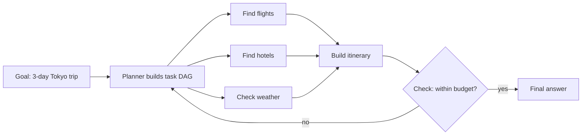

# 11 · Planning and Task Decomposition

> [!success] 🟢 Junior Explanation
> **In plain words:** Break a big goal into small tasks, decide the order, run them, and change the plan if something fails.
>
> **Analogy:** Moving house: a checklist; some tasks wait for others (pack before the truck), some happen in parallel.
>
> **Why interviewers ask:** Shows you can design agents for long, complex tasks.
>
> **Say it in one sentence:** "Agents either plan everything up front (plan-and-execute) or decide step by step (ReAct), and replan when a step fails."
>
> 🎯 **Junior must know:** ReAct vs plan-and-execute. · **Middle adds:** dependencies, parallel subtasks, replanning mechanisms, risks.

> Core track #11 — Why agents need plans, breaking a goal into tasks, dependencies and status, planning vs execution, static vs dynamic plans, replanning when a task fails.

## Why plans `[OS]` `[SDH]`
Long or complex goals overwhelm a single think-act step. A plan keeps progress tracked, avoids repeated work, and lets work be **delegated and parallelized**. The plan lives in **short-term memory** (scratchpad: "the plan, the current step, and intermediate results") `[OS]` → [[Agent Memory]].

## Patterns that plan
| Pattern | Plan style | Source |
|---|---|---|
| **ReAct** | No upfront plan; decides one step at a time (Thought → Action → Observation) — fully **dynamic** | `[OS]` `[SDH]` |
| **Plan-and-Execute** | Create **complete plan first**, then execute steps one by one — good for **long tasks** | `[OS]` |
| **Orchestrator-Worker** | Central orchestrator LLM **breaks a complex query into subtasks**, delegates to specialized workers (Coder, Search), **synthesizes** results | `[SDH]` `[OS]` |
| **Planner role** | Produces a step-by-step plan that workers execute | `[OS]` |
| **Tree of Thoughts** | Explores many reasoning paths, judges each step, **backtracks** from bad ones (many more LLM calls) | `[OS]` `[SDH]` |
| **Prompt Chaining** | Developer-fixed decomposition: output of one prompt → input of next; each step small, testable | `[OS]` |

## Planning vs execution
- **Planner** decides *what* to do (decomposition, ordering). **Executor/worker** does one sub-task with its own tools.
- Separating them = specialization pillar of multi-agent systems; workers keep small prompts and small tool sets `[OS]`.
- **SubAgents** execute pieces in **fresh context** and return short results; main agent combines → [[Multi-Agent Systems and SubAgents]] `[OS]`.
- Trip example `[OS]`: main agent → flights SubAgent, hotels SubAgent, itinerary SubAgent, weather SubAgent; flights and hotels run **in parallel**.

## Dependencies and status
Coordination patterns encode dependencies `[OS]`:
- **Sequential** A → B → C (each depends on previous)
- **Parallel** — only when sub-tasks are **truly independent**; merge at the end
- **Hierarchical** — orchestrator → workers → sub-workers
- **Graph** — nodes & edges; **conditional edges** decide, **cycles** redo work when a check fails ([[AI Orchestration vs Agents - Loop and Graph Engineering|Graph Engineering]])

> [!note] Beyond the sources — task records
> A practical plan representation (not spelled out in the sources): each task = `{id, description, depends_on[], status: pending|in_progress|done|failed, result}`. Executor picks tasks whose dependencies are `done`; runs independent ones in parallel; writes result + status back to short-term memory.

## Static vs dynamic plans
| Static (plan once) | Dynamic (plan as you go) |
|---|---|
| Plan-and-Execute, Prompt Chaining, fixed workflows | ReAct, agent-driven Graph patterns |
| Predictable, cheaper, easier to debug | Adapts to surprises; less predictable |
| Developer or planner fixes steps upfront | LLM decides next step at runtime |
`[OS]`: **Start with a fixed workflow. Reach for an agent only when the steps cannot be known in advance.** Often hybrid: fixed high-level flow + agent inside one open-ended step.

## Replanning when a task fails
Grounded mechanisms in the sources:
- **Actionable failure feedback** ("did you mean src/main.py") lets the agent recover next turn `[OS]`.
- **Graph cycles** redo work when a check fails `[OS]`.
- **Corrective RAG** switches to a fallback source when retrieval is bad; Agentic RAG retrieves again with a new query `[OS]`.
- **Reflection / Critic** sends drafts back for revision `[OS]`.
- **Machine-checkable goal** (tests pass) defines when replanning is needed `[OS]`.
- **Step budget**: when exhausted, stop and honestly report `[OS]`.
- Track **Recovery Rate** (can the agent recover when a tool fails) and **Planning Evaluation** (quality of plan) → [[Evaluation - LLM and Agent]] `[OS]`.

> [!warning] Risks `[OS]`
> Deep SubAgent chains get costly; critic loops may never converge; errors propagate across agents. Cap depth, steps, and tokens.

## 🌐 Deeper Context `[WEB]`

Research behind the planning patterns:

| Method | Plan style | Key result / idea |
|---|---|---|
| **ReAct** (ICLR 2023) | Dynamic, one step at a time | Reason + act interleaved |
| **Plan-and-Solve** (ACL 2023) | Static: devise a plan → split into subtasks → carry them out | Fixes "skipped step" errors of plain CoT |
| **LLMCompiler** (ICML 2024) | Planner emits a **DAG** of tasks with **dependencies**; executor runs independent tool calls **in parallel** | Up to **3.7× lower latency than ReAct** (reported) |
| **Reflexion** (NeurIPS 2023) | Replanning through **verbal self-reflection** stored in episodic memory | Retry with lessons learned |
| **Anthropic orchestrator-workers** | Orchestrator decides subtasks **from the input** (not predefined), delegates, synthesizes | Multi-file code changes, multi-source research |
| **Anthropic evaluator-optimizer** | Generate → critique → revise loop | Works when **evaluation criteria are clear** |

*Flights, hotels and weather have no dependencies → run in parallel. The itinerary waits for all three. A failed check sends the work back to the planner (replanning).*

**Sources:** [Agent architectures overview](https://blckalpaca.at/en/knowledge-base/ai-agents/agent-architectures-overview.md) · [Plan-and-execute wiki](https://www.taskade.com/wiki/ai-agents/plan-and-execute) · [ReAct paper](https://openreview.net/pdf/d49877b783d60e3cf6fdb22185a1a37de0ced704.pdf) · [Anthropic: Building effective agents](https://www.anthropic.com/engineering/building-effective-agents)

> [!question] Recall
> 1. ReAct vs Plan-and-Execute — static or dynamic, and when each?
> 2. Decompose "plan a 3-day Tokyo trip" into tasks with dependencies; which run in parallel?
> 3. Name 5 grounded replanning mechanisms.
> 4. Why start with a fixed workflow?

Related: [[Agent Loop]] · [[Multi-Agent Systems and SubAgents]] · [[AI Orchestration vs Agents - Loop and Graph Engineering]]
