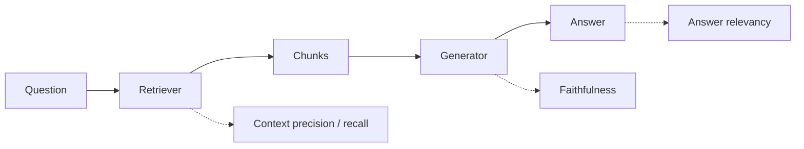

# Evaluation — LLM and Agent

> [!success] 🟢 Junior Explanation
> **In plain words:** Since AI answers change, we test with 'exams' (eval sets) scored by rules, another LLM, or humans.
>
> **Analogy:** A school exam with an answer key, plus a teacher grading essays.
>
> **Why interviewers ask:** 'How do you know it works?' comes up in every interview.
>
> **Say it in one sentence:** "We run an eval set on every prompt or model change, using LLM-as-judge, faithfulness checks and human review."
>
> 🎯 **Junior must know:** eval set + run on every change. · **Middle adds:** judge biases, RAG metrics, agent trajectory metrics.

## Why `[OS]`
Unit tests are deterministic; LLMs aren't → **evals**. **LLM Evaluation** = measuring how well an LLM performs on expected tasks. An eval runs a prompt and **scores output** vs expected answer or quality metric.

Types `[OS]`:
- **Exact match** — known factual answers.
- **LLM-as-a-judge** — stronger LLM grades output.
- **Human eval** — slow, most reliable.
- **Code-based** — run generated code, check tests.

Run evals on every change to **prompt, model, or architecture** — without evals you're flying blind; a change that "feels" better can hurt a user segment `[OS]`.
Tools: OpenAI Evals, Promptfoo, Braintrust, **Ragas** (RAG).

## LLM as a Judge `[OS]`
Types:
1. **Single answer scoring** (1–5) — track quality over time.
2. **Pairwise comparison** — compare models/prompts.
3. **Reference-based** — compare to known correct answer.
4. **Rubric-based** — score per criterion (accuracy, helpfulness, clarity, tone) — **most common in production**.

| Bias | Mitigation |
|---|---|
| **Position** (prefers first) | Swap order, run twice, average |
| **Verbosity** (prefers longer) | Instruct not to |
| **Style** (rewards bullets etc.) | Specify expected style |
| **Self-preference** (own family) | Judge from different family or a **panel** |
Calibrate: compare judge scores to a **small human-labeled set**; trust at scale only if they agree most of the time.

## RAG eval (support-bot case) `[OS]`
LLM-as-judge vs expected answers · **faithfulness** (Ragas: grounded in retrieved context) · **refusal accuracy** (says "I don't know" when it should, not when it shouldn't) · **retrieval quality** (are top 5 chunks right) · weekly human review of 50 conversations. Eval set: 200 hand-picked Qs.

## Agent evaluation `[OS]`
| | LLM eval | Agent eval |
|---|---|---|
| Check | Final text | Final output + all steps |
| Steps | One | Many |
| Tools | None | Many calls |
| Cost | One call | Many LLM + tool calls |
| Failures | Wrong text | Wrong tool, wrong order, infinite loop… |

Types: **Outcome** (final result) · **Trajectory** (every step) · **Tool use** (right tools, right args) · **Planning** (plan quality).
Metrics: **Task Success Rate** (most important), Tool Call Accuracy, Steps per Task, Cost per Task, Latency per Task, **Recovery Rate**, Safety Score, Loop Detection. Track together — high success is useless if each task is very expensive/slow.

## Classic ML eval `[SDH]`
Validation on unseen data; precision/recall; offline eval → registry → canary/shadow/A-B → [[Model Deployment Strategies]].

## 🌐 Deeper Context `[WEB]`

### LLM-as-a-judge — the evidence
**Zheng et al., "Judging LLM-as-a-Judge with MT-Bench and Chatbot Arena" (NeurIPS 2023):**
- Strong judges like GPT-4 reach **over 80% agreement with human preferences** — about the **same as human–human agreement**. On MT-bench (no ties) GPT-4 vs humans: **85%**, humans vs humans: **81%**.
- Studied biases: **position**, **verbosity**, **self-enhancement** (preferring its own outputs), and **limited reasoning** (e.g. grading math it can't solve).
- MT-bench = **80 multi-turn questions**; Chatbot Arena = crowdsourced pairwise battles.

### RAG metrics (Ragas) — which part each one tests
| Metric | Tests | Plain meaning |
|---|---|---|
| **Faithfulness** | Generation | Share of claims in the answer that are **supported by retrieved context** (supported ÷ total claims) |
| **Answer relevancy** | Generation | Does the answer actually address the question? |
| **Context precision** | Retrieval | Are the useful chunks **ranked above** the useless ones? |
| **Context recall** | Retrieval | Did retrieval bring **everything needed**? (usually needs a reference answer) |

*Low context recall → fix retrieval. High recall but low faithfulness → fix the prompt/model.*

**Sources:** [LLM-as-a-Judge paper (arXiv 2306.05685)](https://arxiv.org/pdf/2306.05685) · [NeurIPS 2023 poster](https://neurips.cc/virtual/2023/poster/73434) · [Ragas metrics docs](https://docs.ragas.io/en/v0.1.21/concepts/metrics/) · [RAG metrics guide](https://dev.to/dublecc/rag-evaluation-metrics-guide-2026-faithfulness-context-precision-and-how-to-score-a-pipeline-46gi)

> [!question] Recall
> 1. Four eval types; four judge types; four judge biases + fixes.
> 2. Design eval for a RAG support bot.
> 3. Agent eval: outcome vs trajectory; top metric.

Related: [[Observability]] · [[AI Red Teaming and LLM Watermarking]] · [[Prompt Management and DSPy]]
