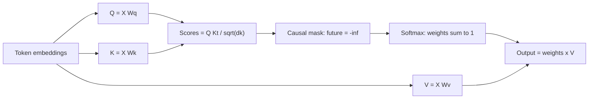

# 01 · Attention

> [!success] 🟢 Junior Explanation
> **In plain words:** Each word looks back at earlier words to decide which ones matter for the next word. It uses three vectors: Query (what I'm looking for), Key (what each word offers), Value (its content).
>
> **Analogy:** Reading 'it' in a sentence and looking back to find what 'it' refers to.
>
> **Why interviewers ask:** Attention explains the KV cache, long-context cost, and many optimizations.
>
> **Say it in one sentence:** "Attention compares the current token's Query with all previous Keys, then mixes their Values by importance."
>
> 🎯 **Junior must know:** what Q, K, V mean. · **Middle adds:** the formula, MHA vs GQA, causal masking, engineering trade-offs.

> Core track #01 — Q, K, V, softmax, self vs cross attention, causal and multi-head attention, engineering trade-offs.

## Core idea `[OS]`
Inside a Transformer (stack of attention + feed-forward layers), each token converts itself into three vectors:
- **Query (Q)** — "what am I looking for?"
- **Key (K)** — "what do I contain?" (compared against queries)
- **Value (V)** — "what do I hand over if selected?"
The current token uses its **Query** to compare against the **Keys of all previous tokens**, then **collects Values** from the relevant ones → decides which previous tokens matter most for predicting the next one `[OS]`.

## Softmax and the score matrix `[OS]`
Attention computes an **N×N score matrix** (N = tokens), applies **softmax**, then multiplies with **V** `[OS]`. 4,000 tokens → 16M entries; 100,000 → 10B entries — the reason for [[Flash Attention]] `[OS]`.

> [!note] Beyond the sources — the formula
> `Attention(Q, K, V) = softmax(Q·Kᵀ / √d_k) · V`. Q·Kᵀ gives similarity scores; dividing by √d_k keeps them in a stable range; softmax turns each row into weights summing to 1; multiplying by V produces a weighted mix of values.

## Variants
| Variant | Meaning | Source |
|---|---|---|
| **Multi-Head Attention (MHA)** | Many heads, **each with its own Q, K, V** — great quality, big KV cache | `[OS]` |
| **Grouped Query Attention (GQA)** | Groups of heads **share** one K and V | `[OS]` → [[Grouped Query Attention]] |
| **Multi-Query Attention (MQA)** | All heads share K and V | `[OS]` |
| **MLA** (DeepSeek) | Stores small compressed vector per token | `[OS]` |
| **Sliding-window attention** | Each token attends only to a fixed recent window | `[OS]` |
| **Causal (autoregressive) attention** | Token sees only **previous** tokens — implied by "compare against Keys of all *previous* tokens" | `[OS]` |

> [!note] Beyond the sources — self vs cross, causal mask
> - **Self-attention**: Q, K, V all come from the same sequence (what decoder-only LLMs use).
> - **Cross-attention**: Q from one sequence, K/V from another (e.g. decoder attending to encoder output in translation, or text attending to image features).
> - **Causal mask**: sets scores for future positions to −∞ before softmax so token *t* can't see *t+1…* — required for next-token prediction.

## Positional information `[OS]`
**RoPE** (Rotary Position Embedding) makes attention depend on **relative distance**; far-apart tokens' attention tends to decay → [[Context Window Limits - Context Rot, Lost in the Middle, RoPE]].

## Engineering trade-offs `[OS]`
| Issue | Consequence | Fix |
|---|---|---|
| Past K/V needed every step | Recompute is wasteful | [[KV Cache]] (~50× fewer computations at 100 tokens) |
| KV cache 0.5 MB/token (Llama-2-like) | Memory limits concurrency & context | PagedAttention, GQA/MQA/MLA, KV quantization |
| N×N matrix in slow HBM | Memory-bound, slow on long seqs | [[Flash Attention]] (tiling + online softmax, 2–4×) |
| Quadratic growth with length | Long contexts costly; context rot | Sliding window, context engineering |
| Decode reads all weights + KV per token | Memory-bandwidth-bound | Quantization, speculative decoding, batching |

## 🌐 Deeper Context `[WEB]`

Verified against **"Attention Is All You Need"** (Vaswani et al., 2017):

| Point | Detail |
|---|---|
| Formula | $\text{Attention}(Q,K,V) = \text{softmax}\left(\frac{QK^\top}{\sqrt{d_k}}\right)V$ — "scaled dot-product attention" |
| Why divide by $\sqrt{d_k}$ | Large dot products push softmax into regions with **tiny gradients**. If Q and K components have mean 0 and variance 1, $q\cdot k$ has variance $d_k$; dividing by $\sqrt{d_k}$ brings it back to 1 |
| Causal mask (decoder self-attention) | Scores for **future positions** are set to a large negative value (≈ −∞) **before softmax**, so they get weight 0 |
| Padding mask | Same trick for padding tokens |
| Encoder–decoder (cross) attention | **Queries from the decoder; keys and values from the encoder** — lets the decoder look at the input sentence |

> The "Beyond the sources" box above is now **web-verified**.

**Sources:** [Attention Is All You Need (arXiv 1706.03762)](https://arxiv.org/pdf/1706.03762) · [TU Berlin: The attention mechanism](https://platform.commit.tu-berlin.de/en/book/sci-python/chapter/ch30/section/s01)

> [!question] Recall
> 1. Explain Q, K, V with one sentence each; why only K and V get cached.
> 2. Write the attention formula; why √d_k?
> 3. Self vs cross attention; what does the causal mask do?
> 4. MHA vs GQA vs MQA — KV cache size ranking.

Related: [[LLM Recap - Tokens and Autoregression]] · [[KV Cache]] · [[Flash Attention]] · [[Grouped Query Attention]]

➡️ **Go deeper:** [[Transformer Architecture Deep Dive]] · [[Positional Encodings - RoPE, ALiBi and Long Context]]
