# Continuous Batching

> [!success] 🟢 Junior Explanation
> **In plain words:** As soon as one request finishes, a new one takes its seat in the GPU batch, so the GPU is never half empty.
>
> **Analogy:** A bus that picks up a new passenger at every stop when someone gets off, instead of waiting until everyone leaves at the last stop.
>
> **Why interviewers ask:** It's the single biggest throughput win.
>
> **Say it in one sentence:** "Continuous batching refills finished slots every step, keeping the GPU full and throughput high."
>
> 🎯 **Junior must know:** the idea. · **Middle adds:** throughput vs TTFT, why mixing very long and short requests hurts.

## Problem `[OS]`
Naive: process requests one by one → GPU underused. Naive batching: whole batch waits for the **slowest** request; finished slots sit empty.

## Solution `[OS]`
Pack many requests together at every step; **as soon as one finishes, a waiting request fills its slot**.
```
Naive:      [R1 R2 R3 R4] -> [R1 R2 -- R4] -> [R1 -- -- R4] -> [-- -- -- R4] -> new batch
Continuous: [R1 R2 R3 R4] -> [R1 R2 R5 R4] -> [R1 R6 R5 R4] -> [R7 R6 R5 R4]  (always full)
```
**Single biggest win** in inference optimization; vLLM is famous for doing it well `[OS]`.

## Trade-off `[OS]`
Bigger batches → higher throughput but higher TTFT ([[Latency and Cost Metrics]]). Mixing 50,000-token reasoning requests with 200-token chats **kills throughput** → separate pools ([[Test-Time Compute]]). `[SDH]` calls request grouping **micro-batching** — efficiency without much added latency.

## 🌐 Deeper Context `[WEB]`

- **Origin:** Orca (Yu et al., **OSDI 2022**) introduced **iteration-level scheduling** — the scheduler re-decides the batch **every model iteration (token step)** instead of once per batch — plus **selective batching** (batch only the operations that can be batched).
- **Result reported:** **36.9× throughput** vs NVIDIA FasterTransformer on GPT-3 175B **at the same latency**.
- **Naming:** industry calls it *continuous batching* or *in-flight batching*; research calls it *iteration-level scheduling*. vLLM, SGLang, TensorRT-LLM all implement it.

```mermaid
gantt
    title Static vs continuous batching (one GPU, 4 slots)
    dateFormat X
    axisFormat %s
    section Static
    R1 (short) :0, 2
    R2 (long)  :0, 6
    slot idle until batch ends :crit, 2, 6
    section Continuous
    R1 (short) :0, 2
    R5 joins immediately :2, 5
    R2 (long)  :0, 6
```



**Sources:** [Orca (USENIX OSDI '22)](https://www.usenix.org/conference/osdi22/presentation/yu) · [Orca paper PDF](https://www.usenix.net/system/files/osdi22-yu.pdf) · [Continuous batching explainer](https://www.morphllm.com/continuous-batching)


> [!question] Recall
> Draw naive vs continuous batching; why does continuous win?

Related: [[Inference Server and Engines]] · [[Inference Optimization - Overview]]

➡️ **Go deeper:** [[Inference Engine Internals]]
