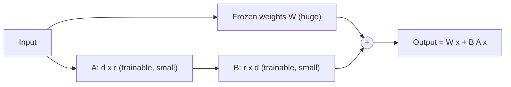

# 05 · Fine-Tuning and LoRA

> [!success] 🟢 Junior Explanation
> **In plain words:** Extra training on your own examples to change how the model behaves. LoRA trains only small add-on weights, so it's cheap.
>
> **Analogy:** Sending an experienced employee to a short course; LoRA is adding sticky notes to the textbook instead of rewriting it.
>
> **Why interviewers ask:** 'Should we fine-tune?' is a classic judgment question.
>
> **Say it in one sentence:** "RAG adds knowledge, fine-tuning changes behavior; when I fine-tune I use LoRA because it trains under 1% of the weights."
>
> 🎯 **Junior must know:** RAG vs fine-tuning and 'don't fine-tune too early'. · **Middle adds:** LoRA/QLoRA, training infra, full FT vs PEFT vs SFT.

> Core track #05 — Updating a pretrained model's weights on a task dataset, full FT vs PEFT vs SFT, LoRA and QLoRA, when to pick fine-tuning over prompting or RAG.

## What `[OS]`
Take a base model (e.g. Llama 8B) and **train it further on your own data** to teach **new behavior** when prompting and RAG aren't enough.

## Fine-tuning vs RAG vs prompting `[OS]`
> **RAG gives the model new knowledge. Fine-tuning gives the model new behavior** (format, tone, narrow skill).
- "Model doesn't know our data" → **RAG**.
- "Model doesn't behave as we want even with good prompts" → consider **fine-tuning**.
- Most apps: **prompting + RAG is enough**. `[OS]` author: most teams reach for fine-tuning **too early** — better prompting, retrieval, or a stronger base model often solves it with a fraction of the effort.
- Worth it only with a **very narrow task + lots of high-quality data**.

## Infrastructure `[OS]`
| Piece | Role |
|---|---|
| **Training cluster** | GPUs on fast network; tensor/pipeline parallelism for big models |
| **Training data pipeline** | Collect, clean, dedupe, format — bad data ⇒ bad model |
| **Experiment tracking** | Many runs/hyperparameters — Weights & Biases, MLflow |
| **Model registry** | Versioned models the inference server pulls |
| **Evaluation** | Run [[Evaluation - LLM and Agent\|eval pipeline]] before deploy to prove it improved |
Tools: **Hugging Face TRL, Axolotl, LLaMA Factory, Unsloth**.

## LoRA / QLoRA `[OS]`
- **LoRA (Low-Rank Adaptation)**: **freeze** original weights; train small **adapter** weights on top — sometimes **< 1%** of model size. Much cheaper/faster; keep **multiple adapters** for different tasks and **swap at inference**.
- **QLoRA**: LoRA variant on a quantized base ([[Quantization]]).
- Most production fine-tuning today = LoRA or a variant.

> [!note] Beyond the sources — terminology
> - **Full fine-tuning**: update **all** weights — best ceiling, highest GPU memory/cost, one full model copy per task.
> - **PEFT (Parameter-Efficient Fine-Tuning)**: update only a small set of parameters (LoRA, adapters, prefix tuning) — LoRA is the dominant PEFT method.
> - **SFT (Supervised Fine-Tuning)**: training on (prompt → ideal response) pairs; describes the **data/objective**, and can be done with full FT or PEFT. Preference methods (DPO etc.) usually follow SFT.
> - LoRA idea: weight update ΔW ≈ B·A with small rank r, so only A and B are trained.

## Interview angle
Ask: Is the gap **knowledge** or **behavior**? Data volume/quality? Narrow task? Then: prompting → RAG → (LoRA) fine-tuning, plus evals gating every step. Also consider [[Model Distillation]] for cost.

## 🌐 Deeper Context `[WEB]`

| Paper | Key numbers |
|---|---|
| **LoRA** (Hu et al., 2021) | Freeze pretrained weights, inject trainable **low-rank matrices** into each layer. Vs full fine-tuning of GPT-3 175B with Adam: **~10,000× fewer trainable parameters** and **~3× less GPU memory**; quality **on par or better**; **no extra inference latency** (adapters can be merged into the weights) |
| **QLoRA** (Dettmers et al., NeurIPS 2023) | 4-bit **NF4** base + double quantization + paged optimizers → fine-tune **65B on one 48 GB GPU** (16-bit full FT of 65B needs **> 780 GB**) while preserving 16-bit fine-tuning quality |

*Rank r is tiny (e.g. 8–64) compared with d (thousands), so A and B are a sliver of the model.*

**Sources:** [LoRA (arXiv 2106.09685)](https://arxiv.org/abs/2106.09685v2) · [QLoRA (NeurIPS 2023)](https://proceedings.neurips.cc/paper_files/paper/2023/hash/1feb87871436031bdc0f2beaa62a049b-Abstract.html) · [HF: bitsandbytes 4-bit & QLoRA](https://huggingface.co/blog/4bit-transformers-bitsandbytes)

> [!question] Recall
> 1. RAG vs fine-tuning one-liner.
> 2. Five pieces of fine-tuning infra.
> 3. How does LoRA make fine-tuning cheap? What's QLoRA?
> 4. Full FT vs PEFT vs SFT (beyond sources).

Related: [[RAG Fundamentals]] · [[Classic ML Components]] · [[Quantization]]

➡️ **Go deeper:** [[Post-Training - SFT, RLHF and DPO]] · [[Distributed Training - Memory, ZeRO and Parallelism]]
