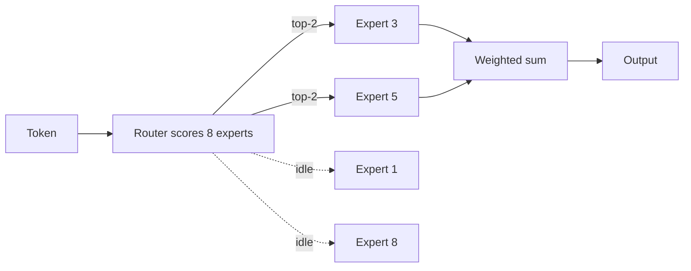

# 06 · Mixture of Experts (MoE)

> [!success] 🟢 Junior Explanation
> **In plain words:** The model has many expert sub-networks; a router uses only a couple of them for each token.
>
> **Analogy:** A hospital receptionist sends each patient to the right specialists, not to every doctor.
>
> **Why interviewers ask:** Explains how huge models stay fast.
>
> **Say it in one sentence:** "MoE activates only top-k experts per token, so compute is like a small model but memory must hold all experts."
>
> 🎯 **Junior must know:** total vs active parameters. · **Middle adds:** memory vs compute planning, load balancing, MoE ≠ routing.

> Core track #06 — Routing tokens to a subset of experts per layer, top-k routing, active vs total parameters, load balancing, serving complexity.

## Definition `[OS]`
> **MoE = many small expert networks + a router that picks which ones to use (per token).**
Used by Mixtral, DeepSeek-V3, several frontier models; Voyage 4 Large embeddings too `[OS]`. `[SDH]` lists MoE among distributed-training techniques in the model layer.
Hospital analogy: receptionist (router) sends patient to relevant specialists, not every doctor.

## Mechanics `[OS]`
- Replaces the Transformer's **feed-forward sub-layer** with many experts side by side (8, 64, 128…).
- Tiny **router** scores all experts per token → picks **top-k** (usually **top-2**).
- Only picked experts run; output = **weighted sum** using router scores.
```
Token -> Router -> [E3] [E5] chosen (others idle) -> weighted sum -> output
```

## Active vs total parameters `[OS]`
**Mixtral 8x7B**: total ≈ **47B**, active ≈ **13B per token** → fast like 13B, smart like 47B.

## Serving implications `[OS]`
- **Memory** planned for **total** params (all experts loaded).
- **Compute** set by **active** params.
→ Big-model smartness at small-model per-token compute, but you still need GPU memory for the whole model (often multi-GPU).

## MoE ≠ LLM routing `[OS]`
MoE: experts per **token**, **inside** one model. [[LLM Routing]]: one full LLM per **query**, **outside**.

> [!note] Beyond the sources — load balancing & serving complexity
> - **Load balancing**: without care the router sends most tokens to a few "popular" experts (others undertrained/idle). Training adds an **auxiliary load-balancing loss** and/or per-expert **capacity limits** (tokens beyond capacity dropped or rerouted).
> - **Expert parallelism**: experts spread across GPUs; tokens shuffled to the GPU holding their expert (all-to-all communication) → network-heavy, harder batching, uneven GPU load when routing is skewed.

## 🌐 Deeper Context `[WEB]`

The "Beyond the sources" box above, now **web-checked**:

| Model / paper | Facts |
|---|---|
| **Mixtral 8x7B** (Mistral, official) | **46.7B total**, **12.9B used per token**; in every layer a router picks **2 of 8** experts and adds their outputs. All 46.7B must still be **in memory** |
| **Switch Transformer** (Fedus et al., 2021) | **Top-1** routing; an **auxiliary load-balancing loss** (small coefficient, ~0.01 common) pushes routing toward uniform; each expert has a fixed **capacity** (capacity factor e.g. 1.25 = 25% headroom); overflow tokens are **dropped** (typically **< 1%** in their experiments) and pass through the residual connection |
| **DeepSeek-V3** | **671B total / 37B activated per token**; uses **auxiliary-loss-free load balancing** to avoid the quality loss that a balancing loss can cause |



> [!tip] Interview math
> Memory ∝ **total** params (46.7B × 2 bytes ≈ 93 GB for Mixtral at FP16). Compute per token ∝ **active** params (12.9B).

**Sources:** [Mistral: Mixtral of experts](https://mistral.ai/news/mixtral-of-experts/) · [Azure model card](https://ai.azure.com/catalog/models/mistralai-Mixtral-8x7B-v01) · [Switch Transformers (arXiv 2101.03961)](https://arxiv.org/pdf/2101.03961) · [labml Switch implementation notes](https://nn.labml.ai/transformers/switch/index.html) · [DeepSeek-V3 repo](https://github.com/deepseek-ai/deepseek-v3)


> [!question] Recall
> 1. Total vs active params — which sets memory, which sets compute?
> 2. MoE vs LLM routing.
> 3. What goes wrong without load balancing? (beyond sources)

Related: [[Inference Optimization - Overview]] · [[Scaling LLMs - Vertical Horizontal Tensor Pipeline]]

➡️ **Go deeper:** [[MoE Serving and Expert Parallelism]]
