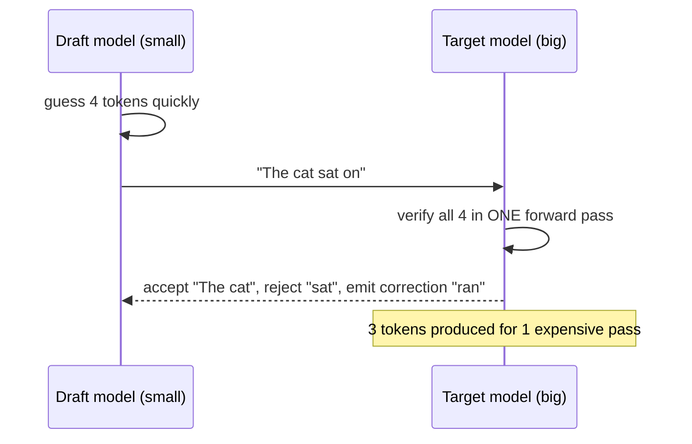

# 03 · Speculative Decoding

> [!success] 🟢 Junior Explanation
> **In plain words:** A small fast model guesses the next few words; the big model checks them all in one step and keeps the correct ones.
>
> **Analogy:** An intern drafts a few sentences; the boss approves them in one glance and fixes the first wrong word.
>
> **Why interviewers ask:** Classic middle-level optimization question.
>
> **Say it in one sentence:** "Speculative decoding lets a draft model propose tokens that the target model verifies in one pass — 2–3× faster with identical quality."
>
> 🎯 **Junior must know:** the draft-and-verify idea. · **Middle adds:** why verification is cheap, acceptance rate, when it stops helping.

> Core track #03 — A draft model proposes tokens, the target model verifies them in one pass, acceptance rate and when it pays off.

## Idea `[OS]`
Guess the next few tokens quickly with a small **draft model**; the big **target model** verifies all guesses in **one forward pass**. Mostly right → many big-model passes saved.

## Why it works `[OS]`
Decode is **memory-bandwidth-bound**: the big cost is reading weights, not math. Checking **4 tokens in one pass ≈ cost of generating 1**.

## Flow `[OS]`
```
1. Draft proposes K=4: "The cat sat on"         (cheap)
2. Target verifies all 4 in ONE pass (parallel):
   The ✓  cat ✓  sat ✗  (skip "on")  -> correction: "ran"
3. Output "The cat ran" = 3 tokens for 1 big-model pass
```
Keep accepted prefix + target's correction.

## Acceptance rate `[OS]`
The longer the draft stays correct (higher acceptance), the bigger the saving. Typical: **2–3× faster** on same GPU. With **rejection sampling** as the acceptance rule, output quality is **exactly** the big model's.

## Ways to draft `[OS]`
| Method | How | Best for |
|---|---|---|
| **Draft model** | Small model from same family | Classic |
| **N-gram speculation** | No extra model; look up continuations in text already in the prompt | Copy-heavy: code editing, summarization, RAG |
| **Medusa** | Extra heads on the big model, each guesses a different future token | No separate model |
| **EAGLE** | Drafts at feature level (internal numbers) | More accurate guesses |

## When it pays off `[OS]`
✅ GPU has **spare compute** — low to medium batch sizes; latency-sensitive decode (improves **TPOT**).
❌ Very high batch sizes — GPU already busy, gain shrinks.

## 🌐 Deeper Context `[WEB]`

| Method / paper | Reported speedup | Notes |
|---|---|---|
| **Leviathan et al., "Fast Inference from Transformers via Speculative Decoding"** (arXiv Nov 2022, ICML 2023) | **~2–3×** on T5-XXL vs T5X | **Identical outputs** (the acceptance scheme keeps the target model's distribution); works with off-the-shelf models, no retraining |
| DeepMind's parallel work "speculative sampling" (Chen et al., 2023) | — | Same core idea, independently developed |
| **Medusa** | Medusa-1 (heads only, base frozen) **2.2×**; Medusa-2 (heads + model) **2.3–3.6×** | Extra heads + **tree attention** verify several candidate continuations at once |
| **EAGLE** | EAGLE-3 reported **3–6.5×** (blog, vLLM context) | Drafts **hidden features**, not tokens → higher acceptance than Medusa |

> [!warning] Compare carefully
> These numbers come from **different models, hardware and setups** — they are not a head-to-head benchmark.



**Sources:** [Leviathan et al. (arXiv 2211.17192)](https://arxiv.org/pdf/2211.17192) · [ICML 2023 proceedings](https://proceedings.mlr.press/v202/leviathan23a.html) · [NVIDIA Model Optimizer: speculative decoding](https://nvidia.github.io/Model-Optimizer/pr-preview/pr-2380/guides/5_speculative_decoding.html) · [vLLM speculative decoding explainer](https://www.morphllm.com/vllm-speculative-decoding)


> [!question] Recall
> 1. Why is verifying K tokens ≈ cost of 1?
> 2. What guarantees identical output quality?
> 3. When does it stop helping?
> 4. Which method for a code-editing assistant and why?

Related: [[Prefill vs Decode]] · [[Inference Optimization - Overview]]

➡️ **Go deeper:** [[Decoding and Sampling]] · [[Inference Whiteboard Drills]]
