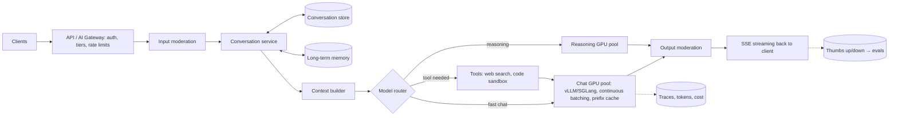

# Case — ChatGPT-Scale Chat Assistant

> [!success] 🟢 Junior Explanation
> **In plain words:** Build a general chat assistant for millions of people. The hard part is not the chat UI — it's keeping thousands of expensive GPUs busy, streaming answers fast, remembering conversations, and not going bankrupt.
>
> **Analogy:** A huge call center where every "agent" (GPU) is very expensive. You need smart queues, fast hand-offs, notes about each caller, and cheaper staff for easy calls.
>
> **Why interviewers ask:** It touches almost every block: inference serving, batching, KV cache, streaming, routing, memory, safety, cost.
>
> **Say it in one sentence:** "A gateway and conversation service build the context, a router picks a model, a GPU fleet with continuous batching and prefix caching streams tokens back over SSE, with memory, safety and cost controls around it."
>
> 🎯 **Junior must know:** the request flow, streaming, history storage, rate limits. · **Middle adds:** GPU estimation, prefix-aware routing, tiered capacity, reasoning-model pool, load shedding.

## 1. Requirements
| Question | Assumed answer |
|---|---|
| Users | 10M DAU, 5 conversations/day, ~4 turns each |
| Tokens | ~2,000 input + 500 output per conversation `[OS]` |
| Latency | TTFT < 1 s p50 for normal chat; stream tokens |
| Features | Multi-turn chat, long-term memory, web search & code tools, a slower "reasoning" mode |
| Tiers | Free and paid; paid gets priority and bigger models |
| Safety | Moderation on input/output; no training on opted-out data |

## 2. Estimation
```
Requests:  10M × 5 × 4           = 200M LLM calls/day ≈ 2,300/s avg, ~7,000/s peak (3×)
Tokens:    input 100B/day, output 25B/day                       [OS]
GPUs:      25B / 432M per H100/day ≈ 58 → ~60–100 H100 with headroom   [OS]
Cost:      ~$4.3k/day ≈ $130k/month (rented H100s, inference only)      [OS]
Streams:   ~2,300/s × ~3 s per answer ≈ 7,000 concurrent streams (~20k at peak)
```
> [!tip] The real limit is often **KV-cache memory**, not math — every open stream holds its KV cache on the GPU → [[KV Cache]].

## 3. Objective & pattern
Open-domain chat → single augmented LLM call per turn (+ optional tools). No agent unless the user enables tool use → [[Agentic Workflow Patterns]].

## 4. Architecture


## 5. Walkthrough of one turn
1. Gateway authenticates, checks tier limits (RPM, TPM, concurrency) → [[Rate Limiting]].
2. Input moderation (PII/abuse/injection) → [[Guardrails]].
3. Conversation service loads history; the **context builder** assembles: system prompt (stable, cacheable) → relevant long-term memories → summary of old turns → recent turns → new message → [[Context Engineering]].
4. Router chooses model: small/fast default, large for hard prompts, reasoning pool if user picked it → [[LLM Routing]].
5. Request goes to a GPU replica chosen by **least outstanding tokens** + **prefix/session affinity** (same conversation → same replica keeps KV warm) → [[Load Balancing for LLMs]].
6. Prefill → first token streams via SSE; decode continues with continuous batching → [[Prefill vs Decode]].
7. Output moderation runs on the stream (in chunks); final message saved; memory writer decides if anything is worth remembering → [[Agent Memory]].
8. Tokens, latency, cost logged; thumbs feedback feeds the eval pipeline → [[Case - LLM Evaluation and Monitoring Pipeline]].

## 6. Deep dives
### Multi-turn efficiency
- Every turn re-sends the whole history → input grows each turn. Fixes: **prefix caching** of the conversation so far, **sticky routing**, and **compaction** of old turns.
### Capacity tiers and load shedding
- Separate queues per tier; at peak, **free tier degrades** first (shorter max output, smaller model, queueing) while paid traffic keeps its SLO.
- Keep a **warm pool** because model load takes minutes → [[Auto Scaling and Warm Pools]].
### Reasoning mode
- 10–100× more tokens per query → separate GPU pool, per-request **thinking-token budget**, "Thinking…" UX → [[Test-Time Compute]].
### Serving optimizations
- vLLM/SGLang with PagedAttention, continuous batching, prefix caching; **chunked prefill** so long pastes don't freeze others; at very large scale **prefill-decode disaggregation** → [[Inference Optimization - Overview]].

## 7. Evaluation & monitoring
TTFT/TPOT p50/p95 per tier, tokens & $ per user, GPU utilization, cache hit rate, moderation flag rate, thumbs-up rate, regression evals on every model/prompt change → [[Evaluation - LLM and Agent]].

## 8. Failure modes
| Failure | Mitigation |
|---|---|
| Region / GPU pool outage | Multi-region, gateway failover, degrade to smaller model |
| GPU OOM from long contexts | Context caps, compaction, KV quantization, admission control |
| Stream drops (user tab closes) | Cancel generation to free GPU; save partial answer |
| Traffic spike | Warm pool + queue + tier-based shedding |
| Prompt injection via web tool | Treat tool output as untrusted, no secrets in context → [[Prompt Injection]] |

## 9. Trade-offs
- Bigger batches = cheaper tokens but higher TTFT.
- Sticky sessions = cache hits but uneven load.
- Long-term memory = personalization but privacy/consent work.

## Interviewer follow-ups
- *"Why not round-robin?"* → variable request cost; use least outstanding tokens.
- *"How do you keep cost down?"* → routing, prompt/prefix caching, output caps, quantized models → [[Cost Optimization]].
- *"How does memory work?"* → read relevant facts each turn, write only what matters next week.

> [!question] Recall
> Draw the architecture from memory; redo the GPU estimate with 20M DAU.

Related: [[Back-of-the-Envelope Estimation]] · [[Streaming Responses]] · [[Case Studies Index]]
