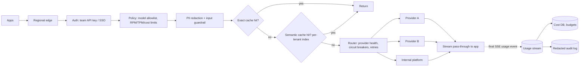

# Case — Enterprise AI Gateway (with Semantic Cache)

> [!success] 🟢 Junior Explanation
> **In plain words:** Every team in the company calls OpenAI, Anthropic, or internal models. Instead of each team managing keys, limits and logging, all calls go through **one gateway** that handles security, cost, caching and failover.
>
> **Analogy:** A company's single procurement office: every purchase goes through it, so budgets, approvals and receipts live in one place.
>
> **Why interviewers ask:** Pure systems design on the LLM hot path: low overhead, streaming, rate limiting, caching correctness, multi-tenancy.
>
> **Say it in one sentence:** "A multi-region proxy that authenticates teams, enforces token/cost limits, redacts PII, serves exact and semantic cache hits, routes with failover and circuit breakers, streams responses through untouched, and logs usage asynchronously."
>
> 🎯 **Junior must know:** what the gateway centralizes; rate limits; failover. · **Middle adds:** hot-path latency budget, semantic cache key design, async metering from SSE, per-tenant isolation.

## 1. Requirements
| Question | Assumed answer |
|---|---|
| Clients | 50 teams, 200 apps |
| Providers | 2 external APIs + internal platform |
| Volume | 50M requests/day (~600/s avg, ~2,000 peak) |
| Overhead | < 10 ms added (p95) excluding cache embedding |
| Must have | Team budgets, PII redaction, audit logs, failover, streaming |

## 2. Architecture

## 3. Hot-path latency budget
| Step | Target |
|---|---|
| Auth + policy lookup (in-memory / Redis) | ~1–2 ms |
| Rate-limit token bucket (Redis) | ~1 ms |
| PII regex + small NER | ~2–5 ms |
| Exact cache lookup (hash) | ~1 ms |
| **Semantic cache** (embed + ANN search) | **5–20 ms** → only on opted-in routes |
| Logging | **async**, 0 ms on hot path |
→ [[API Gateway and AI Gateway]]

## 4. Deep dive — semantic cache correctness
- **Key/namespace** = tenant + model + **system-prompt version** + generation params; embedding of the normalized user message.
- **Only cache** deterministic-ish, non-personal, non-tool-calling requests (FAQ-style). Never cache "my account / my order" questions → [[Semantic Cache]].
- **Threshold** tuned per route on real traffic (start ~0.9; measure false-hit rate with an LLM judge).
- **TTL + invalidation** when source docs or prompts change.
- **Embedding cache** under it to avoid re-embedding repeated texts → [[Embedding Cache]].

## 5. Deep dive — limits & metering
- Token buckets per team for **RPM, TPM, concurrency, $/month**; estimate tokens before the call, **reconcile** with actual usage from the provider's final streaming event → [[Rate Limiting]].
- Budget alerts at 80%/100%; hard stop or downgrade to a cheaper model at limit.

## 6. Failover
Per-provider **circuit breakers** (closed/open/half-open); retries with backoff only **before** the first token is streamed (retrying mid-stream would duplicate text) → [[Fault Tolerance and Circuit Breakers]].

## 7. Failure modes
| Failure | Mitigation |
|---|---|
| Gateway itself down | Multi-region, stateless replicas; documented emergency direct-call path |
| Redis down | Fail-open with local in-memory limits (risk accepted) or fail-closed for costly models |
| Wrong semantic hit | Conservative threshold, per-route opt-in, feedback flag to purge entry |
| Data leak across teams | Tenant-scoped caches, logs, keys → [[Multi-Tenancy]] |

## 8. Trade-offs
Every feature on the hot path adds latency; semantic cache saves money but risks wrong answers; fail-open keeps apps working but can blow budgets.

## 🌍 Evidence `[WEB]`
- OWASP LLM10 **Unbounded Consumption** and LLM02 **Sensitive Information Disclosure** are exactly what a gateway's limits and redaction address → [[Prompt Injection]].
- OpenTelemetry `gen_ai.usage.input_tokens` / `output_tokens` make metering portable across providers → [[Observability]].

> [!question] Recall
> Which requests may use the semantic cache? Why retry only before the first token?

Related: [[Caching in AI - Overview]] · [[Data Privacy and Compliance]] · [[Case Studies Index]]
