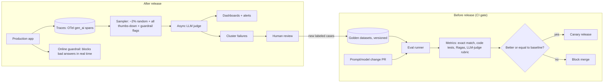

# Case — LLM Evaluation & Monitoring Pipeline

> [!success] 🟢 Junior Explanation
> **In plain words:** A company has several AI features. It needs (1) **tests before release** that catch quality drops when a prompt or model changes, and (2) **monitoring after release** that spots bad answers in real traffic — and turns those bad answers into new tests.
>
> **Analogy:** A restaurant with a tasting panel before a new recipe goes on the menu, plus a mystery shopper sampling real dishes every day.
>
> **Why interviewers ask:** "How do you know it works?" is the hardest question for AI products; this is the full answer.
>
> **Say it in one sentence:** "Versioned golden datasets gate every prompt/model change in CI with automatic and LLM-judge metrics; in production we trace everything, sample traffic for async judge scoring, alert on drops, and feed reviewed failures back into the datasets."
>
> 🎯 **Junior must know:** offline eval set + online monitoring + feedback loop. · **Middle adds:** judge calibration, sampling strategy, cost of judging, guardrail vs judge difference.

## 1. Requirements
| Question | Assumed answer |
|---|---|
| Products | Support RAG bot, summarizer, an internal agent |
| Change rate | Prompts change weekly; models quarterly |
| Traffic | 1M conversations/day |
| Goal | Block regressions before release; detect issues within hours in prod |

## 2. Architecture


## 3. Components
- **Datasets:** real questions from prod traces + expected answers + edge cases + red-team attacks; versioned like code → [[AI Red Teaming and LLM Watermarking]].
- **Metrics by product:** RAG → faithfulness, context precision/recall, refusal accuracy; summarizer → rubric judge; agent → task success, tool-call accuracy, steps, cost → [[Evaluation - LLM and Agent]].
- **Judge calibration:** compare judge scores with a few hundred human labels; swap answer order for pairwise; use a different model family if self-preference is a concern.
- **Guardrail vs judge:** guardrail = **synchronous**, cheap, blocks a single answer *now*; judge = **asynchronous**, richer, measures quality *trends*.
- **Tracing:** OpenTelemetry `gen_ai.*` attributes for model, tokens, finish reason → [[Observability]].

## 4. Estimation (judge cost)
```
1M conversations/day × 2% sample = 20k judge calls/day
× ~3k tokens each = 60M tokens/day ≈ $180/day at $3/M → cheap insurance
```

## 5. Alerts (examples)
Faithfulness < 90% · thumbs-up < 80% · escalation rate spike · cost/day > budget · p95 latency > target · new failure cluster appears `[OS]`.

## 6. Failure modes
| Failure | Mitigation |
|---|---|
| Eval set becomes stale | Continuously add fresh prod cases |
| Judge drifts when its model updates | Pin judge version; re-calibrate on upgrade |
| Overfitting prompts to the eval set | Hidden holdout set; rotate examples |
| Privacy in traces | Redact PII before storing; restricted access → [[Data Privacy and Compliance]] |

## 🌍 Real-world evidence `[WEB]`
- **DoorDash** (Dasher support, 2024): replaced a flow-based bot with **RAG + an online LLM Guardrail + an LLM Judge** for quality monitoring; summaries report **~90% fewer hallucinations** and **~99% fewer compliance issues** (secondary). A 2026 follow-up describes an **LLM chatbot simulator** with a judge calibrated against human judgment to validate guardrails before deployment.
- **LinkedIn** (GenAI assistant): reached ~**80% of the target experience in the first month**, then needed **~4 more months to reach ~95%** — evaluation and consistent quality at scale were the main challenges.
- **MT-Bench study:** strong LLM judges agree with humans **> 80%**, about human–human level → judges are usable if calibrated.

**Sources:** [DoorDash: Path to high-quality LLM-based Dasher support](https://careersatdoordash.com/?p=12568) · [ZenML summary of DoorDash](https://www.zenml.io/llmops-database/llm-based-dasher-support-automation-with-rag-and-quality-controls) · [InfoQ: DoorDash chatbot simulator](https://infoq.com/news/2026/03/doordash-llm-chatbot-simulator/) · [The New Stack: 5 lessons from LinkedIn](https://thenewstack.io/5-lessons-from-linkedins-first-foray-into-genai-development/) · [LLM-as-a-Judge paper](https://arxiv.org/pdf/2306.05685)

> [!question] Recall
> Guardrail vs judge? Design the sampling rule. What makes an eval set go stale?

Related: [[Prompt Management and DSPy]] · [[Model Deployment Strategies]] · [[Case Studies Index]]
