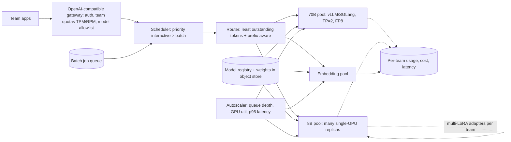

# Case — LLM Inference Platform for Many Teams

> [!success] 🟢 Junior Explanation
> **In plain words:** A company wants to run its own open models (e.g. a 70B chat model, an 8B model, embedding models) on its own GPUs and give every internal team one simple API — fair, fast and cheap.
>
> **Analogy:** An internal "power plant" for AI: one shared, expensive plant, many neighborhoods drawing power, each with a meter and a limit.
>
> **Why interviewers ask:** Deep serving knowledge: GPU sizing, batching, KV cache, autoscaling, multi-tenancy, rollouts.
>
> **Say it in one sentence:** "An OpenAI-compatible gateway with per-team quotas routes to per-model GPU pools running vLLM/SGLang, autoscaled on queue depth with warm pools, with batch jobs backfilling idle capacity."
>
> 🎯 **Junior must know:** why self-host, gateway + quotas, one pool per model. · **Middle adds:** memory math for TP, interactive vs batch priority, multi-LoRA, cold starts, chargeback.

## 1. Requirements
| Question | Assumed answer |
|---|---|
| Why self-host? | Data can't leave the company; high volume makes per-token APIs expensive |
| Models | Llama-class 70B chat, 8B fast model, embedding model, team-specific LoRA fine-tunes |
| Traffic | Interactive (chat tools, copilots) + batch (nightly classification, summarization) |
| SLOs | Interactive TTFT < 1 s p95; batch done by morning |
| Tenancy | ~40 teams, quotas and cost chargeback per team |

## 2. Estimation
```
70B @ FP16  = 140 GB weights → doesn't fit one 80 GB H100
  Option A: tensor parallel TP=2 (160 GB) → only ~20 GB left for KV cache (few long chats)
  Option B: FP8 weights (70 GB) + TP=2 → ~90 GB for KV cache → many more concurrent users
Demand: 20B output tokens/day ÷ 432M tokens per H100/day (5,000 tok/s example) ≈ 46 H100 → ~60 with headroom
```
→ [[Scaling LLMs - Vertical Horizontal Tensor Pipeline]] · [[Quantization]] · [[KV Cache]]

## 3. Architecture


## 4. Key design decisions
### One API, many models
OpenAI-compatible endpoint so teams can swap between internal and external models with config only → [[API Gateway and AI Gateway]].
### Interactive vs batch
- Interactive requests get priority; **batch jobs backfill idle GPU time** (nights, weekends) through a queue and are preempted/paused when interactive load rises.
- Batch saves money the same way provider batch APIs are ~50% cheaper `[OS]`.
### Routing inside a pool
**Least outstanding tokens** + **prefix-aware** routing (shared system prompts → same replica → KV reuse) → [[Load Balancing for LLMs]].
### Autoscaling & cold starts
Model load takes **minutes** → keep warm replicas; cache weights on local NVMe; scale on **queue depth / GPU util / p95**, not CPU; predictive scale-up before 9am → [[Auto Scaling and Warm Pools]].
### Many fine-tunes, one base
Serve per-team **LoRA adapters** on a shared base model instead of a full copy per team → [[Fine-Tuning and LoRA]].
### Rollouts
New model/engine version: offline evals → **shadow** traffic → **canary** 5–10% → full; registry keeps old version for rollback → [[Model Deployment Strategies]].

## 5. Multi-tenancy
Per-team TPM/RPM/concurrency quotas, cost dashboards & chargeback, isolation of caches and logs, noisy-neighbor protection (one team's 100k-token prompts can't starve others) → [[Multi-Tenancy]].

## 6. Failure modes
| Failure | Mitigation |
|---|---|
| GPU node dies | Replicas across nodes; health checks remove it; requests retried |
| OOM from long contexts | Max context per tier, admission control, KV quantization |
| Traffic spike | Pause batch, warm pool, queue with timeout, shed lowest priority |
| Bad model release | Canary + automatic rollback on eval/latency regression |

## 7. Trade-offs
Self-host (fixed GPU cost, control, privacy, ops burden) vs API (zero ops, per-token cost, data leaves). TP=2 FP16 (best quality) vs FP8 (more users per GPU, tiny quality cost).

## 🌍 Evidence `[WEB]`
- Engine choice: TGI is in maintenance mode; HF recommends vLLM/SGLang → [[Inference Server and Engines]].
- PagedAttention: 2–4× throughput vs FasterTransformer/Orca; KV waste < 4% → [[KV Cache]].
- Goodput (requests/s meeting SLO per GPU) is the right platform KPI → [[Latency and Cost Metrics]].

> [!question] Recall
> Size the 70B pool: FP16 vs FP8, TP=1 vs 2. How do batch jobs coexist with interactive traffic?

Related: [[Inference Optimization - Overview]] · [[Case Studies Index]]
