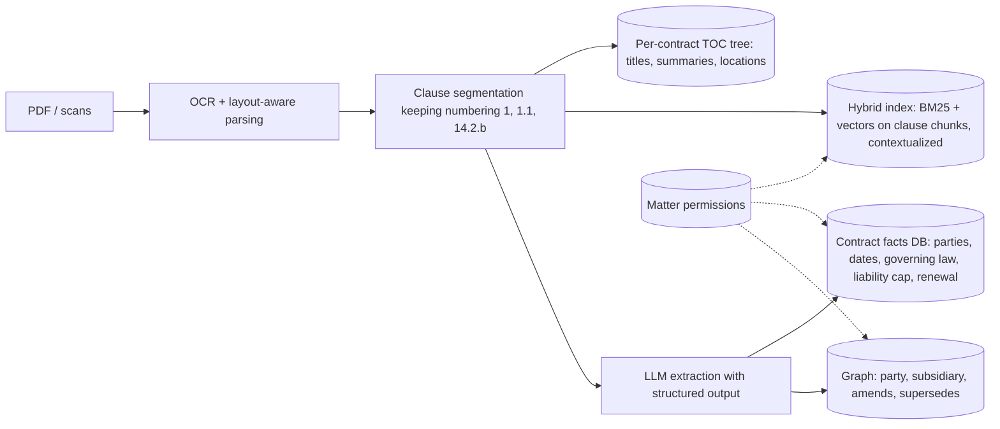
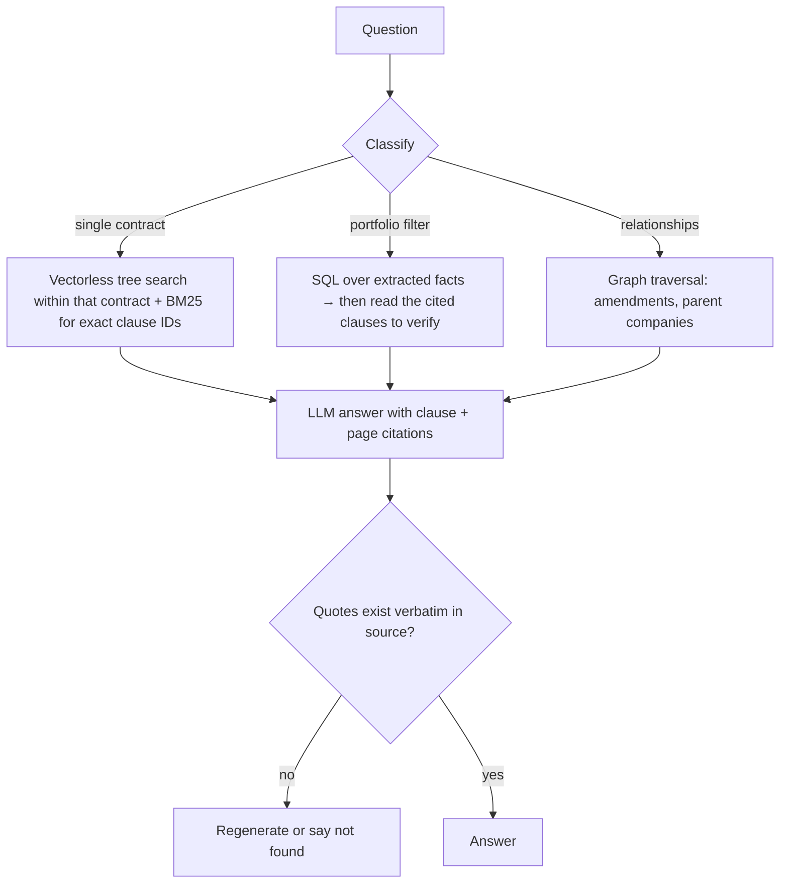

# Case — Legal Contract Q&A

> [!success] 🟢 Junior Explanation
> **In plain words:** Lawyers ask questions about thousands of long contracts. Answers must be **exact**, quote the **clause number**, respect **who is allowed to see which contract**, and handle tricky words like "not" and "except".
>
> **Analogy:** A paralegal who knows every contract's table of contents, keeps a spreadsheet of key terms, and always shows the exact page.
>
> **Why interviewers ask:** Shows you know when plain vector RAG fails (negation, clause numbers, cross-document questions) and how to combine several retrieval styles.
>
> **Say it in one sentence:** "Parse contracts with their structure, extract key terms into a database, and route each question: single-contract questions use structure-aware/vectorless search, portfolio questions use SQL over extracted fields, relationship questions use a graph — always with verified clause citations and access control."
>
> 🎯 **Junior must know:** why chunk-only RAG is risky here; citations; permissions. · **Middle adds:** query routing across SQL / tree search / graph, extraction pipeline, eval with lawyers.

## 1. Requirements
| Question | Assumed answer |
|---|---|
| Corpus | 200k contracts, avg ~40 pages (~20k tokens) |
| Questions | (a) "What does clause 14.2.b of the Acme MSA say?" (b) "Which contracts have uncapped liability?" (c) "Which amendments override the 2021 MSA?" |
| Accuracy | Wrong answers are expensive → must cite clause + page, say "not found" when unsure |
| Access | Per-matter permissions (ethical walls) |
| Privacy | Data residency, no-train contracts with providers |

## 2. Estimation
```
Corpus: 200k × 20k tokens = 4B tokens
One-time contextualization/extraction with prompt caching ≈ $1 per million doc tokens (Anthropic estimate)
  → ≈ $4k per full pass (+ extraction runs of similar magnitude)
Queries: ~5k/day → small; cost dominated by long context per answer
```

## 3. Ingestion

→ [[Document Parsing and Chunking]] · [[Structured Output]]

## 4. Query routing

→ [[Agentic RAG, GraphRAG, Vectorless RAG]] · [[Hybrid Search, HyDE, Reranking, ColBERT]]

## 5. Deep dives
- **Negation & exceptions:** answer from **whole clauses + their parent section** (exceptions often live in a nearby clause), never from tiny fragments.
- **Exact IDs:** BM25 / regex on clause numbers ("14.2.b") — embeddings confuse 14.2.b vs 14.3.b.
- **Permissions:** filter by matter ACL **before** retrieval (pre-filter), so restricted text never reaches the prompt or cache → [[Multi-Tenancy]].
- **Verification:** every quoted span is string-matched against the source; citations link to page coordinates.

## 6. Evaluation
Lawyer-labeled set (single-doc, portfolio, negation, "not present" cases); metrics: faithfulness, citation exactness, extraction field accuracy, refusal accuracy → [[Evaluation - LLM and Agent]].

## 7. Failure modes
| Failure | Mitigation |
|---|---|
| OCR errors in scans | Confidence routing → human review of low-confidence pages |
| Extraction field wrong | Store source span with every field; spot-check; re-extract on model upgrade |
| Leaked privileged doc | ACL pre-filter, per-matter caches, audit logs |
| Over-confident answer | Verification + "not found" allowed and rewarded in evals |

## 8. Trade-offs
Vectorless tree search: accurate and explainable but several LLM calls per question. Extraction to SQL: fast portfolio queries but must be re-run when schemas change. GraphRAG: great for relationships, expensive to build/update.

## 🌍 Evidence `[WEB]`
- Contextual retrieval: −49% retrieval failures, −67% with reranking; ~$1.02 per million document tokens with caching → [[Document Parsing and Chunking]].
- Lost in the Middle: don't stuff 50 clauses into one prompt → [[Context Window Limits - Context Rot, Lost in the Middle, RoPE]].

> [!question] Recall
> Route these: "termination notice period in the Globex NDA", "all contracts governed by NY law", "which subsidiaries signed with us?"

Related: [[RAG Fundamentals]] · [[Data Privacy and Compliance]] · [[Case Studies Index]]
