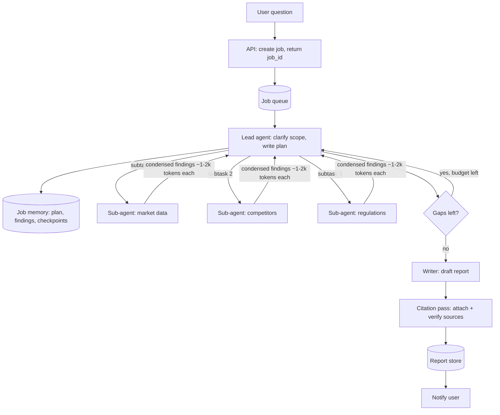

# Case — Multi-Agent Research Assistant ("Deep Research")

> [!success] 🟢 Junior Explanation
> **In plain words:** The user asks a big research question. A **lead agent** makes a plan, sends several **sub-agents** to search different angles at the same time, collects their short summaries, and writes a cited report. It runs for minutes, in the background.
>
> **Analogy:** A newspaper editor assigning parts of a story to several reporters, then writing the final article from their notes.
>
> **Why interviewers ask:** Tests multi-agent design, async jobs, context management, budgets, and evaluating non-deterministic agents.
>
> **Say it in one sentence:** "An orchestrator-worker system run as an async job: the lead agent plans and delegates to parallel sub-agents with their own context, merges condensed findings, and a final pass adds and checks citations — with strict token and step budgets."
>
> 🎯 **Junior must know:** why parallel sub-agents, async job flow, step limits. · **Middle adds:** token economics (~15× chat), checkpoints, eval rubric, when NOT to use multi-agent.

## 1. Requirements
| Question | Assumed answer |
|---|---|
| Output | 2–10 page report with citations |
| Time | 2–20 minutes is fine (async, user notified) |
| Volume | 10k reports/day |
| Sources | Web + internal docs (via MCP connectors) |
| Budget | Must stay within a per-report token budget |

## 2. Estimation
```
Per report: lead ~60k tokens + 5 sub-agents × ~80k = ~460k tokens (≈ 0.5M)
Daily:      10k × 0.5M = 5B tokens/day
Cost:       at ~$5/M blended ≈ $2.5 per report ≈ $25k/day  → only worth it for high-value questions
```

## 3. Architecture


## 4. Walkthrough
1. Request becomes an **async job** (job_id, status) → [[Async Processing and Message Queues]].
2. **Lead agent** (strong model) clarifies scope and writes a plan with independent subtasks → [[Planning and Task Decomposition]].
3. **Sub-agents** (cheaper models) run **in parallel**, each with its **own context** and tools (web search, MCP connectors), and return condensed findings → [[Multi-Agent Systems and SubAgents]].
4. Lead checks coverage; spawns follow-up subtasks if gaps remain and budget allows.
5. Writer drafts; citation pass maps claims to sources and drops unsupported claims.
6. Plan, findings and progress are **checkpointed** so a crash resumes instead of restarting.

## 5. Deep dives
### Budgets & stopping
Max sub-agents, max steps per agent, max total tokens, wall-clock limit; "stop and report what you have" when exhausted → [[Agent Loop]].
### Context management
Lead never sees raw pages — only sub-agent summaries; long plans live in job memory, not in the window → [[Context Engineering]].
### Delegation quality
Each subtask brief must state objective, output format, tools to use, and boundaries — vague briefs cause duplicate or missing work.
### Evaluation
Rubric LLM-judge on: factual accuracy, citation accuracy, completeness, source quality, efficiency (tokens/steps); plus human spot checks; trace every run → [[Evaluation - LLM and Agent]], [[Observability]].

## 6. Failure modes
| Failure | Mitigation |
|---|---|
| Sub-agents duplicate work | Clear, non-overlapping briefs |
| Runaway cost | Hard token/step budgets per job |
| Low-quality sources (SEO spam) | Source-quality ranking, prefer primary sources |
| Injection from web pages | Sub-agents have read-only tools; no exfiltration path → [[Prompt Injection]] |
| Crash mid-run | Checkpoints + idempotent resume |

## 7. When NOT to use multi-agent
Short questions, tightly coupled tasks (most coding tasks), or low-value queries → a single agent or plain RAG is cheaper and easier to debug.

## 🌍 Real-world evidence `[WEB]`
- Anthropic's Research feature uses an **orchestrator-worker** design: a lead agent delegates to **parallel sub-agents**.
- Reported: multi-agent (Claude Opus 4 lead + Claude Sonnet 4 sub-agents) beat single-agent Claude Opus 4 by **90.2%** on their internal research eval; **token usage explained ~80% of performance variance** in browsing evals.
- Cost: multi-agent systems used roughly **15× the tokens of a chat interaction** (secondary summaries).
- Limits noted: most **coding tasks have fewer parallelizable parts**, and agents are not yet great at real-time coordination.

**Sources:** [Anthropic: How we built our multi-agent research system](https://www.anthropic.com/engineering/multi-agent-research-system) · [ByteByteGo summary](https://blog.bytebytego.com/p/how-anthropic-built-a-multi-agent) · [ZenML LLMOps summary](https://www.zenml.io/llmops-database/building-a-multi-agent-research-system-for-complex-information-tasks)

> [!question] Recall
> Why does parallelism help research but less so coding? Compute cost per report for 8 sub-agents.

Related: [[Agentic Workflow Patterns]] · [[MCP, A2A and Agent Skills]] · [[Case Studies Index]]
