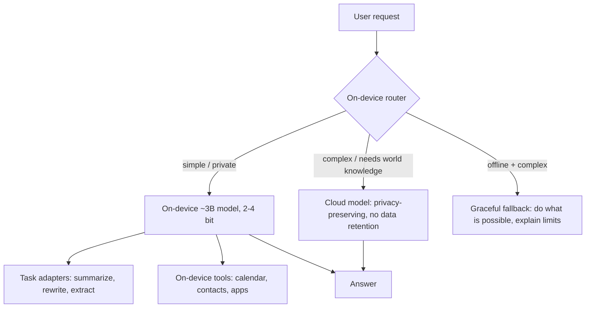

# Case — On-Device AI Assistant

> [!success] 🟢 Junior Explanation
> **In plain words:** A phone assistant that summarizes notifications, rewrites messages and answers simple questions **on the phone itself** — private, fast, works offline — and asks a cloud model only for hard tasks.
>
> **Analogy:** A pocket calculator for everyday sums, and a phone call to a professor for the hard problems.
>
> **Why interviewers ask:** Tests memory math, quantization, distillation, hybrid routing, privacy and how you ship models without servers.
>
> **Say it in one sentence:** "A ~3B quantized model with small task adapters runs on device; a router keeps private and simple tasks local and escalates complex ones to a privacy-preserving cloud model."
>
> 🎯 **Junior must know:** why on-device, size limits, hybrid routing. · **Middle adds:** bits-per-weight math, KV cache on device, adapters, update and eval strategy.

## 1. Requirements
| Question | Assumed answer |
|---|---|
| Tasks | Summarize notifications/emails, rewrite text, simple Q&A, app actions (create event) |
| Devices | Recent phones with ~8 GB RAM shared with apps |
| Privacy | Personal data should stay on device whenever possible |
| Offline | Core tasks must work without network |
| Latency | First token < 300 ms on device |

## 2. Memory math
```
3B params × 16 bits = 6.0 GB   → too big next to other apps
3B params ×  4 bits = 1.5 GB
3B params ×  2 bits = 0.75 GB  → realistic on a phone
+ KV cache for short contexts (keep prompts small)
```
→ [[Quantization]] · [[Edge AI and On-Device Inference]]

## 3. Architecture


## 4. Deep dives
- **Small model, many skills:** one base model + small **LoRA adapters** per task loaded on demand, instead of many models → [[Fine-Tuning and LoRA]].
- **Getting quality into 3B:** **distill** from a big teacher on task-specific data → [[Model Distillation]].
- **Guided generation:** constrained/structured output so app actions get valid parameters → [[Structured Output]].
- **Routing rule:** decide by task type + data sensitivity + confidence; the cloud call carries the minimum data needed → [[LLM Routing]].
- **Shipping:** base model ships with OS/app updates; adapters can be downloaded separately; evaluate on each device class (latency, battery, heat).

## 5. Evaluation
Per-task eval sets run **on real devices**: quality (LLM-judge vs cloud baseline), TTFT, tokens/s, memory peak, battery drain, thermal throttling.

## 6. Failure modes
| Failure | Mitigation |
|---|---|
| Device low on memory | Unload model, smaller context, fall back to cloud (with consent) |
| Thermal throttling | Shorter outputs, defer background summarization |
| Wrong local answer | Confidence check → escalate to cloud |
| Old model on old app version | Server-side feature flags; cloud fallback |

## 7. Trade-offs
Privacy/offline/zero GPU bill vs smaller capability; 2-bit = fits easily but needs quantization-aware training to keep quality.

## 🌍 Real-world evidence `[WEB]` — Apple Foundation Models (2025 tech report)
- On-device model ≈ **3B parameters**, optimized for Apple silicon with **KV-cache sharing** and **2-bit quantization-aware training**; KV-cache sharing reported to cut memory use by **37.5%**.
- Server model: a **Parallel-Track Mixture-of-Experts** transformer running on **Private Cloud Compute** — the "hybrid" cloud half.
- Developers get a Swift **Foundation Models framework** with **guided generation**, **constrained tool calling**, and **LoRA adapter** fine-tuning.

**Sources:** [Apple Foundation Models Tech Report 2025](https://machinelearning.apple.com/research/apple-foundation-models-tech-report-2025) · [arXiv 2507.13575](https://arxiv.org/abs/2507.13575v2) · [InfoQ summary](https://www.infoq.com/news/2025/07/apple-foundation-models-ios26)

> [!question] Recall
> Compute memory for a 7B model at 4-bit. Which tasks stay local, which go to cloud, and why?

Related: [[Multimodal Systems]] · [[Case Studies Index]]
