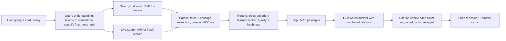

# Case — Perplexity-Style AI Search Engine

> [!success] 🟢 Junior Explanation
> **In plain words:** The user asks a question; the system searches the web live, picks the best few passages, and an LLM writes a short answer with **numbered citations** to the sources.
>
> **Analogy:** A research assistant who googles for you, reads the top pages, and hands you a summary with footnotes.
>
> **Why interviewers ask:** It's RAG at web scale with **freshness** and **trust (citations)** as first-class requirements.
>
> **Say it in one sentence:** "Rewrite the query, retrieve candidates from our index plus live search, fetch and extract passages, rerank, then have the LLM write a cited answer that we verify before streaming."
>
> 🎯 **Junior must know:** retrieve → rerank → generate with citations. · **Middle adds:** freshness vs caching, parallel fetch with timeouts, citation verification, cost of search APIs.

## 1. Requirements
| Question | Assumed answer |
|---|---|
| Scale | 5M queries/day (~60 QPS avg, ~200 peak) |
| Latency | First token < 2 s; full answer < ~8 s |
| Freshness | News/prices must be minutes-fresh; evergreen topics can be cached |
| Trust | Every factual sentence must cite a source |
| Follow-ups | Multi-turn ("and what about in 2024?") |

## 2. Estimation
```
Per answer: ~8 passages × ~400 tokens + prompt ≈ 4,000 input, ~400 output tokens
Daily:      5M × 4k = 20B input tokens, 5M × 400 = 2B output tokens
Fetches:    5M × ~10 pages ≈ 50M page fetches/day (≈ 600/s) → crawler/fetch fleet + caching
```

## 3. Pipeline


## 4. Walkthrough
1. **Query rewriting** turns "and in 2024?" into a standalone query; a classifier tags freshness need → [[Hybrid Search, HyDE, Reranking, ColBERT]].
2. **Retrieve** from the own index (crawled, parsed, chunked, embedded; hybrid BM25 + vector) and, for fresh topics, a live search API.
3. **Fetch in parallel** with a strict timeout; use whatever returns in time (don't wait for the slowest site).
4. **Rerank** passages by relevance, source quality and freshness; keep the best few (retrieval returns far more than can be cited).
5. **Generate** with a prompt that requires `[n]` citations and "say you don't know if sources disagree or are missing".
6. **Verify** citations (claim ↔ passage support) and **stream** with source cards.

## 5. Deep dives
### Freshness vs caching
| Query type | Cache TTL |
|---|---|
| Evergreen ("what is TCP") | hours–days, semantic cache OK |
| News / prices / sports | minutes or no cache |
| Personal / logged-in context | never shared cache |
→ [[Semantic Cache]]
### Citation quality
- Citations are produced **inside** the generation (model sees numbered passages), then a lightweight checker (NLI model or LLM judge) flags unsupported sentences → drop or regenerate.
- Track **citation precision** (cited source supports claim) and **coverage** (claims that have a citation) → [[Evaluation - LLM and Agent]].
### Latency budget
Rewrite 100 ms · retrieval 200 ms · fetch ≤ 800 ms · rerank 150 ms · LLM TTFT 400 ms → first token ≈ 1.6 s. Overlap: start fetching while the reranker scores the first arrivals.
### Index pipeline
Crawler → parse/clean → chunk → embed → hybrid index with continuous updates → [[Embeddings Pipeline]].

## 6. Failure modes
| Failure | Mitigation |
|---|---|
| Sites slow/down | Timeouts, use partial set, cached copy |
| Poisoned page with hidden instructions | Treat page text as untrusted data; model has no dangerous tools → [[Prompt Injection]] |
| Sources contradict | Prompt asks to present both sides with citations |
| Search API outage | Fall back to own index + disclose reduced freshness |
| Hallucinated citation | Verification step; never cite a passage not given to the model |

## 7. Trade-offs
More passages = better recall but higher cost, slower TTFT and lost-in-the-middle risk. Own index = control & cost at scale vs live API = freshness with per-query fees.

## 🌍 Real-world evidence `[WEB]`
- Vespa's case study says Perplexity's retrieval runs on **Vespa**, chosen to combine **keyword + semantic search, filtering, passage ranking and continuous indexing** in one platform instead of separate DBs/vector stores/rankers.
- Third-party analyses describe the flow as gather candidate pages → filter/rank by relevance, freshness, source quality → LLM writes **numbered citations as part of the answer** (secondary sources; internal details unverified).

**Sources:** [Vespa: Perplexity case study](https://vespa.ai/case-studies/perplexity/) · [How Perplexity built their search engine](https://theaiengineer.substack.com/p/how-perplexity-built-their-search) · [How Perplexity finds, ranks and cites](https://llmpulse.ai/blog/how-perplexity-works/)

> [!question] Recall
> Name the 6 pipeline stages; set TTLs for 3 query types; how do you verify citations?

Related: [[RAG Fundamentals]] · [[Agentic RAG, GraphRAG, Vectorless RAG]] · [[Case Studies Index]]
