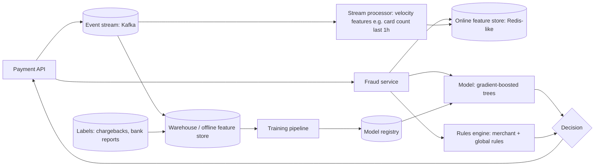

# Case — Real-Time Fraud Detection (classic ML)

> [!success] 🟢 Junior Explanation
> **In plain words:** Every card payment must be scored for fraud **in milliseconds**, before it's approved. A fast ML model uses fresh "behavior" features (how many payments this card made in the last hour, unusual amount, new device) and returns allow / block / extra check.
>
> **Analogy:** A bank cashier who glances at your ID and recent history in one second before handing over cash.
>
> **Why interviewers ask:** The classic ML system design case `[SDH]`: real-time features, feature store, training–serving skew, delayed labels, fallback when the model is slow.
>
> **Say it in one sentence:** "A streaming pipeline keeps real-time features in an online feature store; the payment path fetches them, scores with a gradient-boosted model plus rules within a strict latency budget, and labels from chargebacks retrain the model offline."
>
> 🎯 **Junior must know:** hot path vs offline training, feature store, why not an LLM in the hot path. · **Middle adds:** point-in-time features, delayed labels, fail-open vs fail-closed, shadow deployment.

## 1. Requirements
| Question | Assumed answer |
|---|---|
| Latency | Score inside the payment authorization path, budget ~50–100 ms (assumption) |
| Throughput | 5k payments/s peak |
| Decisions | Allow · Block · Step-up (3-D Secure) · Manual review |
| Labels | Chargebacks / bank fraud reports arrive **days–weeks later** |
| Merchants | Can add their own rules |

## 2. Architecture

→ [[Feature Store and Offline vs Online]] · [[Classic ML Components]]

## 3. Latency budget (example)
| Step | Budget |
|---|---|
| Feature fetch (online store) | 10–20 ms |
| Model scoring | ~5 ms |
| Rules | ~5 ms |
| Overhead / network | ~10 ms |
| **Total** | **~30–40 ms**, well inside ~100 ms |

## 4. Deep dives
### Features
Velocity (counts/sums over 1 min / 1 h / 24 h per card, device, IP, email), deviation from the customer's normal amount/country, device fingerprint, network-wide signals (same card seen at many merchants).
### Training–serving skew
Same feature definitions offline and online (feature store) `[SDH]`.
> [!note] Beyond the sources — point-in-time correctness
> When building training data, only use feature values that **existed at the moment of the payment**. Using later data ("leakage") makes offline metrics look great and production performance bad.
### Delayed labels
Fraud is confirmed weeks later → train on a window that has matured; monitor with **proxy metrics** (block rate, review outcomes) until labels arrive.
### Rollout
New model runs in **shadow** (scores logged, not used), then **canary**, compared on precision/recall at a fixed false-positive rate → [[Model Deployment Strategies]].
### Where LLMs fit
Not in the millisecond hot path. Useful **offline**: summarize a case for analysts, explain a decision, generate rule suggestions — behind review.

## 5. Failure modes
| Failure | Mitigation |
|---|---|
| Model/feature store timeout | Fallback to rules-only score; **fail-open** for low amounts, **fail-closed / step-up** for high risk |
| Feature pipeline lag | Freshness monitors; fallback to slower aggregates |
| Fraud pattern shift (drift) | Drift dashboards, frequent retraining, analyst feedback loop `[SDH]` |
| Too many false positives | Threshold tuning per merchant segment; step-up instead of block |

## 6. Trade-offs
Recall vs false positives (lost good customers); fail-open (revenue) vs fail-closed (losses); rich features vs latency.

## 🌍 Real-world evidence `[WEB]`
- Stripe Radar scores **every payment** with adaptive ML, blocking high-risk ones; merchants can layer **custom rules** on top.
- Its signals aggregate behavior **across the whole network** of businesses, and the **ground-truth fraud labels come from banking partners** rather than manual tagging.

**Sources:** [Stripe: A primer on machine learning for fraud detection](https://stripe.com/au/blog/a-primer-on-machine-learning-for-fraud-detection) · [Stripe Radar guide](https://stripe.com/en-gb-us/radar/guide)

> [!question] Recall
> Draw hot path vs offline path. What do you do if the feature store is down for a $5 payment vs a $5,000 payment?

Related: [[ML System Architecture - Data Model Serving Layers]] · [[Case - Recommendation Engine]] · [[Case Studies Index]]
