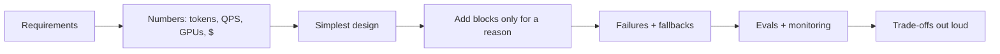

# Case Studies Index

> [!success] 🟢 Junior Explanation
> Case studies are where the theory "clicks". Each one is a full interview answer: requirements → numbers → architecture diagram → deep dives → failures → trade-offs. Start with 🟢 cases, then 🟡, then 🔴. The matrix below shows **which building blocks each case trains** — pick cases that cover your weak spots.

## Study order
| Level | Case | One-line idea |
|---|---|---|
| 🟢 | [[Case - Customer Support Chatbot]] | RAG + small model + escalation (the classic) |
| 🟢 | [[Case - Cursor]] | Codebase RAG + a different model per job |
| 🟢 | [[Case - Recommendation Engine]] | Retrieve 1,000 candidates → rank → cache |
| 🟡 | [[Case - Perplexity-Style AI Search Engine]] | Live web RAG with citations and freshness |
| 🟡 | [[Case - ChatGPT-Scale Chat Assistant]] | GPU fleet, streaming, memory, tiers |
| 🟡 | [[Case - Claude Code]] | Coding agent loop: gather → act → verify |
| 🟡 | [[Case - Enterprise AI Gateway]] | One proxy for limits, cost, cache, failover |
| 🟡 | [[Case - Real-Time Fraud Detection]] | Millisecond ML scoring with a feature store |
| 🟡 | [[Case - On-Device AI Assistant]] | 2-bit 3B model on a phone + cloud fallback |
| 🟡 | [[Case - LLM Evaluation and Monitoring Pipeline]] | CI eval gates + online judge + data flywheel |
| 🔴 | [[Case - Legal Contract Q&A]] | Router across tree search, SQL, graph; exact citations |
| 🔴 | [[Case - Multi-Agent Research Assistant]] | Orchestrator + parallel sub-agents, async, budgets |
| 🔴 | [[Case - LLM Inference Platform for Many Teams]] | Self-hosted GPU pools, quotas, batch backfill |
| 🔴 | [[Case - Real-Time Voice AI Agent]] | 800 ms streaming STT→LLM→TTS, barge-in |

## Building-block matrix
| Case | RAG | Agent / tools | Multi-agent | Streaming | Async / queue | Caching | Routing | Self-host GPU | Safety | Evals | Classic ML | Edge |
|---|---|---|---|---|---|---|---|---|---|---|---|---|
| Support Chatbot | ✅ |  |  | ✅ |  | ✅ | ✅ |  | ✅ | ✅ |  |  |
| Cursor | ✅ | ✅ |  | ✅ |  | ✅ | ✅ |  |  |  |  |  |
| Recommendation | ✅ |  |  |  | ✅ | ✅ |  |  |  |  | ✅ |  |
| Perplexity search | ✅ |  |  | ✅ |  | ✅ |  |  | ✅ | ✅ |  |  |
| ChatGPT-scale | ✅ | ✅ |  | ✅ |  | ✅ | ✅ | ✅ | ✅ | ✅ |  |  |
| Claude Code |  | ✅ | ✅ | ✅ |  |  |  |  | ✅ | ✅ |  |  |
| AI Gateway |  |  |  | ✅ | ✅ | ✅ | ✅ |  | ✅ |  |  |  |
| Fraud detection |  |  |  |  | ✅ | ✅ |  |  |  | ✅ | ✅ |  |
| On-device |  | ✅ |  | ✅ |  |  | ✅ |  | ✅ | ✅ |  | ✅ |
| Eval pipeline |  |  |  |  | ✅ |  |  |  | ✅ | ✅ |  |  |
| Legal Q&A | ✅ | ✅ |  | ✅ | ✅ | ✅ | ✅ |  | ✅ | ✅ |  |  |
| Multi-agent research | ✅ | ✅ | ✅ |  | ✅ |  | ✅ |  | ✅ | ✅ |  |  |
| Inference platform |  |  |  | ✅ | ✅ | ✅ | ✅ | ✅ |  | ✅ |  |  |
| Voice agent |  | ✅ |  | ✅ |  | ✅ | ✅ | ✅ | ✅ | ✅ |  |  |

## The pattern behind every case

## How to practice a case (30–40 min)
1. Read only the **Requirements** table. Close the note.
2. Do the estimate, draw the diagram, list 3 failure modes — out loud, with a timer.
3. Open the note and compare. Write down what you missed.
4. Answer the **Recall** questions at the bottom.
5. Repeat the same case a week later without looking.

## Real-world references used `[WEB]`
Anthropic multi-agent research · Vespa/Perplexity · DoorDash support bot (RAG + guardrail + judge) · LinkedIn GenAI lessons · Stripe Radar · Apple Foundation Models 2025 → links inside each case and in [[Research Library]].

Related: [[Interview Framework - 8 Steps]] · [[Interview Question Bank]] · [[Mock Interview 1 - Support Chatbot]]
