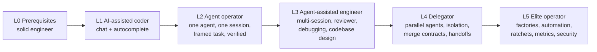
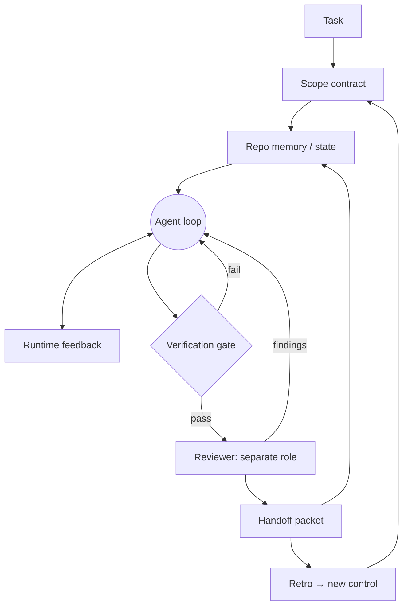

# Agent-Assisted Engineering: Zero → Hero Roadmap

> [!success] 🟢 What this track gives you
> **In plain words:** Coding agents are fast, tireless, and have no judgment. They do exactly as well as the environment you put them in. This track teaches you to build that environment (context, specs, tests, gates, reviewers, handoffs, automation) so agent output is **safe to ship**, and to run several agents at once without losing control.
>
> **One sentence:** "I frame the task with evidence, give the agent the smallest context that is still enough, make 'done' a check it cannot fake, review with a separate role, and turn every correction into a permanent control."
>
> **Path:** AI-assisted coder → Agent operator → Agent-assisted engineer → Delegator → **Elite engineering operator**

---

## 0. The core thesis in 6 lines

1. **Agent = Model + Harness + Environment.** You control the environment the most, and it has the most leverage.
2. **Agents produce entropy.** They have no taste and see only what is in their window. Left alone they drift: scope creep, quietly weakened tests, duplicated helpers, "looks done."
3. **Speed without verification just moves the bottleneck** to you: you become the Bug Catcher, the Babysitter, and you end the day burned out.
4. **Build brakes before accelerators.** Shared language, specs, tests, gates, and review come first. Loops, parallelism, and factories come second.
5. **Done means a passing check, not a sentence the agent wrote.** If a check can't prove it, it isn't done.
6. **Every correction is evidence of a missing control.** Fix the system that let it happen, not just this one diff.

```
            ┌───────────────────────── YOUR LEVERAGE ─────────────────────────┐
            │                                                                 │
   low ◄────┤  Model choice   →   Prompt wording   →   Harness   →   Environment ├────► high
            │  (you rent it)      (one turn)          (runtime)     (repo, specs,│
            │                                                       tests, gates,│
            │                                                       memory, CI)  │
            └─────────────────────────────────────────────────────────────────┘
```

---

## 1. Evidence legend (how much to trust each practice)

The field moves fast and a lot of it is hype. Every module tags its practices:

| Tag | Meaning | Examples |
|---|---|---|
| 🟢 **Proven** | Decades of software engineering evidence, and it clearly carries over to agents | Tests, CI, small batches, code review, ADRs, types, reproduce-before-fix, least privilege |
| 🔵 **Established (agents)** | Widely adopted across 2025–26 with consistent practitioner results | AGENTS.md/CLAUDE.md, plan-before-code, hooks as guardrails, subagent review, git worktrees, headless CI agents, file-backed state |
| 🟠 **Emerging** | Promising, but evidence is thin or vendor-reported | Ralph loops, fully autonomous issue→PR factories, multi-agent swarms, calibrated LLM judges, mutation testing as an agent gate |
| 🔴 **Caution** | Popular, but evidence is weak or contradicts it | 3,000-line instruction files, "just use a smarter model," agent-reviewed agent code with no deterministic gate, metrics like "% of code written by AI" |

> [!warning] Read the numbers critically
> Figures you'll see quoted, such as Terminal-Bench "top-30 → top-5 by harness only," Vercel "80% → 100% by deleting tools," and Cloudflare's "131k review runs," are **self-reported by vendors or practitioners**. Treat them as *directional*. The most rigorous public data point cuts the other way: METR's randomized trial (July 2025) found experienced open-source developers were **~19% slower** with early-2025 AI tools while *believing* they were ~20% faster. DORA's 2025 report found that AI **amplifies** what already exists: strong engineering systems get faster, weak ones get less stable. **Lesson: measure yourself. Don't trust how fast it feels.**

---

## 2. The level ladder



| Level | You can… | Bottleneck you hit | Module(s) |
|---|---|---|---|
| **L0** | Read unfamiliar code, write tests, use git and the shell fluently | — | Prereq check (§4) |
| **L1** | Get useful code from chat and autocomplete | You copy-paste and are the integration layer | [[01 Foundations - How Agents Actually Work]] |
| **L2** | Hand an agent a **framed** task in a prepared repo and get a verified diff | Agent drifts across sessions; review takes forever | [[02 Context Engineering and Repo Memory]], [[03 Specification, Framing and Planning]], [[04 Verification - Tests, Feedback Loops and Gates]] |
| **L3** | Run week-long work across sessions; debug with agents; keep the codebase agent-friendly | You can only run one stream at a time | [[05 Debugging, Code Review and Codebase Design]] |
| **L4** | Run 2–5 agents in parallel on disjoint work and integrate safely | You're still the scheduler and the trigger | [[06 Delegation, Parallelism and Handoff]] |
| **L5** | Run a self-improving system: issues go in, reviewed PRs come out, with metrics and retros | Organizational trust, security, cost | [[07 Software Factories and Automation]] |
| **Hero** | Ship the workbench pack plus a reproducible case study | — | [[08 Projects, Capstone and Mastery]] |

---

## 3. The master mental model: the workbench

Seven surfaces wrap the model. Remove one and its failure mode comes back.



| Surface | Carries | Failure when missing |
|---|---|---|
| **Instructions** | Router, rules, definition of done | Agent guesses what shipping means |
| **State** | Active task, touched files, blockers, next action | Every session starts from zero |
| **Scope** | Allowed and forbidden paths, acceptance | Edits leak into unrelated code |
| **Feedback** | Real stdout/stderr/exit captured into the loop | "Tests pass" when nothing ran |
| **Verification** | Deterministic gate over artifacts | "Looks good" reaches main |
| **Review** | Second role, fresh context, read-only | Builder grades its own homework |
| **Handoff** | What changed, why, what's left, next action | Next session rediscovers everything |

Underneath, every surface is a classic distributed-systems primitive (see [[01 Foundations - How Agents Actually Work#6. Strip the vocabulary down to primitives]]): **functions, workers, triggers, runtimes, RPC, queues, persistence, authorization policy.** When you hear a new buzzword, translate it back to one of these.

---

## 4. Prerequisites (L0 self-check)

You can't delegate what you can't judge. Score yourself 0–2 on each. You need **≥ 12/16** before Module 02.

| #   | Skill                 | 2 = fluent means                                                                                     |
| --- | --------------------- | ---------------------------------------------------------------------------------------------------- |
| 1   | One language in depth | You can explain its error model, concurrency model, and packaging                                    |
| 2   | Testing               | You write unit + integration tests; you know mocks vs fakes; you can make a flaky test deterministic |
| 3   | Git                   | Branch, rebase, bisect, worktree, interactive staging from the CLI                                   |
| 4   | Shell                 | Pipes, `grep`/`rg`, `jq`, exit codes, env vars, background jobs                                      |
| 5   | Reading code          | You can trace a request through an unfamiliar repo in < 30 min                                       |
| 6   | Debugging             | Reproduce → minimize → hypothesize → instrument → fix                                                |
| 7   | Design basics         | Coupling and cohesion, interfaces, dependency injection, layering                                    |
| 8   | CI                    | You've written a CI pipeline and you know what makes it slow                                         |

Gaps? Fix them first. Agents **amplify** your judgment; they don't replace it.

> [!example] Python study materials for each row
> [[P0 Prerequisites Index (Python)]] · [[P1 Python in Depth - Errors, Concurrency, Packaging|1 Language]] · [[P2 Testing with pytest - Unit, Integration, Doubles, Flakiness|2 Testing]] · [[P3 Git from the CLI - Rebase, Bisect, Worktree, Staging|3 Git]] · [[P4 Shell Fluency for Python Engineers|4 Shell]] · [[P5 Reading Unfamiliar Python Code|5 Reading code]] · [[P6 Debugging Method in Python|6 Debugging]] · [[P7 Design Basics in Python - Coupling, Interfaces, DI, Layers|7 Design]] · [[P8 CI Pipelines for Python|8 CI]]

---

## 5. Curriculum map

| # | Module | Level | Core artifact you produce |
|---|---|---|---|
| 01 | [[01 Foundations - How Agents Actually Work]] | L1 | Instrumented baseline: prompt-only vs framed run, with an intervention log |
| 02 | [[02 Context Engineering and Repo Memory]] | L2 | `AGENTS.md` router (< 60 lines), glossary, ADR, state schema, `init_agent.py` |
| 03 | [[03 Specification, Framing and Planning]] | L2 | Task frame, evidence-backed plan DAG, scope contract, feature list |
| 04 | [[04 Verification - Tests, Feedback Loops and Gates]] | L2 | One `check` command, feedback runner, Stop/PreToolUse hooks, verification gate, a mutation run |
| 05 | [[05 Debugging, Code Review and Codebase Design]] | L3 | Repro-first bug fix, calibrated reviewer rubric, one module deepened plus an enforced boundary |
| 06 | [[06 Delegation, Parallelism and Handoff]] | L4 | Delegation plan with path ownership, worktree runs, handoff generator, clean-state check |
| 07 | [[07 Software Factories and Automation]] | L5 | Implementer + reviewer workflows, a ratchet, one scheduled job, factory metrics |
| 08 | [[08 Projects, Capstone and Mastery]] | Hero | Workbench pack + reproducible case study |

---

## 6. Study plan (12 weeks part-time, ~8–10 h/week)

| Week | Focus | Exit artifact (commit it) |
|---|---|---|
| 0 | Prereq gaps + pick a **practice repo** (small, real, slightly messy, yours) | Prereq score ≥ 12 |
| 1 | Module 01 + Project P1 | `baseline-report.md` with numbers |
| 2 | Module 02 | Agent-ready repo (P2) |
| 3 | Module 03 | Framed + planned feature (P3, first half) |
| 4 | Module 04 | Hooks + gate wired; P3 shipped through the gate |
| 5 | Module 04 deep | Mutation run, custom lint rule (P6) |
| 6 | Module 05 (debugging + review) | P4 bug fix + P5 calibrated reviewer |
| 7 | Module 05 (design) | P7 legacy module deepened |
| 8 | Module 06 | P8 parallel delegation |
| 9 | Module 06 (multi-session) | P9 three-session task with handoffs |
| 10 | Module 07 | P10 factory, part 1: implementer + reviewer |
| 11 | Module 07 | P10 factory, part 2: ratchet + scheduled job + metrics |
| 12 | Module 08 | Capstone pack + case study, reviewed by a peer |

**Rhythm for every module:** read → build on the practice repo → run → **prove** (capture output) → retro. No binge-reading. The value lives in the artifacts.

---

## 7. Mastery criteria (how you know you've leveled up)

> [!tip] Rule
> Mastery = **observable evidence a reviewer can reproduce.** Feeling productive doesn't count.

| Level | You've mastered it when… |
|---|---|
| L1 | You can explain the agent loop, context window limits, and why the same model behaves differently in two harnesses. P1 report shows a measured before/after. |
| L2 | 5 consecutive framed tasks merged where **every** "done" claim is backed by a feedback record, and zero out-of-scope files. |
| L3 | A task spanning ≥ 3 sessions resumes in < 2 min each time from the handoff alone. The reviewer agrees with your verdict on ≥ 80% of a 10-item calibration set. |
| L4 | You've integrated ≥ 3 parallel work units with no path conflicts. Integration took < 20% of total wall time. |
| L5 | The factory has merged ≥ 10 PRs. You track rework rate, human-minutes per merged PR, escaped defects, and cost per PR. At least 3 retro findings became deterministic checks. |
| Hero | A peer reproduces your weakest acceptance check from your case study **without asking you anything**. |

---

## 8. The elite operator's daily loop (preview)

```
Morning  ─ read factory dashboard + handoffs ─ triage: which tickets need ME (decisions, one-way doors)
         ─ grill/frame 1–3 tasks deeply (high leverage)  ─ dispatch well-framed work to agents
Midday   ─ review PRs by merge-danger, not by arrival order ─ unblock human-unknowns
         ─ while agents run: design, read code, write ADRs (never idle-watch a terminal)
Evening  ─ retro the day's corrections → 1 new check / 1 deleted no-op instruction
         ─ leave clean state + handoffs ─ queue overnight AFK jobs (low blast radius only)
```

Full playbook: [[08 Projects, Capstone and Mastery#4. The elite operator playbook]].

---

## 9. Related notes in this vault

- [[Agent Loop]] · [[What is an AI Agent]] · [[Tool Calling]] · [[Agent Memory]]
- [[Planning and Task Decomposition]] · [[Multi-Agent Systems and SubAgents]] · [[MCP, A2A and Agent Skills]]
- [[Agentic Workflow Patterns]] · [[AI Orchestration vs Agents - Loop and Graph Engineering]]

## 10. Core sources (primary, read these)

- Anthropic: *Building Effective Agents* (2024); *Effective Context Engineering for AI Agents* (2025); *Effective Harnesses for Long-Running Agents* (2025); Claude Code docs (hooks, headless, subagents, skills)
- OpenAI: *Harness engineering* (Codex team); *Unrolling the Codex agent loop*; AGENTS.md spec at agents.md
- Martin Fowler / Birgitta Böckeler: *Harness engineering for coding agent users* (guides + sensors)
- METR (2025): *Measuring the Impact of Early-2025 AI on Experienced OSS Developer Productivity*
- Google DORA: *State of AI-assisted Software Development* (2025)
- Simon Willison: *The lethal trifecta* (prompt injection, 2025)
- Matt Pocock: `mattpocock/skills` (grill-with-docs, to-spec, to-tickets, code-review, retro, improve-codebase-architecture)
- Classics: Evans *DDD*; Nygard *ADRs*; Hunt & Thomas *Pragmatic Programmer* (tracer bullets); Ousterhout *A Philosophy of Software Design*; Feathers *Working Effectively with Legacy Code*; Fowler *Refactoring*; Beck *XP / TDD*
