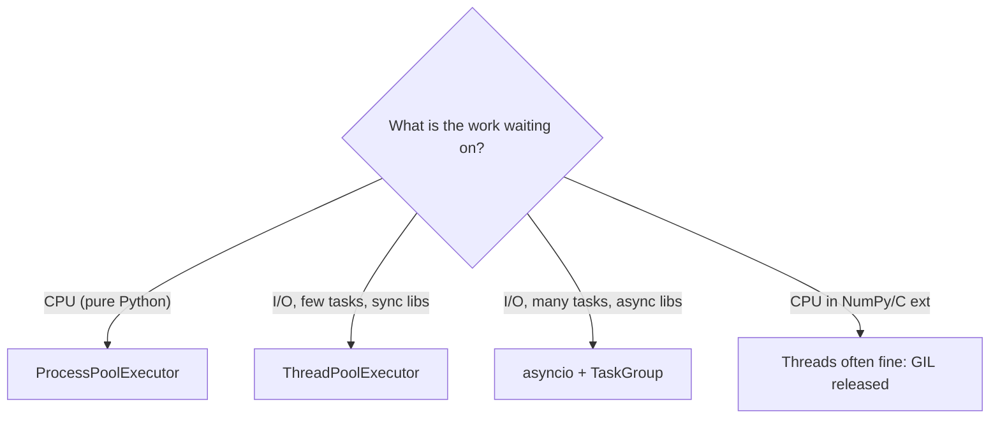

# P1 · Python in Depth: Error Model, Concurrency Model, Packaging

> [!success] 🟢 Junior Explanation
> **In plain words:** "Knowing a language in depth" doesn't mean knowing every feature. It means you can answer three questions without guessing: **What happens when something goes wrong?** (error model) **What happens when two things run at once?** (concurrency model) **How does my code get from a folder to `import`able on another machine?** (packaging).
>
> **Analogy:** Driving vs knowing the car. Anyone can drive. Knowing the car means you know what the brakes do on ice, what happens when two systems want the engine, and how it was assembled.
>
> 🎯 **Fluent means:** you can explain all three to a colleague with a whiteboard and a Python REPL, and spot when agent-written code gets them wrong.

Index: [[P0 Prerequisites Index (Python)]] · Next: [[P2 Testing with pytest - Unit, Integration, Doubles, Flakiness]]

---

## 1. Error model

### 1.1 The mental model

Python uses **exceptions**, not return codes. A raised exception unwinds the stack frame by frame until an `except` matches. If nothing matches, the interpreter prints a traceback and exits with status `1`.

```
BaseException
 ├── SystemExit            ← sys.exit(); don't catch accidentally
 ├── KeyboardInterrupt     ← Ctrl-C; don't catch accidentally
 ├── BaseExceptionGroup
 │    └── ExceptionGroup
 └── Exception             ← everything you normally catch lives here
      ├── ValueError, TypeError, KeyError, ...
      ├── OSError (FileNotFoundError, ConnectionError, TimeoutError, ...)
      └── YourLibraryError  ← your own hierarchy
```

Rules you must know cold:

| Rule | Why |
|---|---|
| Catch the **narrowest** type you can handle | `except Exception` hides bugs (`AttributeError` from a typo looks like "network failed") |
| Never bare `except:` | It catches `KeyboardInterrupt` and `SystemExit`; your program won't stop |
| Handle *or* re-raise, never swallow | `except X: pass` is a silent failure; at minimum log with `logger.exception(...)` |
| EAFP over LBYL for races | `try: open(p)` beats `if p.exists(): open(p)` (file can vanish between check and use) |
| Use `else` and `finally` deliberately | `else` = "only if no exception", `finally` = "always, cleanup" |

```python
try:
    conn = connect(url)          # only the risky call goes in try
except ConnectionError as e:
    logger.warning("connect failed: %s", e)
    raise                        # bare raise keeps the original traceback
else:
    process(conn)                # bugs here are NOT caught by the except above
finally:
    metrics.incr("connect.attempt")
```

### 1.2 Your own exception hierarchy

A library should raise its **own** base exception so callers can catch "anything from this library" in one line.

```python
# src/linkcheck/errors.py
class LinkcheckError(Exception):
    """Base for every error linkcheck raises on purpose."""


class ConfigError(LinkcheckError):
    pass


class FetchError(LinkcheckError):
    def __init__(self, url: str, status: int | None = None, reason: str = "") -> None:
        super().__init__(f"{url}: status={status} {reason}".strip())
        self.url = url
        self.status = status
        self.reason = reason
```

### 1.3 Chaining: `raise ... from`

When you translate a low-level error into a domain error, **chain** it so the original cause survives in the traceback.

```python
import tomllib
from pathlib import Path

from linkcheck.errors import ConfigError


def load_config(path: Path) -> dict:
    try:
        return tomllib.loads(path.read_text(encoding="utf-8"))
    except FileNotFoundError as e:
        raise ConfigError(f"no config file at {path}") from e
    except tomllib.TOMLDecodeError as e:
        raise ConfigError(f"invalid TOML in {path}: {e}") from e
```

| Form | `__cause__` | Traceback says |
|---|---|---|
| `raise New() from e` | `e` | "The above exception was the **direct cause** of…" |
| `raise New()` inside `except` | (implicit `__context__`) | "**During handling** of the above exception, another occurred" (looks like a bug in your handler) |
| `raise New() from None` | suppressed | Only the new error (use when the cause is noise, e.g. a `KeyError` lookup detail) |

Since 3.11 you can also attach context without wrapping: `e.add_note(f"while checking {url}")`.

### 1.4 Many errors at once: `ExceptionGroup` and `except*`

Concurrent code can fail in several places at once. `asyncio.TaskGroup` (3.11+) raises an `ExceptionGroup` containing every failure. `except*` matches **subsets** of the group.

```python
try:
    asyncio.run(check_all(urls))
except* FetchError as group:
    for err in group.exceptions:
        print(f"broken: {err.url}", file=sys.stderr)
except* TimeoutError as group:
    print(f"{len(group.exceptions)} timeouts", file=sys.stderr)
```

### 1.5 Cleanup belongs in context managers

If something must be released (file, lock, connection, temp dir), use `with`. Write your own with `contextlib`:

```python
import sys
import time
from contextlib import contextmanager


@contextmanager
def timed(label: str):
    start = time.perf_counter()
    try:
        yield
    finally:  # runs on success AND on exception
        print(f"{label}: {time.perf_counter() - start:.3f}s", file=sys.stderr)
```

> [!warning] Agent smell detector (errors)
> Flag these in any agent diff: `except Exception: pass`, `except:` bare, `raise NewError(str(e))` without `from e`, catching an exception just to `return None` (the caller now has to guess), and `try` blocks wrapping 30 lines.

---

## 2. Concurrency model

### 2.1 The three tools and the GIL

The default CPython build has a **Global Interpreter Lock (GIL)**: only one thread executes Python bytecode at a time. The GIL is released during blocking I/O and inside many C extensions (NumPy, hashing, compression).

| Tool | Runs | Good for | Bad for | Unit of work |
|---|---|---|---|---|
| `threading` / `ThreadPoolExecutor` | OS threads, share memory | Blocking I/O with libraries that aren't async (e.g. `requests`, DB drivers) | Pure-Python CPU work (GIL) | Function |
| `multiprocessing` / `ProcessPoolExecutor` | Separate processes, separate memory | CPU-bound pure Python | Lots of small tasks (pickling overhead), shared state | Picklable function |
| `asyncio` | One thread, event loop, cooperative | Thousands of concurrent I/O waits (HTTP, sockets) | CPU work, any blocking call | Coroutine (`async def`) |



> [!info] Free-threaded Python
> CPython 3.13 introduced an experimental **free-threaded** build (no GIL, binary usually called `python3.13t`/`python3.14t`), and 3.14 moved it to *officially supported but optional* (PEP 779). The default build still has the GIL. Know that it exists, that C extensions must opt in, and that it makes thread-safety bugs **much** easier to hit. 🟠 Don't design around it yet unless you've measured.

### 2.2 The GIL does not make your code thread-safe

The GIL protects the interpreter's internals, not *your* invariants. `counter += 1` is read-modify-write and is **not atomic** as a whole.

```python
import threading

counter = 0
lock = threading.Lock()


def work(n: int) -> None:
    global counter
    for _ in range(n):
        with lock:          # remove the lock: results become nondeterministic,
            counter += 1    # especially on the free-threaded build


threads = [threading.Thread(target=work, args=(100_000,)) for _ in range(8)]
for t in threads:
    t.start()
for t in threads:
    t.join()
assert counter == 800_000
```

Prefer designs with **no shared mutable state**: pass inputs, return results (`executor.map`), or communicate through `queue.Queue`.

### 2.3 `asyncio` in one page

- `async def` defines a coroutine. Calling it returns a coroutine object; nothing runs until it's awaited or scheduled.
- `await` is the **only** place your coroutine yields control. Between awaits, you have the loop to yourself.
- **Never block the loop.** `time.sleep(1)`, `requests.get(...)`, heavy CPU loops freeze *every* task. Use `await asyncio.sleep`, async libraries (`httpx.AsyncClient`), or offload with `await asyncio.to_thread(fn, ...)`.
- Use **structured concurrency**: `asyncio.TaskGroup` owns its tasks; if one fails, the rest are cancelled and the errors surface as an `ExceptionGroup`.
- Bound concurrency with `asyncio.Semaphore`. Bound time with `asyncio.timeout(...)`.

The `linkcheck` core:

```python
# src/linkcheck/adapters.py
import asyncio
from dataclasses import dataclass

import httpx


@dataclass(frozen=True)
class LinkResult:
    url: str
    status: int | None
    error: str | None = None

    @property
    def ok(self) -> bool:
        return self.error is None and self.status is not None and self.status < 400


async def check_one(client: httpx.AsyncClient, sem: asyncio.Semaphore, url: str) -> LinkResult:
    async with sem:
        try:
            async with asyncio.timeout(10):
                resp = await client.head(url, follow_redirects=True)
            return LinkResult(url, resp.status_code)
        except (httpx.HTTPError, TimeoutError) as e:
            # Per-link failure is DATA for this tool, not a crash.
            return LinkResult(url, None, f"{type(e).__name__}: {e}")


async def check_all(urls: list[str], limit: int = 20) -> list[LinkResult]:
    sem = asyncio.Semaphore(limit)
    async with httpx.AsyncClient() as client:
        async with asyncio.TaskGroup() as tg:
            tasks = [tg.create_task(check_one(client, sem, u)) for u in urls]
    return [t.result() for t in tasks]
```

> [!note] Week-1 shape
> This first version talks to `httpx` directly. In [[P7 Design Basics in Python - Coupling, Interfaces, DI, Layers]] you'll refactor it behind a `Fetcher` port so the logic is testable without a network.

Design decision to be able to defend: per-URL failures are **caught and returned as data** (so one dead link doesn't cancel the other 499), while *unexpected* errors (a bug, `KeyError`) still propagate and cancel the group. That's the difference between expected failure and a defect.

| Pattern | On first failure | Use when |
|---|---|---|
| `TaskGroup` | Cancels siblings, raises `ExceptionGroup` | Failures are bugs or should abort the batch |
| `gather(..., return_exceptions=True)` | Keeps going; exceptions returned in the result list | Legacy code; you must then inspect each result |
| Catch inside each task, return a result object | Keeps going; typed results | Failures are expected outcomes (this tool) |

> [!warning] Agent smell detector (concurrency)
> `time.sleep` or `requests` inside `async def`; `asyncio.run()` called inside an already-running loop; unbounded `gather` over 10,000 URLs; `create_task` without keeping a reference (task can be garbage-collected); threads mutating a shared `dict`/`list` without a lock; "made it async for performance" on CPU-bound code.

---

## 3. Packaging model

### 3.1 Vocabulary that people confuse

| Term | Means |
|---|---|
| **Module** | One `.py` file (`domain.py`) |
| **Import package** | A directory of modules (`linkcheck/` with `__init__.py`) that you `import` |
| **Distribution package** | What you `pip install`/`uv add` (name on PyPI), described by `pyproject.toml` |
| **sdist** | Source archive (`.tar.gz`); needs a build step on install |
| **wheel** | Pre-built archive (`.whl`); installs by unzipping. What you want |
| **Build backend** | Tool that turns your source into an sdist/wheel (hatchling, setuptools, uv_build, flit-core, poetry-core) |
| **Environment** | An interpreter + its `site-packages` (a virtualenv like `.venv/`) |
| **Lockfile** | Exact resolved versions of every transitive dependency (`uv.lock`; the standard `pylock.toml` format was accepted in PEP 751) |

### 3.2 How `import linkcheck` finds code

`import` searches `sys.path` in order: the script's directory (or CWD for `python -m` / REPL), `PYTHONPATH`, then the environment's `site-packages`. The first match wins.

That explains the classic "works on my machine" bug: running from the repo root accidentally imports the **local folder** instead of the installed package. The **src layout** (`src/linkcheck/`) prevents it: the package is only importable once installed (editable or not), so your tests exercise what users get.

```bash
python -c "import linkcheck, sys; print(linkcheck.__file__); print(*sys.path, sep='\n')"
```

### 3.3 A modern `pyproject.toml`

```toml
[project]
name = "linkcheck"
version = "0.1.0"
description = "Async Markdown link checker"
requires-python = ">=3.12"
dependencies = [
    "httpx>=0.27",
]

[project.scripts]
linkcheck = "linkcheck.cli:main"   # creates a `linkcheck` executable on install

[dependency-groups]                 # PEP 735: dev-only deps, not published
dev = [
    "pytest>=8",
    "pytest-asyncio>=0.24",
    "pytest-cov",
    "hypothesis",
    "ruff",
    "mypy",
]

[build-system]
requires = ["hatchling"]
build-backend = "hatchling.build"

[tool.pytest.ini_options]
asyncio_mode = "auto"
testpaths = ["tests"]

[tool.ruff.lint]
select = ["E", "F", "I", "B", "UP", "SIM"]
```

### 3.4 The `uv` workflow (current de facto standard tool)

```bash
uv init --package linkcheck      # src layout + pyproject + build backend
cd linkcheck
uv add httpx                     # adds to [project].dependencies and updates uv.lock
uv add --dev pytest ruff mypy    # adds to [dependency-groups].dev
uv sync                          # create/refresh .venv to match uv.lock exactly
uv run linkcheck README.md       # run inside the project env (no manual activate)
uv run pytest
uv lock --upgrade-package httpx  # deliberate, reviewable upgrade
uv build                         # dist/linkcheck-0.1.0.tar.gz + .whl
uv python install 3.13           # manage interpreters too
```

Library vs application rule: **libraries** declare *ranges* (`httpx>=0.27`) and don't ship a lockfile to users; **applications** commit the lockfile so every machine (and every agent worktree, and CI) gets identical versions.

Also know `python -m linkcheck` requires `src/linkcheck/__main__.py`:

```python
# src/linkcheck/__main__.py
from linkcheck.cli import main

raise SystemExit(main())
```

> [!warning] Agent smell detector (packaging)
> `sys.path.insert(0, ...)` hacks; `pip install` into the global interpreter; adding a dependency without updating the lockfile; pinning `==` in a library; editing `requirements.txt` *and* `pyproject.toml` so they drift; importing a dev-only package from runtime code.

---

## 4. Drills (do them, don't read them)

| # | Drill | Exit check |
|---|---|---|
| D1 | Create `linkcheck` with `uv init --package`, add `errors.py` hierarchy and `load_config` with chaining | Trigger a missing file and a bad TOML; traceback shows "direct cause" |
| D2 | Implement `check_all` above; check 200 URLs with `limit=20` | Wall time ≈ (200/20) × slowest-ish latency, not 200 × latency. Print it with `timed()` |
| D3 | Put `time.sleep(1)` inside `check_one` | Explain why total time is now ≈ 200 s. Fix it with `asyncio.sleep` and with `asyncio.to_thread`; say which is right when |
| D4 | Write a CPU-bound function (e.g. SHA-256 of 10 MB × 32 in a pure-Python loop); run with threads and processes | Table of timings; explain the difference with "GIL" in one sentence |
| D5 | Remove the lock in §2.2; run 20 times (on a free-threaded build if you have one) | Observe or explain the lost updates |
| D6 | `uv build`, install the wheel into a **fresh** venv, run `linkcheck --help` | Works without the source tree present |
| D7 | Delete `src/` layout (move package to root), run tests from root, then from another dir | Explain the import-path difference |

---

## 5. Self-check: answer out loud

1. What's the difference between `raise X from e`, `raise X` inside `except`, and `raise X from None`?
2. Why is `except Exception:` usually wrong, and when is it right? *(Right at a top-level boundary: CLI `main`, request handler, worker loop, where you log and convert to an exit code or 500.)*
3. Your async service's p99 latency spikes to 2 s every minute. What's the first thing you check? *(Something blocking the event loop: sync I/O, CPU work, `time.sleep`. Use `PYTHONASYNCIODEBUG=1` / `loop.slow_callback_duration`.)*
4. Threads vs processes vs asyncio for: 50 Postgres queries via a sync driver; resizing 10,000 images with Pillow; 5,000 HTTP HEAD requests?
5. What's in a wheel, and why prefer it to an sdist?
6. Why does the src layout catch bugs a flat layout hides?
7. When should a project commit `uv.lock`?

---

## 6. Resources

- Python docs: *Errors and Exceptions* tutorial; `asyncio` *Developing with asyncio* page; `concurrent.futures`.
- PEP 654 (exception groups), PEP 703 + PEP 779 (free-threading), PEP 621 (project metadata), PEP 735 (dependency groups), PEP 751 (lockfiles).
- Python Packaging User Guide (packaging.python.org): *src layout vs flat layout*, *Writing pyproject.toml*.
- `uv` docs (docs.astral.sh/uv): *Projects*, *Locking and syncing*.
- Łukasz Langa's asyncio talks; Brett Slatkin, *Effective Python* (3rd ed.), concurrency chapters.

Next: [[P2 Testing with pytest - Unit, Integration, Doubles, Flakiness]]
