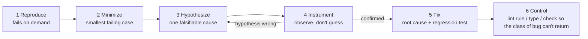

# P6 · Debugging Method in Python: Reproduce → Minimize → Hypothesize → Instrument → Fix

> [!success] 🟢 Junior Explanation
> **In plain words:** Debugging is the scientific method applied to code. **Reproduce** the bug on demand. **Minimize** it to the smallest input and code that still fails. **Hypothesize** one specific cause you can prove wrong. **Instrument** (print, log, debugger) to test that hypothesis. **Fix** the cause, not the symptom, and leave a test so it can never come back.
>
> **Analogy:** A doctor doesn't try random pills until the patient feels better. They reproduce the symptom, narrow it down, form a diagnosis, run a test that could disprove it, then treat.
>
> 🎯 **Fluent means:** you follow the five steps every time, even under pressure, and you know which Python tool fits each step.

Index: [[P0 Prerequisites Index (Python)]] · Prev: [[P5 Reading Unfamiliar Python Code]] · Next: [[P7 Design Basics in Python - Coupling, Interfaces, DI, Layers]]

> [!tip] Why this matters for agent work
> Agents default to "change something, rerun, repeat," which can stumble onto a green test while hiding the root cause. When you direct an agent to debug, you'll give it these exact steps: "first write a failing test that reproduces it, then…" (see [[05 Debugging, Code Review and Codebase Design]]). You can only enforce a method you practice yourself.

---

## 1. The loop



Step 6 isn't in the classic list, but it's the habit that matters most for agent work: **every bug is evidence of a missing control.**

---

## 2. Step 1: Reproduce

Goal: a **single command** that fails reliably. Ideally a pytest test.

- Get the exact input, environment, versions: `uv run python -VV`, `uv pip freeze`, OS, env vars, the data file, the request body.
- Read the traceback **bottom-up**: the last line is the exception, the frame above it is where it was raised, and the first frame in *your* code is usually where to start.
- Turn the report into a failing test **before** touching the code.

```python
# tests/unit/test_regressions.py
def test_issue_42_links_from_second_file_are_missing():
    first = extract_links("https://a.dev")
    second = extract_links("https://a.dev https://b.dev")
    assert second == ["https://a.dev", "https://b.dev"]   # fails: returns ["https://b.dev"]
```

If you can't reproduce it, you can't claim you fixed it. Non-reproducible? Increase observability (logging, `faulthandler`, request IDs) and wait for the next occurrence, or loop until it fails ([[P2 Testing with pytest - Unit, Integration, Doubles, Flakiness#4. Flaky tests and how to make them deterministic]]).

---

## 3. Step 2: Minimize

Shrink until removing anything makes the bug disappear. Smaller case = fewer hypotheses.

| Dimension | How |
|---|---|
| **Input** | Halve the input repeatedly (delta debugging). Hypothesis does this automatically when a property test fails |
| **Code path** | Call the inner function directly instead of through the CLI/HTTP layer |
| **History** | `git bisect run` finds the commit that introduced it (see §4 of [[P3 Git from the CLI - Rebase, Bisect, Worktree, Staging]]) |
| **Environment** | Fresh venv (`uv venv /tmp/clean && ...`); does it still fail? Different Python version? |
| **Dependencies** | Pin back one dependency at a time: `uv add 'httpx==0.27.*'` |

The minimal repro from §2 already tells us a lot: the bug only shows up on the **second call**. That's a strong hint about state.

---

## 4. Step 3: Hypothesize

Write the hypothesis down. It must be **specific** and **falsifiable**.

| Bad | Good |
|---|---|
| "Something's wrong with the cache" | "`extract_links` keeps state between calls; `seen` still contains `https://a.dev` from the first call" |
| "Async is flaky" | "Two tasks interleave at the `await client.head(...)` in `update_stats`, between reading `stats[host]` and writing it back, so one increment is lost" |
| "It's a timezone thing" | "`datetime.now()` is naive; CI runs in UTC, my laptop in CET; the 1-hour offset crosses the cache-expiry boundary" |

Rank several hypotheses by **likelihood × cheapness to test**; test the cheap ones first.

Python suspects worth knowing by heart:

| Symptom | Usual suspects |
|---|---|
| Wrong on 2nd+ call only | Mutable default argument; module-level cache/global; class attribute shared across instances; `lru_cache` on a function returning a mutable object |
| Loop closures all see the last value | Late binding: `lambda: i` in a loop. Fix: `lambda i=i: i` or `functools.partial` |
| `None` where a value was expected | Function missing `return` on one branch; in-place method returns `None` (`list.sort()`, `dict.update()`) |
| Works locally, fails in CI | Env vars, TZ, locale, file ordering (`os.listdir`), CWD-relative paths, Python version, unpinned deps |
| Hangs | Deadlock, blocking call in event loop, waiting on a queue nobody feeds, network without a timeout |
| Slowly growing memory | Unbounded cache, references kept in a global list, task objects never awaited |
| `RuntimeWarning: coroutine ... was never awaited` | Forgot `await` |
| Float off by tiny amount | Binary floating point; use `Decimal` for money, `pytest.approx` for tests |

---

## 5. Step 4: Instrument

Observe the state that would confirm or kill the hypothesis. Pick the lightest tool that answers the question.

### 5.1 Print and log (still underrated)

```python
print(f"{seen=} {id(seen)=}", file=sys.stderr)   # f-string `=` shows name and value
```

```python
import logging
log = logging.getLogger(__name__)
log.debug("checking url=%s attempt=%d", url, attempt)   # lazy formatting; turn on with -v
```

### 5.2 The debugger (`pdb`)

```python
breakpoint()      # stops here; PYTHONBREAKPOINT=0 disables all of them
```

| Command | Does |
|---|---|
| `l` / `ll` | List source around / whole function |
| `n` / `s` / `r` | Next line / step into / run until return |
| `c` | Continue |
| `w`, `u`, `d` | Stack (where), move up/down frames |
| `p expr`, `pp expr` | Print / pretty-print |
| `b file.py:42, cond` | Conditional breakpoint |
| `display expr` | Show expr every time you stop |
| `interact` | Full REPL in the current frame |

```bash
uv run pytest --pdb -x                     # debugger at the first failure, in the failing frame
uv run pytest --trace -k test_issue_42     # debugger at the start of the test
uv run python -m pdb -c continue script.py # post-mortem on crash
uv run python -m pdb -p 12345              # Python 3.14+: attach to a running process (PEP 768)
```

Your editor's debugger (VS Code/PyCharm) is the same thing with a UI. Learn `pdb` anyway: it works over SSH, in containers, and in agent sessions.

### 5.3 Heavier instruments

| Problem | Tool |
|---|---|
| Hang / deadlock | `python -X faulthandler` + `faulthandler.dump_traceback_later(30)`; `py-spy dump --pid PID` (all thread stacks, no restart) |
| Asyncio weirdness | `PYTHONASYNCIODEBUG=1` or `asyncio.run(main(), debug=True)`: logs slow callbacks (blocking calls) and never-awaited coroutines |
| CPU slow | `py-spy record -o profile.svg -- python script.py` (flame graph); `cProfile` |
| Memory growth | `tracemalloc` snapshots diff; `memray` |
| Extra runtime checks | `python -X dev` (enables warnings, asyncio debug, faulthandler) |
| Which code ran | `coverage run -m pytest -k test_x && coverage html` (see executed lines) |

---

## 6. Step 5: Fix (and Step 6: Control)

### 6.1 Worked example, end to end

**Instrument** confirms the hypothesis:

```python
def extract_links(text: str, seen: set[str] = set()) -> list[str]:
    print(f"{id(seen)=} {seen=}", file=sys.stderr)   # same id on every call, not empty on 2nd
    ...
```

Root cause: default argument values are evaluated **once**, when `def` runs. Every call shares the same `set`.

**Fix the cause:**

```python
LINK_RE = re.compile(r"https?://[^\s)\]>\"']+")

def extract_links(text: str) -> list[str]:
    seen: set[str] = set()
    out: list[str] = []
    for url in LINK_RE.findall(text):
        url = url.rstrip(".,;:!?")
        if url not in seen:
            seen.add(url)
            out.append(url)
    return out
```

**Verify:** the regression test from §2 now passes, *and* the full suite passes:

```bash
uv run pytest -q tests/unit/test_regressions.py && uv run pytest -q
```

**Control** so this *class* of bug can't come back anywhere in the codebase: ruff rule `B006` (mutable default argument, from flake8-bugbear) and `B008`.

```toml
[tool.ruff.lint]
select = ["E", "F", "I", "B", "UP", "SIM"]   # "B" includes B006
```

```bash
uv run ruff check   # now fails on any future `def f(x=[])`
```

### 6.2 Fix-quality checklist

- [ ] The regression test **failed before** the fix and **passes after** (run it both ways).
- [ ] The fix addresses the cause you confirmed, not a symptom (no `if url in seen and first_call:` hacks).
- [ ] No unrelated changes in the diff (`git diff --staged` review).
- [ ] Instrumentation removed (`rg "breakpoint\(\)|print_stack|id\(seen\)"`).
- [ ] Commit message states cause and fix: `fix: extract_links shared state via mutable default (B006)`.
- [ ] A control was added or you wrote down why none is possible.

> [!warning] Anti-patterns (yours and the agent's)
> - **Shotgun debugging:** changing five things at once until it passes. You learn nothing and may add bugs.
> - **Fixing the test instead of the code** (changing the expected value to match buggy output).
> - **Catch-and-ignore:** wrapping the failing line in `try/except: pass`.
> - **"Works on my machine"** without explaining the environment difference.
> - **Retry as a fix** for a deterministic error. Retries are for transient failures only.

---

## 7. Drills

| # | Drill | Exit check |
|---|---|---|
| D1 | Plant the mutable-default bug in `linkcheck`; go through all 6 steps; write each step's output in a `debug-log.md` | Log shows hypothesis, evidence, fix, control |
| D2 | Late-binding closure bug: build `[lambda: i for i in range(3)]` style callbacks in a retry scheduler; debug with `pdb` only (no prints) | You used `w`, `u`, `p`, `b` with a condition |
| D3 | Put `time.sleep(2)` in an async handler; find it using only `PYTHONASYNCIODEBUG=1` output | Warning names the slow callback |
| D4 | Write a script with two threads deadlocking on two locks; diagnose with `py-spy dump` | Dump shows both threads waiting on each other's lock |
| D5 | Memory leak: append every result to a module-level list; find it with `tracemalloc` snapshot diff | Top diff line points at the append |
| D6 | Combine with P3: a bug introduced 20 commits ago; minimize history with `git bisect run` | First bad commit found; regression test added |
| D7 | Timezone bug: naive `datetime.now()` compared to an aware timestamp; reproduce with `TZ=UTC` vs `TZ=Asia/Tbilisi` | Fix with aware datetimes + inject a clock |

---

## 8. Self-check

1. Why must the regression test fail *before* the fix?
2. What makes a hypothesis falsifiable? Give one for "the app is slow on Mondays."
3. Name four reasons a function gives a different result on its second call.
4. A production process is hung. How do you see what every thread is doing without restarting it?
5. What does `PYTHONASYNCIODEBUG=1` report?
6. What's the "control" step, and why is it the highest-leverage step when agents write most of your code?

---

## 9. Resources

- David Agans, *Debugging: The 9 Indispensable Rules*.
- Andreas Zeller, *Why Programs Fail* and *The Debugging Book* (debuggingbook.org, Python-based, includes delta debugging).
- Python docs: `pdb`, `faulthandler`, `tracemalloc`, *Python Development Mode*, asyncio *Debug Mode*.
- py-spy (github.com/benfred/py-spy), memray (github.com/bloomberg/memray).
- Ruff rules reference: flake8-bugbear (`B`) rules, each documented with the bug it prevents.

Next: [[P7 Design Basics in Python - Coupling, Interfaces, DI, Layers]]
