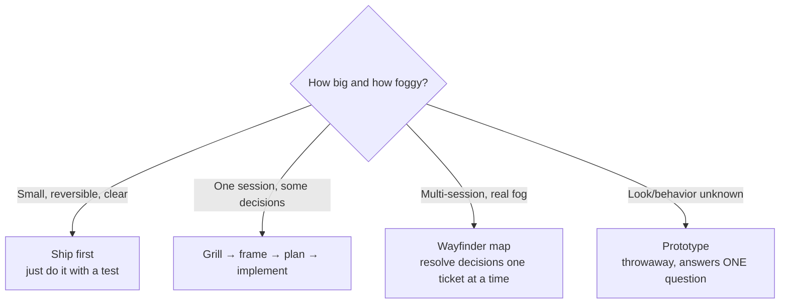
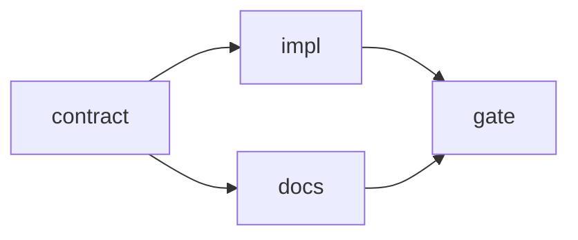

# 03 · Specification, Framing and Planning

> [!success] 🟢 Junior Explanation
> **In plain words:** An agent builds a clear task fast, and it builds an unclear task just as fast. The cost is very different. Before any edit: **frame** the task with evidence from the repo, **plan** it as a dependency graph where each step has proof, and write a **scope contract** that says where the work may and may not land.
>
> **Analogy:** A surgeon marks the incision site, checks the chart, and agrees on what "success" means *before* cutting.
>
> 🎯 **L2 must know:** task frame (6 fields), facts vs assumptions, scope contract, acceptance-before-implementation. · **L3 adds:** evidence-plan DAGs, grilling, tracer bullets, wayfinder maps for foggy work.

Prev: [[02 Context Engineering and Repo Memory]] · Next: [[04 Verification - Tests, Feedback Loops and Gates]] · See also: [[Planning and Task Decomposition]]

---

## 1. Pick the right weight of process



> [!warning] Over-process is also a failure
> Framing a one-line typo fix wastes time. The skill is **matching process weight to uncertainty × blast radius.**

---

## 2. The task frame (6 fields) 🔵

| Field | Question | Must have |
|---|---|---|
| **Goal** | What observable behavior changes? | Behavior, not "edit file X" |
| **Repository facts** | What did you verify? | **Receipt:** `path:line` or command output |
| **Allowed paths** | Where may the change land? | Smallest set of globs |
| **Forbidden paths** | What must not change? | The negative space, stated explicitly |
| **Acceptance evidence** | Which command or observation proves it? | Exact command + the claim it proves |
| **Unknowns** | What isn't decided yet? | Classified (below) |

### Facts need receipts
- ❌ "The API uses 409 for duplicates." *(assumption dressed as fact)*
- ✅ "Duplicate signup returns 409, asserted at `tests/test_accounts.py:44`."

### Classify every unknown
| Class | Meaning | Agent action |
|---|---|---|
| **Discoverable** | The repo or running system can answer it | Investigate, then continue |
| **Decidable** | The contract delegates the choice | Decide, then log it in `assumptions` |
| **Human** | Changes product behavior, cost, risk, public contract | **Pause and ask** before it's buried in code |
| **Deferred** | Outside this slice | Move to non-goals |

### Reconnaissance = searching for constraints (not reading everything)
Look for: current behavior + caller · closest existing test · public contract/serialized shape · governing instructions · build/verify commands · a similar past change (`git log -S`).
**Stop when** every planned decision has evidence, delegated authority, or an explicit unknown.

### Frame as code (validated)
```python
from dataclasses import dataclass, field

@dataclass(frozen=True)
class Fact:
    claim: str
    receipt: str            # "tests/test_accounts.py:44" or "cmd: pytest -k dup → 409"

@dataclass(frozen=True)
class Unknown:
    question: str
    kind: str               # discoverable | decidable | human | deferred

@dataclass(frozen=True)
class TaskFrame:
    goal: str
    facts: tuple[Fact, ...]
    allowed: tuple[str, ...]
    forbidden: tuple[str, ...]
    acceptance: tuple[str, ...]       # exact commands
    unknowns: tuple[Unknown, ...] = field(default=())

    def problems(self) -> list[str]:
        p = []
        if len(self.goal.split()) < 5:
            p.append("goal too vague: state observable behavior")
        p += [f"fact without receipt: {f.claim!r}" for f in self.facts if not f.receipt.strip()]
        if not self.allowed:
            p.append("no allowed paths")
        p += [f"path both allowed and forbidden: {a}"
              for a in self.allowed for f in self.forbidden if a == f or a.startswith(f.rstrip("*"))]
        if not self.acceptance:
            p.append("no acceptance command: 'tests pass' is not a proof plan")
        p += [f"bad unknown kind: {u.kind}" for u in self.unknowns
              if u.kind not in {"discoverable", "decidable", "human", "deferred"}]
        return p

    def ready(self) -> bool:
        return not self.problems() and not any(u.kind == "human" for u in self.unknowns)
```

---

## 3. Grilling: resolve the design tree before coding 🔵

A grilling session is a structured interview (agent asks, you answer) that walks **every branch** of a design decision. Misalignment is the most common agent failure, and grilling is the cheapest fix.

**How to run one**
1. One paragraph: what you want and why.
2. Let it ask; answer precisely. When it offers two terms, **pick one and ban the other** (→ glossary).
3. Push back on fuzzy questions.
4. End by reviewing the glossary/ADR diffs like code.

Prompt skeleton (if you don't use a packaged skill):
```text
Interview me relentlessly about this change until every branch of the design is resolved.
Ask ONE question at a time. For each: offer 2–3 concrete options with trade-offs and your pick.
Challenge any term not in docs/GLOSSARY.md. Do not write code.
When done, output: (1) decisions list, (2) glossary additions, (3) ADR drafts for hard-to-reverse choices,
(4) remaining human unknowns.
Change: <paragraph>
```

---

## 4. From frame to plan: the evidence-backed DAG 🔵

A plan is **not** a to-do list. It is a dependency graph where every node has *evidence* (why this change belongs) and *proof* (what closes it).

### ❌ Weak plan
```
1. Update the API  2. Add tests  3. Update docs
```
No reasons, no order constraints, no proofs, no concurrency information.

### ✅ Strong plan
```json
[
  {"id": "contract", "change": "Define DuplicateEmail error in ErrorEnvelope (code=EMAIL_TAKEN, 409)",
   "evidence": ["app/errors.py:12 envelope shape", "tests/test_errors.py:30"],
   "deps": [], "proof": "pytest tests/test_errors.py -q"},
  {"id": "impl", "change": "Case-insensitive uniqueness check in AccountService.create",
   "evidence": ["app/accounts.py:88 create()", "ADR-0011 emails are case-insensitive"],
   "deps": ["contract"], "proof": "pytest tests/test_accounts.py -k duplicate -q"},
  {"id": "docs", "change": "Document 409 EMAIL_TAKEN in API reference",
   "evidence": ["docs/api/signup.md:40 lists responses"],
   "deps": ["contract"], "proof": "make docs-lint"},
  {"id": "gate", "change": "Integration: full check + scope check",
   "evidence": [], "deps": ["impl", "docs"], "proof": "make check && python scripts/scope_check.py"}
]
```


**Define the shared contract first.** Then the dependents (impl, docs) can run in parallel without inventing conflicting versions.

### Compute execution waves (Kahn's algorithm)
```python
from collections import defaultdict

def execution_waves(items: list[dict]) -> list[list[str]]:
    ids = [i["id"] for i in items]
    if len(ids) != len(set(ids)):
        raise ValueError("duplicate ids")
    known = set(ids)
    indeg = {i: 0 for i in ids}
    children = defaultdict(list)
    for it in items:
        if not it.get("evidence") and it["id"] != "gate":
            raise ValueError(f"{it['id']}: no evidence")
        if not it.get("proof"):
            raise ValueError(f"{it['id']}: no proof")
        for d in it["deps"]:
            if d not in known:
                raise ValueError(f"{it['id']}: unknown dep {d}")
            indeg[it["id"]] += 1
            children[d].append(it["id"])
    waves, ready = [], sorted(i for i, n in indeg.items() if n == 0)
    while ready:
        waves.append(ready)
        nxt = []
        for node in ready:
            for c in children[node]:
                indeg[c] -= 1
                if indeg[c] == 0:
                    nxt.append(c)
        ready = sorted(nxt)
    if sum(map(len, waves)) != len(ids):
        raise ValueError("cycle detected — hidden unresolved decision or bad decomposition")
    return waves   # [['contract'], ['docs', 'impl'], ['gate']]
```

**Validate before executing:** duplicate ids · missing evidence · missing proof · unknown deps · cycles (all mechanical) · **irreversible action before its uncertainty is resolved** (judgment: flag it explicitly).

**Evidence must be able to change the plan.** An existing helper removes a planned abstraction. A compatibility test forces a migration step. If evidence couldn't change any decision, it isn't evidence.

---

## 5. Tracer bullets vs prototypes 🟢

From *The Pragmatic Programmer*:

| | Tracer bullet | Prototype |
|---|---|---|
| Shape | Thin slice through **every layer**, end to end | Explores **one** aspect |
| Fate | **Kept** and thickened | **Thrown away** |
| Use | Ticket decomposition (`/to-tickets` style) | "How should this look/behave?" |

```
 UI ──┬───────────────     Tracer: one real request crosses UI→API→domain→DB,
 API ─┼───────────────     with a test at each seam. Then widen.
 Dom ─┼───────────────
 DB ──┘                    ❌ Horizontal slicing: "all DB first, then all API..."
                              → nothing works end to end until the end.
```

Spec flow that works well with agents 🔵: **idea → grill → spec (on tracker) → tracer-bullet tickets with blocking edges → implement each with TDD → review.**

---

## 6. Scope contracts: make "stay in scope" a check 🔵

```json
{
  "task_id": "T-142",
  "goal": "POST /signup rejects duplicate emails (case-insensitive) with 409 EMAIL_TAKEN",
  "allowed_files": ["app/accounts.py", "app/errors.py", "tests/test_accounts.py",
                    "tests/test_errors.py", "docs/api/signup.md"],
  "forbidden_files": ["migrations/**", "scripts/**", ".github/**", "app/auth/**"],
  "acceptance": ["pytest tests/test_accounts.py tests/test_errors.py -q", "make check"],
  "rollback_plan": "git revert the T-142 merge commit; no data migration involved.",
  "approvals_required": ["new dependency", "schema migration", "any change under app/auth"],
  "time_budget_minutes": 60,
  "network_egress": [],
  "severity": {"docs/**": "warn", "default": "block"}
}
```

| Field | Why |
|---|---|
| `forbidden_files` | **Half the contract.** Without the negative space it's incomplete |
| Globs, not paths | Survive refactors between sessions |
| `rollback_plan` | If you can't write one, don't approve the task |
| Severity by path family | `docs/**` warn; `scripts/**`, `migrations/**`, `config/prod/**` always block |
| Time + network budgets | Scope has more dimensions than files |

### Scope checker (correct `**` handling)
`fnmatch` lets `*` cross `/`, which is wrong for paths. Use a real glob → regex:

```python
import json, re, subprocess, sys
from functools import lru_cache

@lru_cache(maxsize=None)
def glob_re(glob: str) -> re.Pattern:
    i, out = 0, []
    while i < len(glob):
        if glob.startswith("**/", i):   out.append("(?:.*/)?"); i += 3
        elif glob.startswith("**", i):  out.append(".*");       i += 2
        elif glob[i] == "*":            out.append("[^/]*");    i += 1
        elif glob[i] == "?":            out.append("[^/]");     i += 1
        else:                           out.append(re.escape(glob[i])); i += 1
    return re.compile("^" + "".join(out) + "$")

def matches(path: str, globs: list[str]) -> bool:
    return any(glob_re(g).match(path) for g in globs)

def changed_files(base: str) -> list[str]:
    tracked = subprocess.run(["git", "diff", "--name-only", f"{base}...HEAD"],
                             capture_output=True, text=True, check=True).stdout.split()
    staged = subprocess.run(["git", "diff", "--name-only", "HEAD"],
                            capture_output=True, text=True, check=True).stdout.split()
    untracked = subprocess.run(["git", "ls-files", "--others", "--exclude-standard"],
                               capture_output=True, text=True, check=True).stdout.split()
    return sorted(set(tracked + staged + untracked))

def scope_check(contract: dict, files: list[str]) -> list[dict]:
    findings = []
    for f in files:
        if matches(f, contract["forbidden_files"]):
            findings.append({"file": f, "code": "FORBIDDEN_WRITE", "severity": "block"})
        elif not matches(f, contract["allowed_files"]):
            sev = next((s for g, s in contract.get("severity", {}).items()
                        if g != "default" and glob_re(g).match(f)),
                       contract.get("severity", {}).get("default", "block"))
            findings.append({"file": f, "code": "OFF_SCOPE", "severity": sev})
    return findings

if __name__ == "__main__":
    contract = json.load(open(sys.argv[1]))
    findings = scope_check(contract, changed_files(sys.argv[2] if len(sys.argv) > 2 else "main"))
    print(json.dumps(findings, indent=2))
    sys.exit(1 if any(f["severity"] == "block" for f in findings) else 0)
```

**Multi-contract merge = least privilege:** intersect `allowed`, union `forbidden`, take the min time budget, accumulate approvals. Network egress: `None` defers, lists intersect, `[]` (deny-all) sticks.

---

## 7. Project-level scope: the feature list 🔵

A contract bounds one *task*. Nothing in it stops the agent from deciding the project also needs dark mode. Add a project-level queue:

```json
{
  "active": "import-pdf",
  "features": [
    {"id": "import-pdf", "status": "in_progress", "goal": "Import a PDF into the library",
     "done_when": "pytest tests/test_import.py -q && sample PDF visible in library view"},
    {"id": "full-text-search", "status": "todo", "goal": "Search text, ranked with snippets",
     "done_when": "query returns ranked results with snippets"}
  ]
}
```
Invariants (checked at startup): **at most one `in_progress`**. The agent never starts a second feature in a session. The handoff flips `in_progress → done`.

---

## 8. Wayfinder: maps for work that won't fit one session 🟠

For greenfield work or huge features with real fog (from `mattpocock/skills`):

| Term | Meaning |
|---|---|
| Destination | What the end looks like (spec, decision, change). Fixes scope |
| Map | One issue: index of decisions (Destination · Notes · Decisions so far · Not yet specified · Out of scope) |
| Ticket | One question, sized to one ~100k-token session |
| Frontier | Open, unblocked, unclaimed tickets |
| Fog | Questions you can sense but not yet phrase → "Not yet specified" |

Ticket types: **Grilling** (human in loop) · **Research** (agent alone, external facts) · **Prototype** (human reacts to an artifact) · **Task** (manual work, record resulting facts).
Rule: **plan, don't do.** The urge to start building means you've hit the edge of the map. One ticket per session; when one resolves, any fog it made specifiable becomes a new ticket.

---

## 9. Exercises (Project P3, first half)

1. Frame a real bug from your repo **without proposing a solution.** Then find one "fact" that's actually an assumption and replace it with a receipt.
2. Add a **human** unknown whose answer would change the public contract. Ask it before coding.
3. Turn the frame into a plan JSON. Run `execution_waves`. Deliberately add a cycle and explain the hidden product disagreement behind it.
4. Write the scope contract. Run the agent. Run `scope_check.py` against the diff. Did it creep?
5. Decompose a 1-week feature into tracer-bullet tickets with blocking edges.

## 10. Mastery check

- [ ] My frames fit on one screen, and every fact has a receipt.
- [ ] I write the acceptance command **before** the implementation.
- [ ] My plans are DAGs; I can say which items run in parallel and why.
- [ ] Scope violations are caught by a script, not by me noticing.

> [!quote] Takeaway
> The first unit of reliable agent work is not an edit. It's a task frame backed by evidence.
