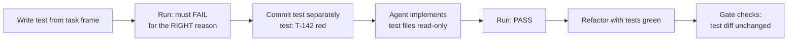

# 04 · Verification: Tests, Feedback Loops and Gates

> [!success] 🟢 Junior Explanation
> **In plain words:** The agent doesn't get to mark its own work done. Every command it runs gets captured (real output, real exit code). A deterministic **gate** reads those records plus the diff and says pass or fail. Tests come first, and the agent can't quietly weaken them. Checks run automatically through hooks, so nobody has to remember.
>
> **Analogy:** A factory inspection station. Parts don't ship because the machine says they're fine. They ship because they passed the gauge.
>
> 🎯 **L2 must know:** feedback records, the "no exit code, no progress" rule, verification gate, hooks, TDD with protected tests. · **L3 adds:** defense in depth, mutation testing, property tests, custom lint rules, ratchets, frontend verification.

Prev: [[03 Specification, Framing and Planning]] · Next: [[05 Debugging, Code Review and Codebase Design]]

---

## 1. The enforcement hierarchy (strongest first) 🟢

```
  1. Make it UNREPRESENTABLE   types, branded IDs, discriminated unions, no `any`
  2. Make it FAIL FAST         lint rules, boundary rules, tests, hooks
  3. Make it GET CAUGHT        verification gate, reviewer agent standards
  4. WRITE IT DOWN             a sentence in a doc  ← weakest, last resort
```
**Push every rule as far up this list as it can go.** A mechanical rule that lives in prose is a bug in your environment.

```typescript
// Level 1 in practice: a UserId can't be confused with an OrderId
type Brand<T, B extends string> = T & { readonly __brand: B };
type UserId = Brand<string, "UserId">;
type OrderId = Brand<string, "OrderId">;
const asUserId = (s: string): UserId => { if (!/^usr_/.test(s)) throw new Error("bad UserId"); return s as UserId; };
function refund(order: OrderId, by: UserId) { /* ... */ }
// refund(userId, orderId)  ← compile error. The agent physically can't make this mistake.
```

---

## 2. Runtime feedback: facts, not predictions 🔵

**Failure:** "Running tests now… all tests pass." Nothing ran, or the failure line got truncated away.
**Fix:** every command goes through a runner that writes a structured record. The agent reads records; the gate reads records.

| Field | Why |
|---|---|
| `command_id`, `parent_command_id` | Retry chains stay visible (retries can't masquerade as first-try passes) |
| `argv`, `cwd` | Exact command, no shell surprises |
| `exit_code` | **The** success signal. `null` ⇒ loop must not advance |
| `stdout_tail`, `stderr_tail` | Deterministic head+tail truncation; errors live at the tail |
| `duration_ms`, `started_at` | Slow probes, replay |
| `agent_note` | What the agent *expected*. The gap between that and reality is the signal |

```python
import json, os, re, subprocess, time, uuid
from datetime import datetime, timezone
from pathlib import Path

LOG = Path(".agent/feedback.jsonl")
HEAD, TAIL = 20, 80
MAX_LOG_BYTES = 1_000_000
SECRETS = [re.compile(p) for p in (
    r"(?i)bearer\s+[A-Za-z0-9._\-]+",
    r"(?i)(password|passwd|api[_-]?key|secret|token)\s*[=:]\s*\S+",
    r"AKIA[0-9A-Z]{16}",
    r"xox[baprs]-[A-Za-z0-9-]+",
    r"sk-[A-Za-z0-9_\-]{20,}",
)]

def _text(x) -> str:
    return x.decode("utf-8", "replace") if isinstance(x, bytes) else (x or "")

def redact(text: str) -> str:            # redact at WRITE time: the file is what leaks
    for pat in SECRETS:
        text = pat.sub("[REDACTED]", text)
    return text

def truncate(text: str) -> str:          # deterministic: same input → same record
    lines = text.splitlines()
    if len(lines) <= HEAD + TAIL:
        return text
    cut = len(lines) - HEAD - TAIL
    return "\n".join(lines[:HEAD] + [f"... truncated {cut} lines ..."] + lines[-TAIL:])

def _rotate() -> None:
    if LOG.exists() and LOG.stat().st_size > MAX_LOG_BYTES:
        for i in range(4, 0, -1):
            src = LOG.with_suffix(f".jsonl.{i}")
            if src.exists():
                src.replace(LOG.with_suffix(f".jsonl.{i + 1}"))
        LOG.replace(LOG.with_suffix(".jsonl.1"))

def run_with_feedback(argv: list[str], note: str, timeout_s: int = 600,
                      parent_id: str | None = None) -> dict:
    base = {"command_id": uuid.uuid4().hex[:12], "parent_command_id": parent_id,
            "argv": argv, "cwd": os.getcwd(), "agent_note": note,
            "started_at": datetime.now(timezone.utc).isoformat()}
    t0 = time.perf_counter()
    try:
        p = subprocess.run(argv, capture_output=True, text=True, timeout=timeout_s)
        outcome = {"exit_code": p.returncode, "error": None,
                   "stdout_tail": truncate(redact(p.stdout)),
                   "stderr_tail": truncate(redact(p.stderr))}
    except subprocess.TimeoutExpired as e:
        outcome = {"exit_code": None, "error": f"timeout after {timeout_s}s",
                   "stdout_tail": truncate(redact(_text(e.stdout))),
                   "stderr_tail": truncate(redact(_text(e.stderr)))}
    except OSError as e:
        outcome = {"exit_code": None, "error": f"{type(e).__name__}: {e}",
                   "stdout_tail": "", "stderr_tail": ""}
    record = {**base, **outcome, "duration_ms": round((time.perf_counter() - t0) * 1000)}
    LOG.parent.mkdir(parents=True, exist_ok=True)
    _rotate()
    with LOG.open("a", encoding="utf-8") as f:
        f.write(json.dumps(record) + "\n")
    return record
```

Feedback ≠ telemetry: **feedback** is for the next turn of *this* run (small, local). **Telemetry** (OTel GenAI conventions, Langfuse/Phoenix) is for operators looking across runs. Different files, different retention.

---

## 3. TDD with agents: tests are the spec, so protect them 🟢🔵

TDD matters *more* with agents: a failing test is an unambiguous, machine-checkable goal.



**Failure F4 (test tampering):** under pressure to go green, agents will sometimes loosen an assertion, add `skip`/`xfail`, special-case the test input, or delete the test. Defenses:

1. **Commit the red test first**, separately. The implementer's diff should not touch it.
2. **Mark test paths forbidden** in the implementation task's scope contract.
3. **Gate-level tamper detector** (below).
4. **Reviewer checks** for special-casing (`if input == "test@example.com"`).

```python
import re, subprocess

SKIP_MARKERS = re.compile(r"(@pytest\.mark\.(skip|xfail)|\b(it|test|describe)\.(skip|only)\(|\bxit\(|t\.Skip\()")

def test_tamper_findings(base: str, test_globs=("tests/", "test_", "_test.", ".spec.", ".test.")) -> list[dict]:
    diff = subprocess.run(["git", "diff", "-U0", f"{base}...HEAD"], capture_output=True,
                          text=True, check=True).stdout
    findings, current, removed_asserts, added_asserts = [], None, 0, 0
    for line in diff.splitlines():
        if line.startswith("+++ b/"):
            current = line[6:]
            continue
        if not current or not any(g in current for g in test_globs):
            continue
        if line.startswith("+") and not line.startswith("+++"):
            if SKIP_MARKERS.search(line):
                findings.append({"file": current, "code": "TEST_SKIP_ADDED", "severity": "block"})
            added_asserts += "assert" in line or "expect(" in line
        elif line.startswith("-") and not line.startswith("---"):
            removed_asserts += "assert" in line or "expect(" in line
    if removed_asserts > added_asserts:
        findings.append({"file": "*tests*", "code": "ASSERTIONS_REMOVED",
                         "severity": "block", "detail": f"-{removed_asserts}/+{added_asserts}"})
    return findings
```

**Property-based tests** 🟢 catch the edge cases agents forget (empty, unicode, huge, negative):
```python
from hypothesis import given, strategies as st
from app.slug import slugify

@given(st.text())
def test_slugify_is_idempotent_and_url_safe(s):
    out = slugify(s)
    assert slugify(out) == out
    assert all(c.isalnum() or c == "-" for c in out)
```

---

## 4. The verification gate 🔵

A **pure, deterministic function** over artifacts → one verdict. No LLM judge (that's the reviewer's job, Module 05).

| Check | Source | Severity |
|---|---|---|
| Every acceptance command ran | feedback.jsonl | block |
| Latest run of each acceptance command exited 0 | feedback.jsonl | block |
| No `null` exit codes | feedback.jsonl | block |
| No forbidden writes | scope findings | block |
| Off-scope writes | scope findings | block / warn per path family |
| No test tampering | tamper findings | block |
| Coverage ≥ floor and not down > 1pt vs base | coverage report | block |
| Block-severity rules pass | rule report | block |

```python
import json
from pathlib import Path

def load_feedback(path=Path(".agent/feedback.jsonl")) -> list[dict]:
    if not path.exists():
        return []
    return [json.loads(l) for l in path.read_text().splitlines() if l.strip()]

def verify(task_id: str, contract: dict, feedback: list[dict],
           scope_findings: list[dict], tamper_findings: list[dict],
           coverage: float | None = None, base_coverage: float | None = None,
           floor: float = 80.0, strict: bool = False) -> dict:
    findings: list[dict] = []
    latest = {}
    for rec in feedback:                                   # later records win
        latest[" ".join(rec["argv"])] = rec
    for cmd in contract["acceptance"]:
        rec = latest.get(cmd)
        if rec is None:
            findings.append({"code": "ACCEPTANCE_NOT_RUN", "detail": cmd, "severity": "block"})
        elif rec["exit_code"] != 0:
            findings.append({"code": "ACCEPTANCE_FAILED", "detail": f"{cmd} → {rec['exit_code']}",
                             "severity": "block"})
    findings += [{"code": "NULL_EXIT", "detail": " ".join(r["argv"]), "severity": "block"}
                 for r in feedback if r["exit_code"] is None]
    findings += scope_findings + tamper_findings
    if coverage is not None:
        if coverage < floor:
            findings.append({"code": "COVERAGE_BELOW_FLOOR", "detail": f"{coverage:.1f} < {floor}", "severity": "block"})
        if base_coverage is not None and coverage < base_coverage - 1.0:
            findings.append({"code": "COVERAGE_DROPPED", "detail": f"{base_coverage:.1f} → {coverage:.1f}", "severity": "block"})
    if strict:                                             # release branches, post-incident
        findings = [{**f, "severity": "block"} for f in findings]
    passed = not any(f["severity"] == "block" for f in findings)
    report = {"task_id": task_id, "passed": passed, "findings": findings}
    out = Path(f".agent/verification/{task_id}.json")      # ONE path, CI reads the same file
    out.parent.mkdir(parents=True, exist_ok=True)
    out.write_text(json.dumps(report, indent=2) + "\n")
    return report
```

**Note:** the gate checks that commands *ran through the runner*. For agents that use their own Bash tool, the runner in CI reruns the acceptance commands itself. **Re-execution beats trusting logs** for the final gate.

**Overrides:** only a human can override, with a signed row in `overrides.jsonl` (finding code, reason, user, HEAD sha, timestamp). No Slack-thread overrides.

---

## 5. Hooks: enforcement the agent can't forget 🔵

Claude Code hooks are shell commands that run at lifecycle events and receive JSON on stdin. Exit code **2** = block, and stderr goes back to the model. (Other harnesses have equivalents. Check current docs; names and fields evolve.)

| Event | Exit 2 does | Use for |
|---|---|---|
| `PreToolUse` | Blocks the tool call | Scope guard, dangerous-command guard |
| `PostToolUse` | Feeds stderr to the model (tool already ran) | Format + lint the edited file |
| `Stop` | Blocks stopping, so the model must continue | "Not done until `make check` is green" |
| `SessionStart` | — (adds context) | Run `init_agent.py`, inject state summary |
| `UserPromptSubmit` | Can block the prompt | Inject task context, block secrets in prompts |

`.claude/settings.json` (committed):
```json
{
  "hooks": {
    "PreToolUse": [
      { "matcher": "Edit|Write|MultiEdit",
        "hooks": [{ "type": "command", "command": "python3 \"$CLAUDE_PROJECT_DIR\"/.claude/hooks/scope_guard.py" }] }
    ],
    "PostToolUse": [
      { "matcher": "Edit|Write|MultiEdit",
        "hooks": [{ "type": "command", "command": "\"$CLAUDE_PROJECT_DIR\"/.claude/hooks/format_file.sh" }] }
    ],
    "Stop": [
      { "hooks": [{ "type": "command", "command": "\"$CLAUDE_PROJECT_DIR\"/.claude/hooks/stop_guard.sh" }] }
    ]
  }
}
```

`scope_guard.py`:
```python
#!/usr/bin/env python3
import json, os, sys
from pathlib import Path

ROOT = Path(os.environ.get("CLAUDE_PROJECT_DIR", ".")).resolve()
sys.path.insert(0, str(ROOT / "scripts"))
from scope_check import matches            # the glob matcher from Module 03

event = json.load(sys.stdin)
target = event.get("tool_input", {}).get("file_path")
contract_file = ROOT / ".agent/scope_contract.json"
if not target or not contract_file.exists():
    sys.exit(0)
rel = os.path.relpath(Path(target).resolve(), ROOT)
c = json.loads(contract_file.read_text())
if matches(rel, c["forbidden_files"]):
    print(f"BLOCKED: '{rel}' is forbidden by scope contract {c['task_id']}. "
          "Do not work around this. If the change is truly required, add it to "
          ".agent/state.json blockers and stop for human approval.", file=sys.stderr)
    sys.exit(2)
if not matches(rel, c["allowed_files"]):
    print(f"BLOCKED: '{rel}' is outside allowed_files for {c['task_id']}: {c['allowed_files']}. "
          "Find an in-scope approach or record a blocker.", file=sys.stderr)
    sys.exit(2)
sys.exit(0)
```

`format_file.sh` (PostToolUse; reads the path from stdin JSON):
```bash
#!/usr/bin/env bash
f=$(jq -r '.tool_input.file_path // empty')
[ -z "$f" ] && exit 0
case "$f" in
  *.py)           ruff format "$f" >/dev/null && ruff check --fix "$f" 1>&2 || exit 2 ;;
  *.ts|*.tsx|*.js) npx prettier --write "$f" >/dev/null && npx eslint "$f" 1>&2 || exit 2 ;;
esac
exit 0
```

`stop_guard.sh`:
```bash
#!/usr/bin/env bash
input=$(cat)
# Loop guard: if we already forced one continuation, let it stop (and let the gate catch it).
[ "$(echo "$input" | jq -r '.stop_hook_active')" = "true" ] && exit 0
cd "$CLAUDE_PROJECT_DIR" || exit 0
if ! out=$(make check 2>&1); then
  { echo "make check is failing — you are not done. Last output:"; echo "$out" | tail -n 40; } >&2
  exit 2
fi
exit 0
```

> [!warning] Hooks are a layer, not a wall
> A `PreToolUse` guard on `Edit|Write` doesn't see `sed -i` or `echo > file` run through Bash. That's why you need **defense in depth**:
> `PreToolUse guard → PostToolUse lint → Stop gate → pre-commit hook → CI verification gate (re-executes) → branch protection`.
> Each layer is deterministic. Each catches what the previous one missed.

---

## 6. Fast feedback = agent speed limit 🟢

Feedback rate is the agent's speed limit. Slow checks get skipped, time out, or burn context.

| Technique | Example |
|---|---|
| Per-edit: format + lint *one file* | PostToolUse hook |
| Related tests only during iteration | `vitest related <file>`, `jest --findRelatedTests`, `pytest --testmon`, Nx/Turbo `affected` |
| Incremental types | `tsc --incremental`, project references; `mypy` daemon (`dmypy`) |
| Full suite on Stop + CI only | Stop hook, CI |
| Parallelize + cache | `pytest -n auto`, CI caches |
| **Print per-step durations** | So the retro can find the slow step |

Target: **per-edit < 5s · related tests < 30s · full check < 3 min.**

---

## 7. Custom lint rules: turn retro findings into checks 🔵

When the same mechanical mistake shows up twice, write a rule. **The error message is a prompt**: say exactly what to do instead. Agents are good at writing these rules. Give them a failing fixture and a passing one.

```javascript
// eslint-rules/no-fetch-in-domain.js  (ESLint v9 flat config)
export default {
  meta: {
    type: "problem",
    messages: { noFetch: "Domain code must call the injected HttpClient seam (src/ports/http.ts), not fetch()." },
    schema: [],
  },
  create(context) {
    if (!context.filename.includes("/src/domain/")) return {};
    return {
      CallExpression(node) {
        if (node.callee.type === "Identifier" && node.callee.name === "fetch") {
          context.report({ node, messageId: "noFetch" });
        }
      },
    };
  },
};
```
```javascript
// eslint.config.js
import noFetchInDomain from "./eslint-rules/no-fetch-in-domain.js";
export default [
  { plugins: { local: { rules: { "no-fetch-in-domain": noFetchInDomain } } },
    rules: { "local/no-fetch-in-domain": "error" } },
];
```
Python equivalents: `ruff` banned-api (`flake8-tidy-imports`), `import-linter` contracts, small AST checks in `scripts/`.

---

## 8. Mutation testing: do the tests actually catch bugs? 🟢 (as agent gate: 🟠)

Coverage shows code *ran*. Mutation testing shows the tests *would notice if it were wrong*. Tools flip `>` to `>=`, `+` to `-`, empty a block, and rerun the tests.

$$\text{mutation score} = \frac{\text{killed mutants}}{\text{total mutants}} \times 100$$

| Stack | Tool | Typical command |
|---|---|---|
| JS/TS | StrykerJS | `npx stryker run --incremental` |
| Python | mutmut | `mutmut run && mutmut results` |
| JVM | PIT | `mvn org.pitest:pitest-maven:mutationCoverage` |
| Rust | cargo-mutants | `cargo mutants` |

Practice: incremental on PRs for **critical domain modules only**, full run nightly, a break threshold in CI, don't chase 100% (equivalent mutants exist). **A surviving mutant is a perfect agent ticket:** *"Write a test that kills mutant #37 in `pricing.py:88` (`>` → `>=`)."*

---

## 9. Ratchets: adopt strict rules on legacy code 🔵

A metric that may only move one way. CI fails if a PR makes it worse; improvements become the new baseline.

```bash
#!/usr/bin/env bash
# scripts/ratchet.sh <metric-name> <command-that-prints-a-number>
set -euo pipefail
name=$1; shift
baseline_file=".ratchet/$name"
current=$("$@")
baseline=$(cat "$baseline_file" 2>/dev/null || echo "$current")
if [ "$current" -gt "$baseline" ]; then
  echo "RATCHET FAIL [$name]: $baseline → $current (must not increase)" >&2; exit 1
fi
if [ "$current" -lt "$baseline" ] && [ "${GITHUB_REF_NAME:-}" = "main" ]; then
  echo "$current" > "$baseline_file"   # tighten only on main; commit via bot
  echo "ratchet tightened [$name]: $baseline → $current"
fi
```
```bash
scripts/ratchet.sh eslint-warnings sh -c "npx eslint . -f json | jq '[.[].warningCount]|add'"
scripts/ratchet.sh any-count       sh -c "rg -c ': any\b' src | awk -F: '{s+=\$2} END{print s+0}'"
```
Ratchets give agents a safe, endless supply of improvement tickets.

---

## 10. Verifying frontends: give the agent eyes 🔵

Types and unit tests miss what users see. Minimum: browser automation (Playwright or a browser MCP), E2E tests for critical flows, visual snapshots at key breakpoints, `axe` accessibility checks, and **zero console errors**.

```typescript
import { test, expect } from "@playwright/test";

test("signup rejects short password with accessible error", async ({ page }) => {
  const consoleErrors: string[] = [];
  page.on("console", (m) => m.type() === "error" && consoleErrors.push(m.text()));
  await page.goto("/signup");
  await page.getByLabel("Email").fill("a@b.co");
  await page.getByLabel("Password").fill("short");
  await page.getByRole("button", { name: "Create account" }).click();
  await expect(page.getByRole("alert")).toHaveText(/at least 8 characters/i);
  await expect(page).toHaveScreenshot("signup-short-password.png");   // visual regression
  expect(consoleErrors).toEqual([]);
});
```

---

## 11. Exercises (P3 second half + P6)

1. Wire `make check` (or `npm run check`) into a **Stop hook**. Watch the agent get forced to continue on red.
2. Add the **scope guard** PreToolUse hook. Then try to get around it with `sed -i` through Bash. Confirm the CI gate still catches it.
3. Route a full task through `run_with_feedback` and `verify()`. Produce a `.agent/verification/T-xxx.json` with `passed: true`.
4. **Seed tampering:** ask the agent to "make the failing test pass" with test files writable. Did it tamper? Does your detector catch it?
5. Run mutation testing on one domain module. Hand three survivors to the agent as tickets. Rerun.
6. Write one custom lint rule from a real retro finding, with failing and passing fixtures.
7. Add one ratchet to CI.

## 12. Mastery check

- [ ] No "done" claim in my workflow is accepted without a captured exit code.
- [ ] The final gate re-executes acceptance commands and checks scope + test tampering.
- [ ] I can explain why hooks alone aren't enough (defense in depth).
- [ ] My full check runs in < 3 minutes, with per-step timing.
- [ ] I've turned at least one prose rule into a type, lint rule, or test, and deleted the prose.

> [!quote] Takeaway
> The agent can't bribe a deterministic gate. Make "done" a check it can't fake.
