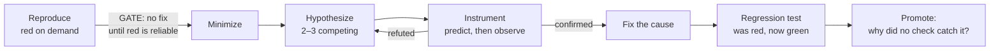

# 05 · Debugging, Code Review and Codebase Design

> [!success] 🟢 Junior Explanation
> **In plain words:** Three L3 skills. (1) **Debug with a loop, not with guesses:** reproduce first, then fix. (2) **Review with a separate role** that sees only the diff and the spec, never the builder's reasoning. (3) **Shape the codebase so agents succeed:** deep modules, clean seams, boundaries enforced by tools. Agents speed up entropy, so design matters *more*, not less.
>
> 🎯 **L3 must know:** repro-first gate, builder/reviewer separation, two-axis review, AI-code smell list, deep modules, seams. · **Operator adds:** calibrated judges, specialist reviewer pools, architecture surveys on a schedule.

Prev: [[04 Verification - Tests, Feedback Loops and Gates]] · Next: [[06 Delegation, Parallelism and Handoff]]

---

# Part A: Debugging with agents

## A1. The gated debug loop 🟢



**Failure F8 (goal loss / fix thrash):** without a reproduction, agents "fix" symptoms, retry variants, and declare victory when the error message changes. The repro gate kills this.

### ❌ Bad
```text
The checkout sometimes fails with a 500. Fix it.
```

### ✅ Good
```text
Bug: POST /checkout returns 500 ~5% of the time in staging (Sentry issue #8812, trace attached).
Step 1 ONLY: build a reproduction that fails reliably (≥ 9/10 runs). A script or test, no fix yet.
  Suggested angle: concurrent checkouts on the same cart (logs show overlapping request ids).
Report the repro command and its output via run_with_feedback. Stop there.
Step 2 (next turn, after I confirm): list 2–3 competing hypotheses, each with a prediction
  you can observe by adding temporary logging. Instrument, observe, eliminate.
Step 3: fix the cause, keep the repro as a regression test, remove temporary logging.
Rules: no try/except that hides the error; no retries as a fix; redact secrets from pasted logs.
Stop rule: if no reproduction after 3 approaches, stop and write what you learned to state.blockers.
```

### Debugging accelerators
| Technique | Agent-friendly because |
|---|---|
| `git bisect run ./repro.sh` | Fully mechanical. Agents excel at it |
| Minimal failing input (delta debugging) | Shrinks context |
| Competing hypotheses with explicit predictions | Avoids anchoring on the first idea |
| Differential testing (old vs new impl) | Deterministic oracle |
| Read-only prod data (logs, traces, replica) | Avoids guessing |

```bash
git bisect start HEAD v2.3.0
git bisect run sh -c 'pytest tests/test_checkout_race.py -q -x || exit 1'
git bisect reset
```

---

# Part B: Code review: separate the builder from the marker

## B1. Three review layers 🟢

| Layer | Who | Catches | Cost |
|---|---|---|---|
| Automated checks | Types, lint, tests, gate | Mechanical errors, every time | Cheapest |
| Automated review | Reviewer agent + standards + spec | Smells, spec drift, scope creep, wrong problem | Moderate |
| Human review | You | Direction, risk, taste, one-way doors | Most expensive: **spend by merge-danger** |

Push every rule as far up this table as it can go.

## B2. Why the builder can't grade itself 🔵

The builder carries the most context pressure (exploring, debugging, its own rationalizations) and is invested in its own plan. The reviewer gets **only**: the diff since a fixed point, the originating spec, the standards file, and the gate report. **Different system prompt, different inputs, no write access.** Same model is fine. Role separation is what matters.

## B3. Two-axis review 🔵

Run two reviewers **in parallel, in separate contexts**, and present the results side by side. **Don't merge or re-rank them.** A change can pass one axis and fail the other.

| Axis | Question | Input |
|---|---|---|
| **Standards** | Does it follow the repo's documented standards plus a smell baseline? | Diff + `CODING_STANDARDS.md` |
| **Spec** | Does it implement the originating issue? What's missing, what's scope creep, what looks done but is wrong? | Diff + spec/issue |

## B4. Reviewer rubric (0–2 per dimension) 🔵

| Dimension | 0 | 2 |
|---|---|---|
| Problem fit | Solves an adjacent problem | Solves the task as stated |
| Scope discipline | Unflagged creep | Confined, or contract grown deliberately |
| Assumptions | Hidden | All written and reviewable |
| Verification quality | Acceptance proves a weaker claim | Acceptance proves the goal |
| Handoff readiness | Next session must rediscover | Resumable from artifacts alone |

Total /10: **< 7 soft fail** (findings back to builder) · **< 5 or any 0 = hard fail** (halt, human).

Reviewer prompt skeleton:
```text
You are a REVIEWER. You cannot edit code. You receive: the diff (git diff <base>...HEAD),
the spec (issue #N), CODING_STANDARDS.md, and the verification report.
For each rubric dimension: score 0–2, cite file:line evidence, state the single most important finding.
Then list findings as {severity: block|warn|info, file, line, problem, suggested_fix}.
Do not re-check what the verification report already proves (tests ran, scope held).
Focus on: wrong problem, special-cased tests, silent fallbacks, duplicated helpers, hallucinated APIs,
security (injection, authz, secrets), and anything that looks implemented but isn't.
Output JSON matching review_report.schema.json.
```

## B5. The AI-generated code smell list 🔵

Beyond Fowler's classic smells, agent code has its own recurring failures:

| Smell | Example | Fix |
|---|---|---|
| **Silent fallback** | `except Exception: return []` | Let it raise, or handle a *specific* exception and log context |
| **Special-cased test input** | `if email == "test@example.com": ...` | Hard fail in review; tamper gate |
| **Hallucinated API** | `requests.get(url, retries=3)` (no such kwarg) | Types + doc retrieval + run it |
| **Slopsquatting risk** | Imports a plausible but nonexistent package | Lockfile review; new dependency = approval boundary |
| **Duplicate helper** | New `format_date()` next to existing `utils/dates.py` | Navigation map; reviewer greps for similar names |
| **Speculative generality** | Strategy pattern + factory for one implementation | Delete until a second real case appears |
| **Over-commenting** | `# increment i by 1` | Comments explain *why*, never *what* |
| **Defensive noise** | `if x is not None and x is not None` / redundant checks | Simplify; trust types |
| **Mock-everything tests** | Test asserts mocks were called, never real behavior | Test through the interface; fakes over mocks |
| **Wrong-layer fix** | Patch in the UI for a domain bug | Fix where the invariant lives |
| **Dead scaffolding** | Unused params, TODO stubs, leftover debug prints | Lint (`unused`), review |

### ❌ Bad (agent-typical)
```python
def get_user_orders(user_id):
    try:
        resp = db.query(f"SELECT * FROM orders WHERE user_id = {user_id}")   # SQL injection
        return resp or []
    except Exception:
        return []                                                         # hides DB outages
```
### ✅ Good
```python
def get_user_orders(user_id: UserId) -> list[Order]:
    rows = db.execute("SELECT id, total_cents, status FROM orders WHERE user_id = %s", (user_id,))
    return [Order.from_row(r) for r in rows]      # DB errors propagate to the handler's error boundary
```

## B6. Calibrate the reviewer, or it's vibes 🟠

LLM judges have documented biases: **position** (prefers the first or second option), **verbosity** (prefers longer), **self-preference** (prefers its own model family), **authority** (over-trusts cited names). Mitigations: evaluate both orderings, reward concision explicitly, rotate model families, strip author names.

**Calibration set:** 10–20 historical PRs with known verdicts (good merges, reverted merges, seeded flaws). Rerun on every reviewer prompt change. **< 80% agreement → fix the rubric before trusting it.**

**Seeded-flaw drill (Project P5):** a branch with 1 standards violation + 1 smell + 1 missing requirement + 1 scope creep + 1 special-cased test. Score how many the reviewer catches.

## B7. Scaling: specialist pools 🟠
At scale, split into specialists (security, performance, docs, release) running on cheaper models, plus a coordinator (strongest model) that de-duplicates and judges severity. Only worth the complexity when a single reviewer measurably misses classes of issues.

---

# Part C: Codebase design for agents

## C1. Why design matters more with agents 🟢

Agents only see a window. A codebase where understanding one concept means bouncing across 12 files guarantees partial understanding and duplicate helpers. A codebase of **deep modules behind small interfaces** lets an agent load one interface and act correctly.

## C2. Vocabulary (Ousterhout + Feathers)

| Term | Meaning |
|---|---|
| **Deep module** | Lots of behavior behind a small interface (Unix file I/O: `open/read/write/close`) |
| **Shallow module** | Interface nearly as complex as the implementation. Costs more than it saves |
| **Seam** | A place where behavior can change without editing there |
| **Enabling point** | Where you choose which behavior runs (constructor / composition root) |
| **Adapter** | An implementation plugged in at a seam |
| **Leverage** | What a caller gets per unit of interface learned |
| **Locality** | Related logic and its bugs live together |

Principles: **the interface is the test surface** · **one adapter = hypothetical seam; two = real seam** · **deletion test:** would deleting this module concentrate complexity (good module) or just move it around (shallow)?

### Shallow-module red flags
Pass-through methods · many tiny files per concept ("classitis") · pure functions extracted "for testability" while the bugs live in the wiring · the same decision encoded in two places (information leakage) · getter/setter clutter.

## C3. Seams & adapters in practice
```typescript
export interface PaymentGateway {
  charge(cents: number, customer: CustomerId): Promise<ChargeResult>;
}

export class Checkout {
  constructor(private readonly gateway: PaymentGateway) {}   // enabling point
  async pay(cart: Cart): Promise<Receipt> { /* domain logic, no SDK imports */ }
}

// composition root (production):  new Checkout(new StripeGateway(stripeClient))
// tests:                           new Checkout(new FakeGateway({ failOn: "card_declined" }))
```
Two adapters (Stripe + Fake) make this a real seam. The agent can now test `Checkout` in milliseconds with no network.

## C4. Rescuing legacy code (Feathers) 🟢
*Legacy code = code without tests.* The dilemma: you need tests to change it safely, and you need to change it to add tests.

1. One `check` command, even if it tests little.
2. Find **hot spots**: `git log --format= --name-only --since=6.months | sort | uniq -c | sort -rn | head -20`
3. **Characterization tests**: pin current behavior, right or wrong. (Agents are great at generating these. Review them for "asserts the bug" and label those.)
4. Break dependencies: **extract interface**, **parameterize constructor**, **sprout method/class** (new tested code called from the old), **wrap method**.
5. Deepen the module, then move to the next hot spot.

## C5. Enforce boundaries with tools 🟢
A boundary in a doc is advice; a boundary in CI is a brake.

| Stack | Tool |
|---|---|
| TS/JS | `dependency-cruiser`, `eslint-plugin-boundaries`, `no-restricted-imports`, package `exports` maps |
| Python | `import-linter` |
| JVM | ArchUnit |
| Go | `internal/` packages |

```ini
# .importlinter
[importlinter]
root_package = app

[importlinter:contract:layers]
name = Domain must not depend on infrastructure
type = layers
layers =
    app.api
    app.services
    app.domain

[importlinter:contract:no-internals]
name = Only import billing via its public API
type = forbidden
source_modules = app.api
forbidden_modules = app.billing.internal
```

## C6. Architecture survey on a schedule 🔵
Run an architecture-improvement pass (e.g., `/improve-codebase-architecture`) every few days: it reads the glossary + ADRs, finds friction in hot spots, and proposes deepening candidates (files, problem, solution, before/after, strength). **You pick one**, grill it, and turn it into a spec → tracer tickets. Refactors suit agents well: the **existing tests are the acceptance criteria.**

---

## Exercises (P4, P5, P7)

1. **P4 Bug hunt:** take a real bug. Enforce the repro gate. Measure turns-to-fix vs your last unguided fix.
2. Use `git bisect run` with an agent-written repro script.
3. **P5 Reviewer:** build the seeded-flaw branch. Run two-axis review. Tighten `CODING_STANDARDS.md` and rerun. Build a 10-item calibration set.
4. Find the 3 worst shallow modules in your hot spots (deletion test). Write one ADR on the deepening you choose.
5. **P7 Legacy:** add characterization tests to one hot spot, deepen it, and add one enforced boundary contract.

## Mastery check

- [ ] I never accept a bug fix without a test that was red before the fix.
- [ ] My reviewer runs in a separate context, is calibrated (≥ 80%), and its report starts human review.
- [ ] I can name a deep and a shallow module in my codebase and defend both labels.
- [ ] At least one architectural boundary fails CI when violated.

> [!quote] Takeaway
> Reproduce before you fix. Review with a different role. Design so that one interface is enough context.
