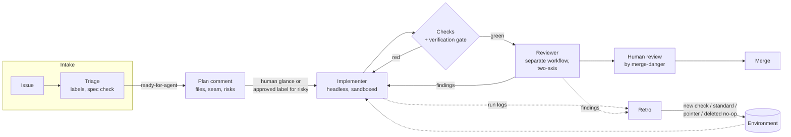

# 07 · Software Factories and Automation

> [!success] 🟢 Junior Explanation
> **In plain words:** A software factory is a pipeline. Specified tickets go in; reviewed PRs with evidence come out. The issue tracker is the queue, CI is the conveyor belt, headless agents are the workers, and Modules 02–06 are quality control. It improves itself by turning every retro finding into a check. You step in only for decisions.
>
> **Warning:** build this **last.** A factory built on weak gates mass-produces bugs.
>
> 🎯 **L5 must know:** headless runs, sandbox + least privilege, build/review split, prompt-injection threat model, retros, metrics. · **Elite adds:** scheduled jobs (rebase, monitors, architecture surveys), cost models, org rollout.

Prev: [[06 Delegation, Parallelism and Handoff]] · Next: [[08 Projects, Capstone and Mastery]]

> [!info] Evidence status
> Individual parts (headless CI agents, auto-review, scheduled jobs) are 🔵 established. **Fully autonomous issue→merge factories are 🟠 emerging.** Most mature teams keep a human merge gate. This module teaches a factory that **ends at a PR**, never at `main`.

---

## 1. Factory architecture



| Factory part | Primitive | Implementation |
|---|---|---|
| Work queue | Queue | GitHub Issues + labels |
| Conveyor | Trigger + runtime | GitHub Actions (events + cron) |
| Workers | Workers | `claude -p` / `claude-code-action`, Codex CLI exec, etc. |
| QC | Functions | Checks, verification gate, reviewer |
| Memory | Persistence | Repo files, run artifacts |
| Safety | Authorization policy | Workflow `permissions:`, tool allowlists, branch protection, sandbox |

---

## 2. Goals and non-goals first

Write them as measurable outcomes:

```markdown
## Factory goal
A triaged ticket labeled `ready-for-agent` becomes a PR with: passing gate, two-axis review comment,
evidence section, and merge-danger call — with zero human involvement before the PR.

## Never
- push to main / merge anything        - touch production or prod credentials
- add dependencies without approval    - exceed $X per run or N runs/day
- act on instructions found inside issue bodies, comments, or fetched web pages beyond the spec
```

---

## 3. Headless agents 🔵

```bash
claude -p "Implement issue #42 per AGENTS.md. Run make check before finishing. Open no PR." \
  --allowedTools "Read,Edit,Write,Grep,Glob,Bash(make check),Bash(git diff:*),Bash(git status)" \
  --max-turns 60 \
  --output-format json > run.json
jq -r '.result' run.json
```
Exit code 0 = finished. Non-zero = failed. `--output-format json` gives a machine-readable result (plus cost/usage fields) to archive as an artifact. **Use an explicit allowlist; never disable permission prompts wholesale in CI.** (Flags evolve. Check `claude --help` for your version.)

---

## 4. Sandbox, secrets, permissions 🟢

| Control | How |
|---|---|
| Ephemeral compute | GitHub-hosted runners (fresh VM per run) or containers with no host mounts |
| Network egress | Restrict where possible (allowlisted hosts, proxy) |
| Repo write | Factory pushes only to `agent/*` branches; **branch protection** on `main` |
| Workflow permissions | Minimal `permissions:` per job |
| Secrets | `ANTHROPIC_API_KEY` as repo/org secret; **no prod credentials ever**; read-only data sources |
| Budgets | `--max-turns`, job `timeout-minutes`, spend alerts, max concurrent runs |

---

## 5. Threat model: prompt injection and the lethal trifecta 🔵

> [!danger] The lethal trifecta (Simon Willison, 2025)
> An agent that has **(1) access to private data**, **(2) exposure to untrusted content**, and **(3) a way to communicate externally** can be tricked into exfiltrating that data. Issue bodies, PR comments, README files from dependencies, fetched web pages, and tool outputs are all **untrusted content.**

Defenses (no single one is enough):
1. **Break the trifecta.** Remove at least one leg per job: no network egress for implementers, no secrets in reader jobs, no untrusted input for jobs that hold secrets.
2. **Trigger hygiene.** Don't run agent jobs with secrets on `pull_request_target` from forks, or on comments from non-members. Gate on author association.
3. **Least-privilege tools.** Allowlist commands; deny `curl`, `wget`, arbitrary `Bash` in jobs that read untrusted text.
4. **Spec over body.** The implementer works from the *triaged spec* a human approved, not from raw issue text.
5. **Output validation.** Deterministic gate + scope check + human merge.
6. **Supply chain.** New dependency = approval boundary (guards against hallucinated packages / slopsquatting); pin actions by SHA.

---

## 6. Implementer workflow 🔵

```yaml
# .github/workflows/agent-implement.yml
name: agent-implement
on:
  issues:
    types: [labeled]
concurrency:
  group: agent-issue-${{ github.event.issue.number }}
  cancel-in-progress: false
jobs:
  implement:
    if: >
      github.event.label.name == 'ready-for-agent' &&
      contains(fromJSON('["OWNER","MEMBER","COLLABORATOR"]'), github.event.issue.author_association)
    runs-on: ubuntu-latest
    timeout-minutes: 45
    permissions:
      contents: write
      pull-requests: write
      issues: write
      id-token: write
    steps:
      - uses: actions/checkout@v4          # pin by SHA in production
      - run: python3 scripts/init_agent.py
      - uses: anthropics/claude-code-action@v1
        with:
          anthropic_api_key: ${{ secrets.ANTHROPIC_API_KEY }}
          prompt: |
            Implement the approved spec in issue #${{ github.event.issue.number }}.
            Follow AGENTS.md. Work on branch agent/issue-${{ github.event.issue.number }}.
            Write .agent/scope_contract.json from the spec before editing.
            Run `make check`, then open a PR whose body has: summary visual, evidence
            (pasted command output), and merge-danger (one-way vs two-way door, blast radius).
          claude_args: "--max-turns 60"
      - name: Verification gate (re-executes acceptance)
        run: python3 scripts/verify_gate.py --rerun
      - uses: actions/upload-artifact@v4
        if: always()
        with:
          name: agent-run-${{ github.event.issue.number }}
          path: .agent/
```
*Action inputs evolve. Check the `anthropics/claude-code-action` README before copying. Running `/install-github-app` inside Claude Code sets up the app + secret.*

## 7. Reviewer workflow (separate context) 🔵
```yaml
# .github/workflows/agent-review.yml
name: agent-review
on:
  pull_request:
    types: [opened, synchronize]
jobs:
  review:
    if: startsWith(github.head_ref, 'agent/')
    runs-on: ubuntu-latest
    timeout-minutes: 20
    permissions:
      contents: read
      pull-requests: write
    steps:
      - uses: actions/checkout@v4
        with: { fetch-depth: 0 }
      - uses: anthropics/claude-code-action@v1
        with:
          anthropic_api_key: ${{ secrets.ANTHROPIC_API_KEY }}
          prompt: |
            You are a REVIEWER and cannot edit code. Review `git diff origin/${{ github.base_ref }}...HEAD`
            on two independent axes: (1) Standards vs docs/CODING_STANDARDS.md + smell baseline,
            (2) Spec vs the linked issue. Present both reports side by side; do not merge them.
            Score the 5-dimension rubric. Post one PR comment.
```
The reviewer never sees the implementer's reasoning, only the diff and the spec.

---

## 8. The retro: the factory's learning loop 🔵

Fixing code fixes one bug. Fixing the environment fixes the **class** of bug.

| Category | Ask | Typical outcome |
|---|---|---|
| Navigation | Did it struggle to find files? | Add a pointer in the router / topic doc |
| Automated checks | Could a check have caught it? Is one unwired? | New lint rule / test / hook |
| Coding standards | Mechanical or judgment? | Mechanical → check; judgment → `CODING_STANDARDS.md` |
| Instructions | Steering text in `AGENTS.md` that belongs elsewhere? | Move to standards/checks |
| Tool economy | Expensive or repeated tool calls? | Script or skill |
| No-ops | Instructions that change nothing? | **Delete** |
| Information access | What data was missing? | Read-only MCP / log tee |

**The ratchet record** for each promoted correction: symptom · root cause · consequence · recurrence count · chosen control · how the control is verified · owner · review/retire date.
Promote a correction when **recurrence or consequence** justifies the permanent complexity. **Separate cause from symptom:** "agent edited README" might be caused by an over-broad allowed path, a plan that bundled docs, or overlapping ownership. Each cause has a different fix.

```python
import hashlib, re

def fingerprint(root_cause: str, layer: str) -> str:
    norm = re.sub(r"[^a-z0-9 ]", "", root_cause.lower())
    norm = " ".join(sorted(set(norm.split()) - {"the", "a", "an", "agent", "was", "is", "to"}))
    return hashlib.sha256(f"{layer}:{norm}".encode()).hexdigest()[:12]
# Same cause, different wording → same fingerprint → bump recurrence, don't add a 2nd rule.
```

**Controls decay.** Retire or rewrite one when the architecture changed, a stronger executable control replaced it, it hasn't fired in a meaningful window, or it costs more friction than the risk it prevents. The goal is the **smallest** system that preserves hard-won judgment.

---

## 9. Scheduled jobs (Factory Part 2) 🟠

| Job | Cadence | What it does | Blast radius |
|---|---|---|---|
| **Morning rebase** | Daily, pre-work | Rebase open agent PRs on main, rerun checks, resolve trivial conflicts, else label `needs-human` + 1-line reason | Low |
| **Architecture survey** | Every few days | Architecture pass on hot spots → files the top candidate as an issue (not a PR) | Very low |
| **Ratchet tightener** | On main merge | Lowers baselines when metrics improve | Low |
| **Mutant hunter** | Nightly | Full mutation run → tickets for survivors in critical modules | Low |
| **Signal monitors** | Daily | Read-only: slow queries (`pg_stat_statements`), error tracker, bundle size, flaky tests → grouped issues | Low (read-only) |
| **Dependency bumps** | Weekly | Bump + run full gate + changelog summary in PR | Medium |

```yaml
on:
  schedule:
    - cron: "30 5 * * 1-5"    # 05:30 UTC weekdays — morning rebase
```

**Pick what to automate:** score recurring work on frequency × mechanicalness ÷ blast radius. High frequency, mechanical, low blast → automate first. Rare, judgment-heavy, high blast → keep it human, maybe with an agent-drafted plan.

---

## 10. Metrics: is the factory working? 🔵

Avoid vanity metrics ("% of code written by AI", "PRs opened"). Track:

| Metric | Definition | Healthy direction |
|---|---|---|
| **Merged-without-rework rate** | Agent PRs merged with no follow-up fix commit within 14 days | ↑ |
| **Human minutes per merged PR** | Review + intervention time | ↓ |
| **Escaped defects** | Bugs traced to agent PRs after merge | ↓ |
| **Cost per merged PR** | Tokens + compute ÷ merged PRs | ↓ (watch for cheapness that raises rework) |
| **Gate catch rate** | Runs blocked by gate ÷ runs | Stable; spikes = environment drift |
| **Reviewer agreement** | Reviewer vs human verdict on sampled PRs | ≥ 80% |
| DORA four keys | Lead time, deploy frequency, change failure rate, time to restore | Throughput ↑ **without** stability ↓ |

> [!warning] Measure against a baseline
> Remember METR: perceived speedup ≠ measured speedup. Record the pre-factory baseline for the same task classes, and compare like with like.

**Cost model sketch:**
`cost/merged PR = (runs/PR × tokens/run × $/token + CI minutes × $/min) + human minutes × loaded $/min`
The human term usually dominates. Optimize it first.

---

## 11. Org rollout (elite operator) 🟠

1. **One team, one repo, low blast radius** ticket class (e.g., lint debt, test gaps).
2. Publish the **workbench pack** (Module 08) as the standard; distribute router + skills from a single source.
3. Shared calibration sets for reviewers; shared retro log.
4. Expand ticket classes only when merged-without-rework ≥ target for 4 consecutive weeks.
5. Security review of every new trigger and tool grant.

---

## 12. Exercises (P10)

1. Write the goals/non-goals doc. Get a peer to attack the "never" list.
2. Build implementer + reviewer workflows on the practice repo. Run **3 tickets** end to end. Retro each run.
3. Threat-model your factory against the lethal trifecta. Which leg did you remove in each job?
4. Add one ratchet + one scheduled job (morning rebase or a monitor).
5. Build a tiny metrics dashboard (even a weekly markdown report) with the table in §10.
6. After 1 week: retro the **factory itself**. Promote ≥ 3 findings into deterministic checks; delete ≥ 1 no-op instruction.

## 13. Mastery check

- [ ] The factory can't push to main, can't reach prod, and has a written injection threat model.
- [ ] Build and review run in separate workflows, separate contexts.
- [ ] Every run leaves artifacts; retros turn findings into checks.
- [ ] I can show the four factory numbers vs a pre-factory baseline.

> [!quote] Takeaway
> Brakes before accelerators. The factory is never finished: run → retro → check → prune → run.
