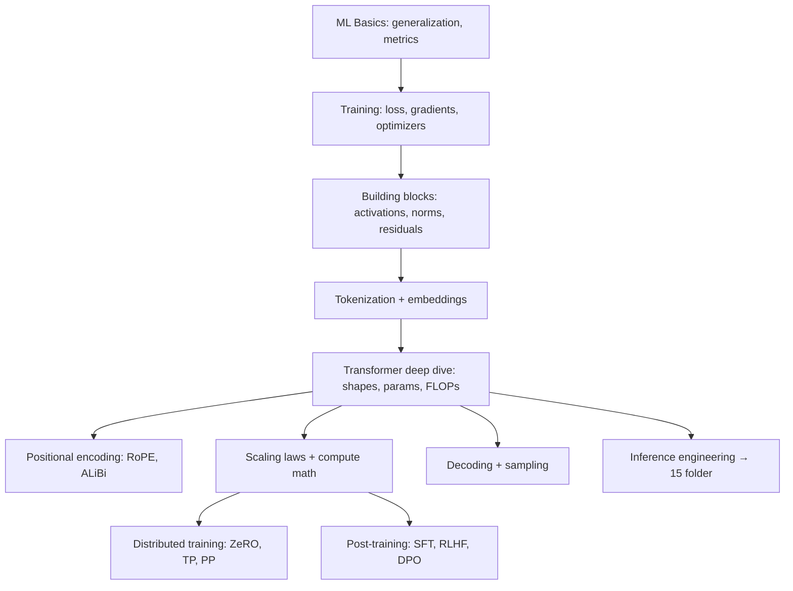

# ML Foundations Roadmap (LLM Internals + ML/DL Intuition)

> [!success] 🟢 Junior Explanation
> **In plain words:** The "ML foundation round" asks how models learn and how a transformer works inside. You don't need research-level math — you need **intuition + a few formulas** you can derive on a whiteboard.
>
> **Why interviewers ask:** People who only know APIs can't debug why a model is slow, unstable, or expensive. Foundations show you can.
>
> **Say it in one sentence:** "I can explain how a model learns (loss → gradient → optimizer), what a transformer layer computes, how big it is (params, FLOPs, memory), and how it's trained and post-trained."

## Map

## Notes
| # | Note | You'll be able to… |
|---|---|---|
| 1 | [[ML Basics - Learning, Generalization and Metrics]] | explain overfitting, bias–variance, leakage, precision/recall |
| 2 | [[Training Fundamentals - Loss, Gradients, Optimizers]] | derive softmax + cross-entropy gradient, explain Adam, LR schedules |
| 3 | [[Neural Network Building Blocks]] | justify GELU/SwiGLU, LayerNorm/RMSNorm, residuals, init |
| 4 | [[Tokenization and Embeddings Internals]] | run BPE by hand, reason about vocab size trade-offs |
| 5 | [[Transformer Architecture Deep Dive]] | count parameters, FLOPs, KV bytes of Llama-style models |
| 6 | [[Positional Encodings - RoPE, ALiBi and Long Context]] | explain RoPE rotation and why models fail past training length |
| 7 | [[Pretraining - Scaling Laws and Compute Math]] | use 6ND and Chinchilla ≈20 tokens/param |
| 8 | [[Distributed Training - Memory, ZeRO and Parallelism]] | compute 16 bytes/param and ZeRO stages |
| 9 | [[Post-Training - SFT, RLHF and DPO]] | derive why DPO removes the reward model |
| 10 | [[Decoding and Sampling]] | implement temperature/top-k/top-p |
| 11 | [[LLM Math Cheat Sheet]] | recall every formula in one page |
| 12 | [[LLM Internals and ML Foundations Q&A]] | answer 50+ rapid-fire questions |

Related: [[Gap Analysis - What Was Missing]] · [[Attention]] · [[KV Cache]]
