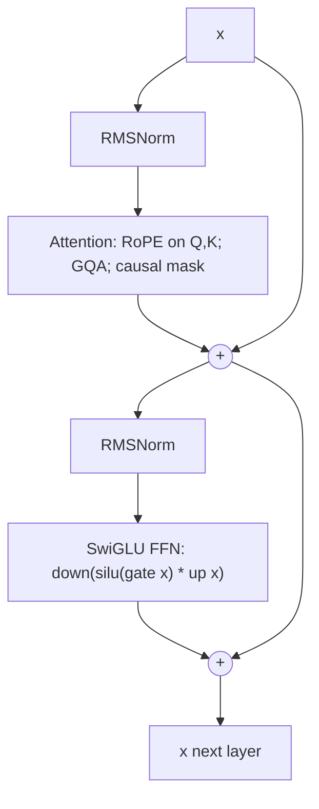

# Neural Network Building Blocks

> [!success] 🟢 Junior Explanation
> **In plain words:** A deep network stacks simple blocks: linear layers (matrix multiply), a non-linearity (so it can learn curves), normalization (keeps numbers tame), and residual connections (a shortcut so signals and gradients flow through many layers).
>
> **Analogy:** A relay race with a shortcut lane: each runner (layer) adds a little, but the baton can also skip ahead (residual).
>
> **Say it in one sentence:** "Modern LLM blocks use pre-norm RMSNorm, attention and a gated SwiGLU feed-forward, each wrapped in a residual connection."
>
> 🎯 **Junior must know:** why non-linearity and residuals. · **Middle adds:** RMSNorm vs LayerNorm, pre vs post-norm, SwiGLU shape math.

## 1. Why non-linearity
Stacking linear layers is still linear ($W_2W_1x=Wx$). A non-linear activation between them lets networks approximate arbitrary functions.

| Activation | Formula | Notes |
|---|---|---|
| ReLU | $\max(0,x)$ | Simple; "dead ReLU" risk |
| GELU | $x\,\Phi(x)$ | Smooth; GPT/BERT-era FFN |
| SiLU/Swish | $x\,\sigma(x)$ | Smooth, used inside SwiGLU |
| **SwiGLU** | $\text{down}\big(\text{SiLU}(\text{gate}(x))\odot\text{up}(x)\big)$ | Gated FFN in Llama-style models `[WEB]` |

### SwiGLU feed-forward and its size
Classic FFN: 2 matrices ($d\to 4d\to d$) = $8d^2$ params. SwiGLU has **3** matrices (gate, up, down), so to keep parameters similar the hidden size is shrunk to ≈ $\tfrac{8}{3}d$ (rounded) → $3\cdot d\cdot\tfrac{8}{3}d=8d^2$ `[GEN]`. Real configs vary: Llama 3 8B uses $d=4096$, $d_{ff}=14336$ (~3.5d) — check each model's config.

## 2. Normalization
| | LayerNorm | **RMSNorm** |
|---|---|---|
| Formula | $\frac{x-\mu}{\sigma}\gamma+\beta$ | $\frac{x}{\text{RMS}(x)}\gamma$, $\text{RMS}=\sqrt{\tfrac1d\sum x_i^2}$ |
| Subtract mean? | Yes | **No** |
| Bias β? | Yes | No |
| Cost | Higher | Cheaper, similarly stable |
Llama-style models use RMSNorm `[WEB]`.

### Pre-norm vs post-norm
- **Post-norm** (original Transformer): `x = Norm(x + Sublayer(x))` — harder to train deep stacks.
- **Pre-norm**: `x = x + Sublayer(Norm(x))` — the residual path stays clean → more stable; used by modern LLMs `[WEB]`.

## 3. Residual connections
$$x_{l+1}=x_l+F(x_l)$$
Gradients flow through the identity path → trains 100+ layers. View: the residual stream is a shared "bus" each layer reads from and writes to `[GEN]`.

## 4. A Llama-style decoder block (diagram)

## 5. Initialization
Keep variance of activations/gradients roughly constant: Xavier (tanh-like), He (ReLU-like); small init scale for residual output projections in deep nets `[GEN]`. Bad init → vanishing/exploding signals.

## 6. Dropout & friends
Dropout randomly zeros activations in training; large-data LLM pretraining typically uses little or none, since data ≫ parameters-per-epoch overfitting risk `[GEN]`.

## 7. Embedding & output head
Token embedding table $V\times d$; output projection $d\times V$ (often **tied** to the embedding in small models, untied in Llama 3 8B → counts twice in params) → [[Transformer Architecture Deep Dive]].

> [!question] Recall
> 1. Why can't we stack linear layers without activations?
> 2. RMSNorm vs LayerNorm — what is dropped and why is that OK?
> 3. Pre-norm vs post-norm and why pre-norm trains deeper nets.
> 4. Compute SwiGLU params for $d=4096$, $d_{ff}=14336$. (= 176.2M)

**Sources:** [LLaMA architecture primer](https://aman.ai/primers/ai/LLaMA/) · [Llama 2/3 deep dive](https://www.besthub.dev/articles/llama-2-3-deep-dive-architecture-innovations-rmsnorm-rope-gqa-and-post-training-pipeline-995d217b577e) · [Open model architecture walkthroughs](https://learn.traeai.com/t/ai-engineering/phases/10-llms-from-scratch/14-open-models-architecture-walkthroughs.html)

Related: [[Training Fundamentals - Loss, Gradients, Optimizers]] · [[Attention]]
