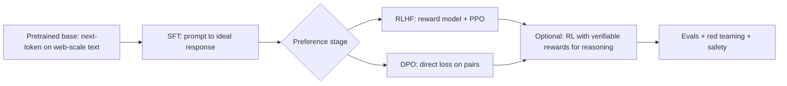

# Post-Training — SFT, RLHF and DPO

> [!success] 🟢 Junior Explanation
> **In plain words:** A pretrained model just continues text. **Post-training** turns it into a helpful assistant: first show it good examples (**SFT**), then teach it human preferences ("answer A is better than B") with **RLHF** or the simpler **DPO**.
>
> **Analogy:** Pretraining = reading every book. SFT = apprenticeship with model answers. RLHF/DPO = a mentor ranking your drafts so you learn taste.
>
> **Say it in one sentence:** "SFT teaches the format on demonstrations; RLHF trains a reward model on preference pairs and optimizes the policy against it with a KL leash; DPO folds that into a single classification-style loss on the pairs, no reward model or RL loop."
>
> 🎯 **Junior must know:** pretrain → SFT → preference tuning. · **Middle adds:** KL penalty, Bradley–Terry, DPO derivation, trade-offs.

## 1. Pipeline

## 2. SFT (supervised fine-tuning) `[GEN]`
Train with cross-entropy on (prompt → ideal response) pairs; **mask the loss to response tokens** (don't learn to generate the prompt). Teaches format, tone, instruction following. Quality ≫ quantity; can be full FT or LoRA/QLoRA → [[Fine-Tuning and LoRA]]. Limitation: only imitates; can't express "A is better than B".

## 3. RLHF `[WEB]`
1. **Collect preferences:** for prompt $x$, humans (or AI) pick winner $y_w$ over loser $y_l$.
2. **Reward model** $r_\phi(x,y)$ trained with **Bradley–Terry** cross-entropy:
$$\mathcal{L}_{RM}=-\log\sigma\big(r_\phi(x,y_w)-r_\phi(x,y_l)\big)$$
3. **Policy optimization** (PPO): maximize reward **minus a KL penalty** to the reference (SFT) model:
$$\max_\pi\ \mathbb{E}\big[r_\phi(x,y)\big]-\beta\,\mathrm{KL}\big(\pi(\cdot|x)\,\|\,\pi_{ref}(\cdot|x)\big)$$
The KL leash prevents **reward hacking** (drifting into gibberish that fools the reward model).
Cost: **4 models in memory** (policy, reference, reward, value/critic), RL instability, heavy engineering.

## 4. DPO (Direct Preference Optimization) `[WEB]`
Key insight: the KL-regularized objective has a closed-form optimal policy
$$\pi^*(y|x)=\tfrac1{Z(x)}\pi_{ref}(y|x)\,e^{r(x,y)/\beta}\ \Rightarrow\ r(x,y)=\beta\log\frac{\pi^*(y|x)}{\pi_{ref}(y|x)}+\beta\log Z(x)$$
Plug into Bradley–Terry: the **$Z(x)$ terms cancel** in the difference, giving a loss on the policy only:
$$\mathcal{L}_{DPO}=-\mathbb{E}\Big[\log\sigma\Big(\beta\Big[\log\tfrac{\pi_\theta(y_w|x)}{\pi_{ref}(y_w|x)}-\log\tfrac{\pi_\theta(y_l|x)}{\pi_{ref}(y_l|x)}\Big]\Big)\Big]$$
- **β** plays the role of the KL coefficient — how far the model may move from reference.
- "The policy is secretly the reward model."
- No reward model, no sampling loop → **2 models** (policy + frozen reference), simple supervised-style training.
- Reported to match or beat PPO-RLHF on sentiment control, summarization, single-turn dialogue (2023-era benchmarks).

| | RLHF (PPO) | DPO |
|---|---|---|
| Models in memory | policy, ref, reward, critic | policy, ref |
| Online sampling | Yes (expensive) | No (offline pairs) |
| Stability | Finicky | Stable, simple |
| Flexibility | Can optimize any reward, on-policy exploration | Limited to the preference data distribution |
| Typical use | Frontier labs, reasoning/safety RL | Open-source alignment, fast iteration |

## 5. Beyond (general knowledge `[GEN]`)
- **RL with verifiable rewards** (math answer correct, code passes tests) — scale reasoning; algorithms like **GRPO** drop the critic by comparing samples in a group. → [[Test-Time Compute]]
- **RLAIF / Constitutional AI:** AI-generated preferences guided by written principles.
- **Safety/red teaming** and refusal tuning → [[AI Red Teaming and LLM Watermarking]].
- **Distillation** from stronger models → [[Model Distillation]].

## 6. Failure modes
| Problem | Description |
|---|---|
| Reward hacking | Optimizing proxy reward degrades true quality (verbosity, sycophancy) |
| Over-optimization | Too little KL → distribution drift |
| Length bias | Preference data favors longer answers → verbose models |
| Alignment tax | Slight capability regressions vs base |
| Data quality | Noisy/biased labels leak into behavior |

> [!question] Recall
> 1. Write the DPO loss and explain what β does.
> 2. Why does $Z(x)$ cancel?
> 3. Why does RLHF need a KL term?
> 4. Memory: models needed for PPO-RLHF vs DPO?

**Sources:** [DPO explained](https://www.zeroentropy.dev/concepts/dpo/) · [PPO vs DPO](https://metricgate.com/blogs/ppo-vs-dpo-rlhf-alignment/) · [DPO paper summary](https://theorempath.com/papers/direct-preference-optimization) · [DPO (Machine Learning at Scale)](https://www.machinelearningatscale.com/blog/dpo-direct-preference-optimization-explained)

Related: [[Pretraining - Scaling Laws and Compute Math]] · [[Fine-Tuning and LoRA]] · [[Evaluation - LLM and Agent]]
