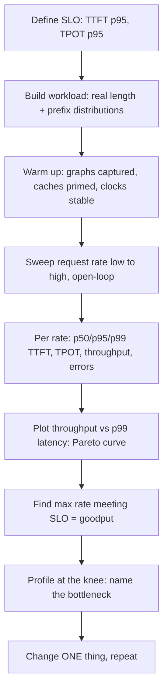

# Benchmarking and Profiling Methodology

> [!success] 🟢 Junior Explanation
> **In plain words:** "It's fast on my laptop" means nothing. Good benchmarking uses **realistic traffic**, measures **latency percentiles** (not averages), and sweeps load to find the **sweet spot** between throughput and latency. Profiling then tells you **why** it's slow: waiting on memory, math, GPU-to-GPU communication, or CPU overhead.
>
> **Analogy:** Testing a restaurant at realistic dinner rush with real orders — not one customer at 3pm.
>
> **Say it in one sentence:** "I run an open-loop load test with production-like prompt/output distributions, sweep request rate, report p50/p95/p99 TTFT and TPOT plus goodput under SLO, then profile the saturation point to name the bottleneck."
>
> 🎯 **Junior must know:** percentiles, realistic load. · **Middle adds:** open vs closed loop, goodput, MBU/MFU, profiling workflow, common pitfalls.

## 1. Metrics `[OS]` `[WEB]`
| Metric | Meaning |
|---|---|
| **TTFT** | request → first token |
| **TPOT / ITL** | time per output token / inter-token latency after the first |
| **E2E latency** | request → last token = TTFT + (n_out−1)·TPOT |
| **Throughput** | output (and input) tokens/s across all requests |
| **Goodput** | request rate **that meets the SLO** (e.g. TTFT<500 ms **and** TPOT<50 ms) per GPU — DistServe's objective `[WEB]` |
| Utilization | **MFU** (compute), **MBU** (bandwidth), KV-cache usage %, queue depth |
Report **p50/p95/p99** (tail latency drives UX) `[SDH]`. Throughput without an SLO is misleading → [[Latency and Cost Metrics]].

## 2. Load generation
| Mode | How | Pitfall |
|---|---|---|
| **Closed-loop** | Fixed concurrency; next request after previous returns | **Hides queueing**: when the server slows, it sends fewer requests ("coordination omission") — latencies look better than reality |
| **Open-loop** | Requests arrive at a fixed rate (**Poisson**) regardless of responses | Reveals saturation and queue growth ← use for SLO testing |
Also needed: realistic **input/output length distributions** (production logs or ShareGPT-style), realistic **prefix sharing** (system prompts → prefix cache hit rate), mix of streaming/non-streaming, correct **sampling params**, representative **concurrency**. Tools: `vllm bench serve` (random/ShareGPT/prefix datasets, request-rate control), NVIDIA GenAI-Perf, custom Locust/k6 scripts.

## 3. Method

Rules: **change one variable**, pin versions (engine, driver, CUDA, model, tokenizer), run ≥3 repeats and report variance, discard warm-up, keep GPU clocks/power fixed, test **cold-cache and warm-cache** separately, include **failures/timeouts** in results.

## 4. Reading the curve
| Observation | Interpretation |
|---|---|
| TTFT blows up first | Prefill/queueing bound → chunking, more prefill capacity, PD disaggregation |
| TPOT rises with load | Decode/KV bandwidth bound or batch too large → reduce max batch tokens, quantize KV, GQA |
| Throughput plateaus, GPU idle gaps | CPU/launch/scheduler overhead → CUDA graphs, async scheduling |
| Preemptions climb | KV cache full → more memory, shorter context, KV quant |
| Latency fine, throughput low | Under-batching / low concurrency in test |

## 5. Profiling workflow
| Level | Tool | Question answered |
|---|---|---|
| System | Engine metrics + **DCGM** (SM active, tensor-core active, DRAM active) | Is the GPU busy and with what? |
| Timeline | **Nsight Systems**, PyTorch profiler / Kineto | Gaps between kernels (launch/CPU), NCCL time, overlap |
| Kernel | **Nsight Compute** | Per-kernel speed-of-light: memory vs compute, occupancy, bank conflicts |
| Comms | NCCL tests/logs | All-reduce latency/bandwidth vs NVLink peak |
Decision tree: **GPU idle?** → CPU/scheduler/launch. **GPU busy but low tensor active & high DRAM active** → memory-bound (check MBU). **High tensor active** → compute-bound (check MFU, precision). **NCCL dominating** → parallelism/comm. Compare **achieved vs roofline** → [[Roofline and Performance Modeling]].
Note: `nvidia-smi` "GPU util" = kernel present, **not** efficiency.

## 6. Pitfalls checklist
- Averages instead of percentiles · closed-loop only · uniform synthetic prompts (no variance) · no prefix sharing (unrealistic cache behavior) or **too much** sharing · ignoring output-length variance · measuring client-side only (network) without server-side breakdown · comparing engines with different sampling/stop settings · not counting speculative-decoding acceptance variation by task · benchmarking at max batch only.

## 7. Report template
Hardware/software versions · model & dtype · workload definition · SLO · table: rate → p50/p95/p99 TTFT, TPOT, throughput, goodput, KV%, preemptions · bottleneck diagnosis · next experiment.

> [!question] Recall
> 1. Why is closed-loop benchmarking misleading under overload?
> 2. Define goodput and why DistServe optimizes it.
> 3. TPOT rising with load but GPU not compute-saturated — causes?
> 4. Describe your profiling decision tree.

**Sources:** [DistServe (goodput)](https://arxiv.org/pdf/2401.09670) · [NVIDIA low-latency inference communication](https://developer.nvidia.com/blog/optimizing-for-low-latency-communication-in-inference-workloads-with-jax-and-xla) · [Roofline for LLM inference](https://www.spheron.network/blog/the-roofline-model-for-llm-inference-are-you-compute-bound-o/) · [AI inference interview prep 2026](https://www.techinterview.org/post/3233475331/ai-inference-infrastructure-interview-prep-2026-vllm-triton/)

Related: [[Observability]] · [[Inference Whiteboard Drills]] · [[Capacity Planning and Cost per Million Tokens]]
