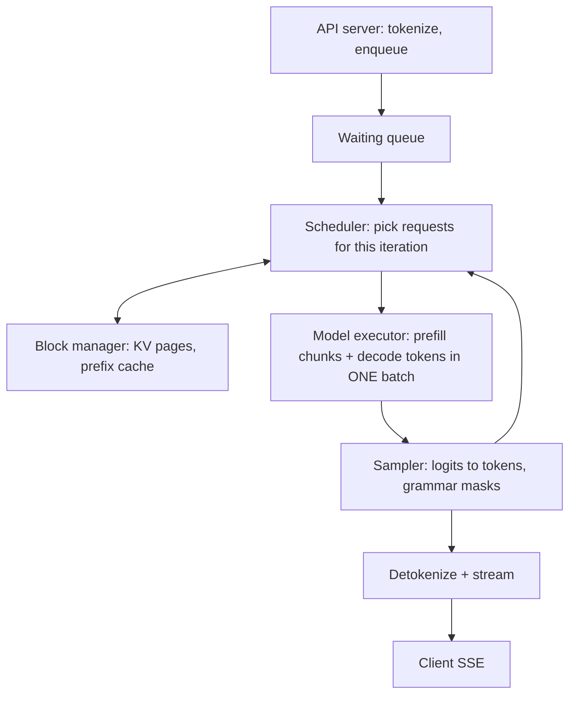

# Inference Engine Internals (vLLM-style)

> [!success] 🟢 Junior Explanation
> **In plain words:** An inference engine is a loop. Every step it (1) decides **which requests run now** (scheduler), (2) makes sure each has **KV memory pages** (block manager), (3) runs the model on the GPU for one token step, (4) **samples** tokens, (5) streams them out, and repeats.
>
> **Analogy:** An air-traffic controller deciding each second which planes may use the runway, while a parking manager hands out gates (memory pages).
>
> **Say it in one sentence:** "Each iteration the scheduler fills a token budget with running decodes plus chunks of waiting prefills, the block manager allocates KV pages (with prefix sharing and copy-on-write), and if memory runs out it preempts a request via swap or recompute."
>
> 🎯 **Junior must know:** continuous batching, paged KV. · **Middle adds:** scheduler policy, token budget, preemption, prefix hashing, CUDA graphs, async scheduling.

## 1. The loop


## 2. Scheduler (iteration-level) `[WEB]` `[GEN]`
Origin: Orca's **iteration-level scheduling** (re-decide batch every token step) `[WEB]`.
```python
# pseudo-code
def schedule():
    budget = MAX_TOKENS_PER_STEP            # e.g. 8k tokens: compute budget per iteration
    batch = []
    for r in running:                       # 1) decodes first (1 token each)
        if block_mgr.can_append_slot(r):
            budget -= 1; batch.append((r, 1))
        else:
            preempt(pick_victim())          # free KV: swap to CPU or recompute later
    while waiting and budget > 0 and block_mgr.can_allocate(waiting[0]):
        r = waiting.pop_first()             # 2) admit new requests
        chunk = min(r.remaining_prompt, budget)   # chunked prefill
        budget -= chunk; batch.append((r, chunk))
        running.add(r)
    return batch
```
Policies: FCFS (default), priority/SLO-aware, shortest-first. **Chunked prefill** = prefill respects the same token budget so decodes keep flowing → [[Prefill vs Decode]] (research name: Sarathi-Serve `[WEB]`).
**Max batch tokens** trades TTFT vs TPOT: bigger budget → more prefill throughput, but each step takes longer → inter-token latency ↑.

## 3. Block manager (PagedAttention) `[WEB]`
- KV memory is a pool of fixed-size **blocks** (e.g. 16 tokens). Each sequence has a **block table** (logical → physical block IDs). Waste < 4% (only the last block) `[WEB]`.
- **Copy-on-write:** parallel sampling/beam search share prefix blocks; copy a block only when a branch diverges `[GEN]`.
- **Prefix caching:** hash(block of tokens + previous block hash) → physical block; new requests with the same prefix **reuse blocks** and skip their prefill (hit = skip compute). Evict with **LRU** among blocks with refcount 0 `[GEN]` (SGLang's RadixAttention uses a radix tree instead `[WEB]`).
- **Block-aligned hits:** only complete matching blocks are reusable.

## 4. Preemption when KV is full `[GEN]`
| Strategy | Action | Cost |
|---|---|---|
| **Recompute** | Drop the victim's blocks, put it back in waiting; redo prefill (prompt + generated so far) later | Compute; cheap if prefix cache survives |
| **Swap** | Copy blocks to CPU memory, restore later | PCIe bandwidth; needs host RAM |
Victim choice: lowest priority / latest arrival. Admission control (watermarks) prevents thrash.

## 5. Executor details
- **Batched forward** mixes prefill chunks and decode tokens ("continuous/mixed batching"); attention kernels handle variable lengths via block tables.
- **CUDA graphs** for decode-only batches at captured sizes → [[Kernels, Fusion and CUDA Graphs]].
- **Sampler** applies penalties, temperature/top-p, **grammar masks** (structured output) → [[Decoding and Sampling]].
- **Speculative decoding** adds draft proposals + verify step in the same loop → [[Speculative Decoding]].
- **Async scheduling:** overlap CPU scheduling/detokenization with GPU execution of the previous step to hide CPU time `[GEN]`.
- **Tensor-parallel workers:** one process per GPU, driver broadcasts scheduler output; NCCL collectives in forward → [[Parallelism for Inference]].

## 6. Metrics to expose
queue depth, running/waiting counts, KV-cache usage %, prefix-cache hit rate, tokens/step, preemption count, TTFT/TPOT histograms, step time breakdown (scheduling / model / sampling) → [[Observability]].

## 7. Engine landscape (recap)
vLLM (default; PagedAttention, continuous batching), SGLang (RadixAttention, structured-output, PD disaggregation), TensorRT-LLM (compiled engines, NVIDIA-only); TGI in maintenance mode → [[Inference Server and Engines]].

> [!question] Recall
> 1. Walk through one scheduler iteration with chunked prefill and a token budget.
> 2. How does prefix caching hash blocks and when does a hit happen?
> 3. Swap vs recompute preemption — when each?
> 4. Why does a larger token budget raise TPOT?

**Sources:** [PagedAttention (arXiv 2309.06180)](https://arxiv.org/abs/2309.06180) · [vLLM blog](https://vllm.ai/blog/2023-06-20-vllm) · [Orca (OSDI '22)](https://www.usenix.org/conference/osdi22/presentation/yu) · [DistServe / Sarathi context](https://www.usenix.org/conference/osdi24/presentation/zhong-yinmin) · [SGLang RadixAttention](https://lmsys.org/blog/2024-01-17-sglang) · [vLLM model execution](https://www.mintlify.com/vllm-project/vllm/concepts/model-execution)

Related: [[Continuous Batching]] · [[KV Cache]] · [[Inference Server and Engines]]
