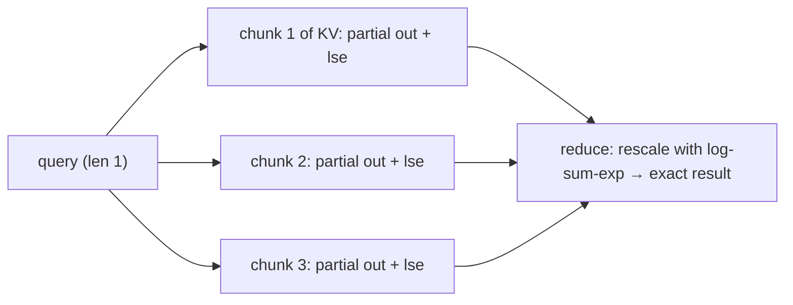

# Kernels, Fusion and CUDA Graphs

> [!success] 🟢 Junior Explanation
> **In plain words:** A GPU program is many small **kernels**. Each kernel reads inputs from slow HBM and writes results back — and the CPU needs time to *launch* each one. **Fusion** merges several steps into one kernel (fewer memory trips). **CUDA graphs** record a sequence of kernels and replay it with one launch (less CPU overhead). **Better kernels** (FlashAttention, tiled GEMM) keep data in fast on-chip memory.
>
> **Analogy:** Instead of walking to the pantry for each ingredient and calling the sous-chef for each step, grab everything once and follow a pre-written recipe card.
>
> **Say it in one sentence:** "I cut HBM round-trips with fusion and tiling, and cut CPU launch overhead with CUDA graphs and torch.compile — they fix different costs."
>
> 🎯 **Junior must know:** kernel, launch overhead, why fusion helps. · **Middle adds:** GEMM tiling, Flash-Decoding, graph capture constraints, when custom kernels pay off.

## 1. Two different costs `[WEB]`
| Cost | Fix |
|---|---|
| **Memory traffic** (intermediate tensors written/read from HBM) | **Kernel fusion**, tiling, FlashAttention |
| **Launch overhead** (CPU submits hundreds of tiny kernels per decode step) | **CUDA graphs**, persistent/megakernels |
Decode runs **hundreds of small kernels per step**, so launch overhead is a large share at small batch sizes `[WEB]`.

## 2. Fusion example
`y = silu(gate(x)) * up(x)` unfused: write `gate_out`, read it for silu, write, read for multiply… 4 HBM round-trips of an $n\times d_{ff}$ tensor. **Fused** epilogue: compute in registers, write once. Same for RMSNorm + residual add, RoPE + KV-cache write, dequantize + GEMM. `torch.compile` (Inductor) fuses pointwise/reduction ops automatically `[WEB]`.

## 3. CUDA graphs `[WEB]`
- **Capture** a fixed sequence of GPU ops (fixed shapes, **static memory addresses**), **replay** with a single launch.
- NVIDIA example cited: a 2.9 µs kernel costing 9.6 µs per step without graphs vs 3.4 µs with a graph (V100 example, via secondary source).
- **vLLM** captures graphs for a **fixed set of batch sizes** at startup and replays the matching one each step; pads batches up to the next captured size. **Piecewise** capture skips unsupported ops (e.g. cascade attention) `[WEB]`.
- Constraints: dynamic shapes/control flow (e.g. variable context length) must stay **outside** the graph or be handled by padding/paged metadata; extra GPU memory per captured graph; capture time at startup.
- Fusion vs graphs: **fusion reduces kernels and HBM trips; graphs reduce launch cost for the kernels that remain** `[WEB]`.

## 4. GEMM tiling intuition `[GEN]`
Matmul $C=AB$: each thread block computes a tile of $C$, looping over $K$: load tiles of $A$ and $B$ into **shared memory**, multiply with tensor cores, accumulate in registers. Each loaded element is reused many times → raises arithmetic intensity. Alignment matters: dims multiple of 8/16/64, correct layout, right dtype.
At **decode** the GEMM is "skinny" ($B$ small) → limited by weight loading; kernels specialize (split-K, GEMV-like paths) to saturate bandwidth.

## 5. Attention kernels
| Kernel | Idea |
|---|---|
| **FlashAttention** | Tile Q/K/V in SRAM, online softmax, never store n×n → [[Flash Attention]] (FA-3 on H100: up to ~740–840 TFLOPS, 75–85% util via asynchrony + FP8 `[WEB]`) |
| **Paged attention kernels** | Read KV through a **block table** (non-contiguous pages) → [[KV Cache]] |
| **Flash-Decoding** | Decode has query length 1 → if batch < #SMs the GPU is underused. **Split the KV sequence into chunks**, compute partial attention per chunk in parallel, then **reduce with log-sum-exp rescaling**. Up to **8×** faster for very long sequences `[WEB]` |
| LeanAttention | Stream-K-style split of the softmax reduction; reported avg 2.6× over FA-2, up to 8.3× at 512k ctx `[WEB]` |

## 6. Tooling ladder
| Level | Tool | Use |
|---|---|---|
| 0 | Library kernels (cuBLAS, FlashAttention, FlashInfer) | Default |
| 1 | `torch.compile` / Inductor | Auto-fusion, graph capture |
| 2 | **Triton** (Python-like, block-level) | Custom fused ops quickly |
| 3 | **CUDA C++ / CUTLASS** | Max control (warp specialization, async copies) |
| 4 | Megakernels | Fuse entire decode step — frontier |

## 7. When to write a custom kernel
Profile first ([[Benchmarking and Profiling Methodology]]): worth it if a memory-bound op is **fusable** and sits on the critical path (dequant+GEMM, RoPE+KV write, sampling), or an op has poor GPU occupancy (Flash-Decoding). Otherwise use library kernels.

> [!question] Recall
> 1. Fusion vs CUDA graphs — what does each save?
> 2. Why must CUDA-graph inputs use static addresses, and how does vLLM cope with variable batch sizes?
> 3. Explain Flash-Decoding's log-sum-exp reduction.
> 4. Why does decode-time attention underuse the GPU at small batch?

**Sources:** [CUDA graphs & LLM inference](https://www.morphllm.com/cuda-graphs) · [vLLM: torch.compile](https://vllm.ai/blog/2025-08-20-torch-compile) · [SGLang CUDA graph docs](https://mintlify.com/sgl-project/sglang/optimization/cuda-graph) · [Flash-Decoding (Stanford CRFM)](https://crfm.stanford.edu/2023/10/12/flashdecoding.html) · [Flash-Decoding (PyTorch)](https://pytorch.org/blog/flash-decoding/) · [FlashAttention-3](https://tridao.me/blog/2024/flash3/) · [Megakernels](https://theorempath.com/topics/megakernels)

Related: [[Flash Attention]] · [[GPU Architecture for Inference Engineers]] · [[Inference Engine Internals]]
