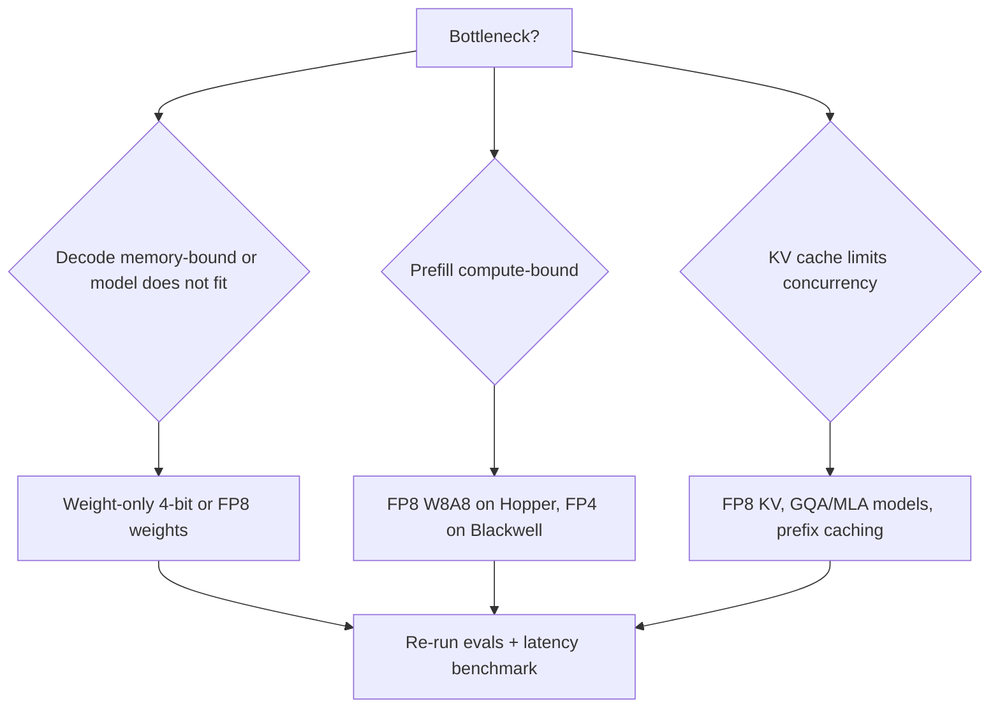

# Low-Precision Inference (FP8, INT8, FP4)

> [!success] 🟢 Junior Explanation
> **In plain words:** Store/compute numbers with fewer bits. Fewer bytes = smaller model, less memory traffic (faster decode), and on newer GPUs, faster math. The catch: fewer bits = coarser numbers, so we add **scales** to keep accuracy.
>
> **Analogy:** Rounding prices to the nearest dollar instead of the cent: smaller to write down; fine for most things, bad if you round too hard.
>
> **Say it in one sentence:** "Weight-only 4-bit speeds up memory-bound decode, FP8 (W8A8) speeds up compute-bound prefill on Hopper, FP4 with block scales does both on Blackwell — all using per-group scales and calibration to protect accuracy."
>
> 🎯 **Junior must know:** bits ↔ memory, small quality drop. · **Middle adds:** formats, scale/zero-point, weight-only vs W8A8, KV quant, hardware support.

## 1. Number formats `[WEB]` `[GEN]`
| Format | Layout (sign/exp/mantissa) | Notes |
|---|---|---|
| FP32 | 1/8/23 | Master weights, optimizer |
| **BF16** | 1/8/7 | Same range as FP32; default LLM dtype |
| FP16 | 1/5/10 | Needs loss scaling in training |
| **FP8 E4M3** | 1/4/3 | **max 448**; more precision; weights/activations (forward) |
| **FP8 E5M2** | 1/5/2 | **max 57,344**; more range, less precision; gradients |
| INT8 / INT4 | integer | Needs scale (and maybe zero-point) |
| **FP4 E2M1** | 1/2/1 | Only **15 distinct values** → mandatory shared scales |
H100 introduced FP8 tensor cores; Transformer Engine default recipe uses **E4M3 forward, E5M2 backward** `[WEB]`.

## 2. Scale and zero-point (the core idea)
Affine quantization: $q=\text{clip}\big(\text{round}(x/s)+z\big)$, dequant $\hat x=s\,(q-z)$. Symmetric: $z=0$, $s=\max|x|/q_{max}$.
- **Granularity:** per-tensor (coarse) → per-channel → **per-group/block** (e.g. 32/64/128 values share a scale) — finer = more accurate, more scale metadata.
- **Outliers** in activations/weights blow up $s$ and crush other values → SmoothQuant (migrate difficulty to weights), AWQ (protect ~1% salient channels), GPTQ (error compensation) `[WEB]` → [[Quantization]].

## 3. Block-scaled FP4 on Blackwell `[WEB]`
| | **MXFP4** (OCP standard) | **NVFP4** (NVIDIA) |
|---|---|---|
| Element | E2M1 | E2M1 |
| Block size | **32** | **16** |
| Scale | one **E8M0** (power-of-two) per block | **FP8 E4M3** per block + **FP32 per-tensor** (two-level) |
| Accuracy | Lower | Better (finer blocks, fractional scales) |
Blackwell FP4 tensor-core math is **2× (GB200) / 3× (GB300)** FP8 throughput `[WEB]`. Guidance (opinion): FP8 on Hopper; NVFP4 on Blackwell for throughput/memory; keep FP8/BF16 for quality-sensitive reasoning models.

## 4. What gets quantized — and what that speeds up
| Scheme | Weights | Activations | KV | Speeds up | Typical use |
|---|---|---|---|---|---|
| **W4A16** (GPTQ/AWQ) | 4-bit | BF16 | BF16 | **Decode** (fewer weight bytes; dequant on the fly) | Memory-bound decode, fit big models |
| **W8A8 / FP8** | 8-bit | 8-bit | any | **Prefill + decode** (FP8 tensor cores 2× BF16 FLOPs) | Hopper production default |
| **FP4 (NVFP4)** | 4-bit | 4-bit/8-bit | any | Both | Blackwell |
| **KV-cache quant** | — | — | FP8/INT4–8 | **Concurrency & long-context** (2–4× KV saving `[OS]`) | Long context |
Rule: pick by bottleneck → [[Roofline and Performance Modeling]]. Weight-only 4-bit doesn't help compute-bound prefill much (dequant overhead); W8A8 needs hardware kernels.

### Memory math
$N\cdot b$: 70B → BF16 140 GB · FP8 70 GB · 4-bit ≈ 35 GB (+ scales: group-128 FP16 scale adds ≈ 0.125 bit/weight) `[GEN]`.
Decode ceiling ∝ 1/bytes: 70B on 3.35 TB/s: BF16 ≈ 24 tok/s → FP8 ≈ 48 → 4-bit ≈ 96 `[WEB]` (derived).

## 5. Accuracy safeguards
- **Calibration data** representative of production (PTQ) — bad calibration = silent regression.
- Keep sensitive layers in higher precision (embeddings, LM head, first/last layers, attention output) `[GEN]`.
- **Evals before/after** on your tasks (reasoning/long-context/code degrade first), not just perplexity → [[Evaluation - LLM and Agent]].
- QAT (quantization-aware training) for 2–4 bit when PTQ isn't enough (e.g. Apple's 2-bit on-device model `[WEB]`) → [[Case - On-Device AI Assistant]].

## 6. Decision flow

> [!question] Recall
> 1. Write the affine quantize/dequantize equations.
> 2. E4M3 vs E5M2 — which for forward and which for gradients, and why?
> 3. MXFP4 vs NVFP4 differences.
> 4. Why does weight-only 4-bit help decode more than prefill?

**Sources:** [NVIDIA Transformer Engine FP8/FP4 primer](https://docs.nvidia.com/deeplearning/transformer-engine/examples/fp8_primer.html) · [NVFP4 introduction](https://www.edge-ai-vision.com/2025/07/introducing-nvfp4-for-efficient-and-accurate-low-precision-inference/) · [NVFP4 pretraining paper](https://arxiv.org/pdf/2509.25149) · [NVIDIA research: pushing to 4-bit](https://research.nvidia.com/labs/eai/blogs/pushing-intelligence-to-4-bit/) · [FP8 formats](https://www.morphllm.com/fp8-quantization) · [GPTQ/AWQ/SmoothQuant overview](https://www.generalcompute.com/blog/quantization-for-inference-gptq-awq-smoothquant-fp8)

Related: [[Quantization]] · [[KV Cache]] · [[GPU Architecture for Inference Engineers]]
