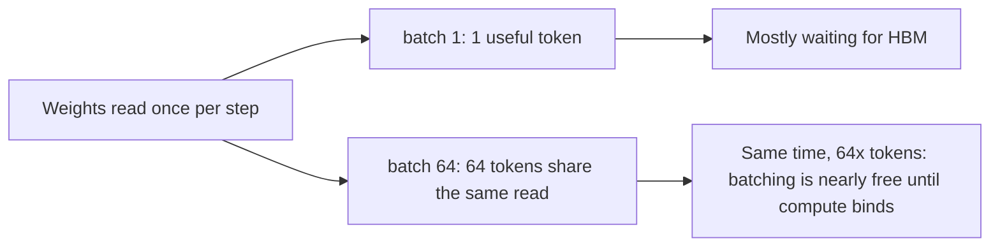

# Roofline and Performance Modeling

> [!success] 🟢 Junior Explanation
> **In plain words:** Any program is limited by either **math speed** or **memory speed**. The **roofline model** says: performance = min(peak math, memory bandwidth × work-per-byte). For LLM decode, work-per-byte is tiny, so **memory** is the limit — which is why batching, quantization and smaller KV caches speed things up.
>
> **Analogy:** A chef (math) who is fast, but the pantry delivery (memory) is slow. If each delivery yields a lot of chopping, the chef is the bottleneck; if not, the delivery is.
>
> **Say it in one sentence:** "I estimate decode step time as bytes-moved over bandwidth, prefill time as FLOPs over peak, and compare arithmetic intensity to the ridge point to know which one binds."
>
> 🎯 **Junior must know:** decode = memory-bound, prefill = compute-bound. · **Middle adds:** compute exact numbers, show why batching helps weights but not KV, MBU/MFU.

## 1. The model `[WEB]`
$$\text{Intensity}=\frac{\text{FLOPs}}{\text{bytes moved}},\quad \text{Ridge}=\frac{\text{peak FLOPs}}{\text{peak BW}},\quad \text{Perf}=\min(\text{peak},\ \text{BW}\times\text{Intensity})$$
H100 BF16 dense ridge ≈ **295 FLOP/byte** (989 TFLOPS ÷ 3.35 TB/s). Below ridge → **memory-bound**.
> Correction note: an often-quoted ~591 uses the *sparse* FP16 figure (1,979); with dense it's ≈295 `[WEB]`.

## 2. Decode intensity
Weights: each step reads $N\cdot b$ bytes and does $2NB$ FLOPs for batch $B$ → intensity $=2B/b\approx B$ (BF16). → to reach ridge you'd need **batch ≈ 295** just for weights. At batch 1: **≈1 FLOP/byte** → ~300× below ridge `[WEB]`.

### But attention/KV doesn't batch
Each sequence has its **own KV cache** → no reuse across sequences. Attention decode intensity ≈ $\frac{4 n d}{2\cdot n\,d_{kv}\,b}$ ≈ O(1)·(group size) FLOP/byte — **independent of batch**. Therefore KV reads grow **linearly with batch × context** and eventually dominate (`[WEB]`: KV becomes the bottleneck well before decode turns compute-bound) → **GQA/MLA/KV quantization** are the levers, batching is not `[GEN]`.

## 3. The decode time model
$$t_{step}\approx\frac{N\,b_w+B\cdot n_{ctx}\cdot \text{KV}_{tok}}{\text{BW}_{eff}}\quad(\text{+ comm + launch overhead})$$
tokens/s (aggregate) ≈ $B/t_{step}$.

### Worked example — Llama 3 8B, BF16, one H100 (3.35 TB/s) `[GEN]`
- Weights: 8.03e9 × 2 = **16.06 GB** → read time = 16.06/3350 = **4.8 ms**.
- KV: **128 KB/token** → 2,048-token sequence = **256 MiB**.
| Batch B | KV read/step | $t_{step}$ | tokens/s (ideal) | Memory used | Compute time ($2NB$/989T) |
|---|---|---|---|---|---|
| 1 | 0.27 GB → 0.08 ms | ~4.9 ms | ~204 | 16.3 GB | 0.016 ms |
| 64 | 17.2 GB → 5.1 ms | ~9.9 ms | **~6,500** | 33 GB | 1.0 ms |
| 209 (max by memory: (72−16)/0.268) | 56 GB → 16.7 ms | ~21.5 ms | **~9,700** | ~72 GB | 3.4 ms |
Insights: (1) throughput **saturates** because KV traffic grows with B; (2) still **memory-bound** at B=209 (3.4 ms math ≪ 21 ms); (3) real systems reach maybe **50–70%** of ideal (overheads) → use as ceilings.
- Cut KV 4× (FP8 KV or GQA 8→2) → B=209 step drops to ~9 ms → ~2× aggregate throughput.

### Single-stream ceiling `[WEB]`
70B BF16 = 140 GB on one 3.35 TB/s GPU (if it fit) → **≈24 tok/s**; TP=2 H100s (6.7 TB/s combined) → ≈ 48 tok/s ideal before comms; 4-bit weights → ~4× that.

## 4. Prefill model
$t_{prefill}\approx\dfrac{2N\,T}{\text{peak}\times \text{MFU}}$. 8B, T=2,048: 33 TFLOP → **33 ms @100%**, **~65 ms @50% MFU** → TTFT floor ≈ 35–70 ms on an H100 (+ queueing + network). Long prompts scale linearly in $T$ (plus attention's $n^2$ term).

## 5. MFU and MBU
| Metric | Definition | Use |
|---|---|---|
| **MFU** | achieved FLOPs/s ÷ peak | Prefill / training efficiency |
| **MBU** | (bytes read per step ÷ step time) ÷ peak BW | **Decode efficiency** — good engines reach ~60–80% `[GEN]` |
Always say which is relevant: decode → MBU.

## 6. Which lever fixes which bottleneck
| Bound | Symptoms | Levers |
|---|---|---|
| Memory (weights) | Low MBU, small batch | Batch more, quantize weights, speculative decoding ([[Speculative Decoding]]) |
| Memory (KV) | Throughput plateaus with batch/context | GQA/MLA, KV quant, shorter context, prefix reuse → [[Long Context and KV Cache Engineering]] |
| Compute | High MFU in prefill | FP8, better kernels, chunk prefill, more GPUs/TP |
| Communication | TP all-reduce time visible | Fewer/faster GPUs, NVLink, custom all-reduce → [[Parallelism for Inference]] |
| Overhead | GPU idle gaps | CUDA graphs, fusion, async scheduling → [[Kernels, Fusion and CUDA Graphs]] |

> [!question] Recall
> 1. Compute the single-stream tokens/s ceiling for a 13B BF16 model on H100.
> 2. Why doesn't batching fix KV traffic?
> 3. At which batch does an 8B model on H100 leave the memory-bound regime for weights? (~295)
> 4. What is MBU and why prefer it for decode?

**Sources:** [Arithmetic intensity](https://www.zeroentropy.dev/concepts/arithmetic-intensity/) · [Roofline for LLM inference](https://www.spheron.network/blog/the-roofline-model-for-llm-inference-are-you-compute-bound-o/) · [Why decode is memory-bound](https://dev.to/ji_ai/why-llm-decoding-is-memory-bound-prefill-vs-decode-roofline-223f) · [Bytes-per-token](https://www.zartis.com/you-dont-have-a-compute-problem-you-have-a-bytes-per-token-problem/)

Related: [[Prefill vs Decode]] · [[LLM Math Cheat Sheet]] · [[GPU Architecture for Inference Engineers]]
