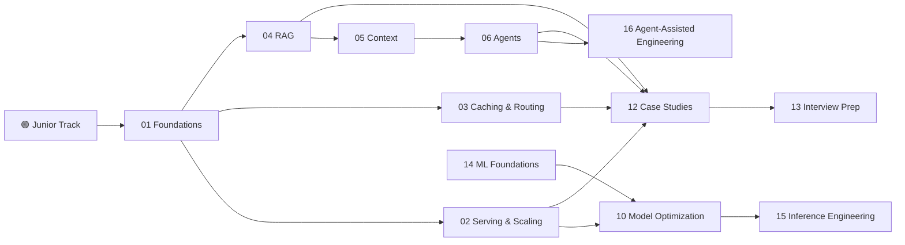

<div align="center">

# 🧠 learn-ai

### The AI Engineer's field manual: from tokens to GPU kernels to production agents.

**160+ interlinked notes** covering AI system design, LLM internals, inference engineering and agent-assisted development.
Built for interviews and written for real systems.


[**Start here →**](AI%20System%20Design/00%20Start%20Here/AI%20System%20Design%20-%20Home.md) · [Learning Path](AI%20System%20Design/00%20Start%20Here/Learning%20Path.md) · [Cheat Sheets](#-cheat-sheets) · [Case Studies](AI%20System%20Design/12%20Case%20Studies)

</div>

---

## ⚡ Why this exists

Most AI material stops at "call the API". Real AI engineering interviews and production systems go further and ask:

- Why is **decode memory-bound** and **prefill compute-bound**?
- How do you serve a **70B model on 4×A100**, and should that be TP=2 or TP=4?
- How do you design **RAG** that stays accurate at 10M documents?
- How do you make an **agent** reliable, observable and cheap?

This repo answers those questions in one connected graph. Every note links to its prerequisites and follow-ups, and most notes open with a 🟢 plain-language summary.

---

## 🗺️ The map



---

## 📚 Sections

| # | Section | What you'll master |
|---|---|---|
| 🟢 | [**Junior Track**](AI%20System%20Design/00%20Junior%20Track) | 10-day plan, the story of one request, 3 mock interviews |
| 00 | [**Start Here**](AI%20System%20Design/00%20Start%20Here) | Home, learning path, gap analysis, research library |
| 01 | [**Foundations**](AI%20System%20Design/01%20Foundations) | Tokens, prefill vs decode, GPU/TPU/LPU, latency & cost metrics |
| 02 | [**Serving & Scaling**](AI%20System%20Design/02%20Serving%20and%20Scaling) | AI gateways, LLM load balancing, rate limiting, streaming, autoscaling |
| 03 | [**Caching & Routing**](AI%20System%20Design/03%20Caching%20and%20Routing) | KV, prompt and semantic caches, LLM routing |
| 04 | [**Retrieval & RAG**](AI%20System%20Design/04%20Retrieval%20and%20RAG) | Chunking, embeddings, vector indexes, hybrid search, GraphRAG |
| 05 | [**Context**](AI%20System%20Design/05%20Context) | Context engineering, context rot, lost-in-the-middle |
| 06 | [**Agents**](AI%20System%20Design/06%20Agents) | Agent loop, tools, memory, MCP & A2A, multi-agent, computer use |
| 07 | [**Multimodal & Voice**](AI%20System%20Design/07%20Multimodal%20and%20Voice) | Voice agents, multimodal pipelines, on-device AI |
| 08 | [**Safety & Compliance**](AI%20System%20Design/08%20Safety%20and%20Compliance) | Prompt injection, guardrails, red teaming, privacy |
| 09 | [**Quality & Ops**](AI%20System%20Design/09%20Quality%20and%20Operations) | Evals, observability, deployment strategies, cost, multi-tenancy |
| 10 | [**Model Optimization**](AI%20System%20Design/10%20Model%20Optimization) | FlashAttention, GQA, MoE, quantization, speculative decoding, LoRA |
| 11 | [**Classic ML Design**](AI%20System%20Design/11%20Classic%20ML%20System%20Design) | Feature stores, online vs offline, serving layers |
| 12 | [**Case Studies**](AI%20System%20Design/12%20Case%20Studies) | ChatGPT, Claude Code, Cursor, Perplexity, voice agents, fraud detection… |
| 13 | [**Interview Prep**](AI%20System%20Design/13%20Interview%20Prep) | 8-step framework, question bank, flashcards, key numbers |
| 14 | [**ML Foundations**](AI%20System%20Design/14%20ML%20Foundations) | Transformers, RoPE, scaling laws, ZeRO, SFT/RLHF/DPO, sampling |
| 15 | [**Inference Engineering**](AI%20System%20Design/15%20Inference%20Engineering) | Roofline, kernels & CUDA graphs, TP/PP/EP, FP8/FP4, $/M tokens |
| 16 | [**Agent-Assisted Engineering**](AI%20System%20Design/16%20Agent-Assisted%20Engineering) | Working with coding agents: context, specs, verification, delegation |

---

## 🎯 Pick your path

| You are… | Go |
|---|---|
| 🌱 **New to AI systems** | Junior Track → 01 → 04 → 06 → Mock Interviews |
| 🏗️ **Backend engineer moving to AI** | 01 → 02 → 03 → 04 → 09 → 12 |
| 🤖 **Agent / GenAI engineer** | 04 → 05 → 06 → 08 → 09 → 16 |
| 🔥 **Inference / ML infra engineer** | 14 → 10 → 15 → 13 drills |
| ⏱️ **Interview next week** | 13 Interview Prep → 12 Case Studies → Cheat Sheets |

---

## 🧾 Cheat sheets

- 📏 [Key Numbers Cheat Sheet](AI%20System%20Design/13%20Interview%20Prep/Key%20Numbers%20Cheat%20Sheet.md): latency, memory and cost numbers to memorize
- ⚖️ [Trade-offs Cheat Sheet](AI%20System%20Design/13%20Interview%20Prep/Trade-offs%20Cheat%20Sheet.md)
- 🧮 [LLM Math Cheat Sheet](AI%20System%20Design/14%20ML%20Foundations/LLM%20Math%20Cheat%20Sheet.md): params, FLOPs, KV-cache size
- 🧩 [7 Infra Patterns for AI Engineers](AI%20System%20Design/13%20Interview%20Prep/7%20Infra%20Patterns%20for%20AI%20Engineers.md)
- 🗣️ [Interview Framework: 8 Steps](AI%20System%20Design/13%20Interview%20Prep/Interview%20Framework%20-%208%20Steps.md)
- 🃏 [Flashcards](AI%20System%20Design/13%20Interview%20Prep/Flashcards.md) · 📖 [Glossary](AI%20System%20Design/13%20Interview%20Prep/Glossary.md)

---

## 🛠️ How to read it

**Best:** open the repo as an [Obsidian](https://obsidian.md) vault. You get `[[wikilinks]]`, graph view, callouts and Mermaid diagrams out of the box.

```bash
git clone https://github.com/gduchidze/learn-ai.git
# Obsidian → "Open folder as vault" → select learn-ai
```

**Also fine:** read it on GitHub. Markdown, tables and Mermaid render natively. `[[wikilinks]]` show as plain text, so use the section folders above to navigate.

### Note conventions
- 🟢 **Junior Explanation**: plain-words summary at the top of each note
- 🌐 **Deeper Context**: verified numbers, paper origins, links
- Source tags: `[OS]` Outcome School · `[SDH]` System Design Handbook · `[JAM]` Jam with AI · `[WEB]` web research. See [Sources](AI%20System%20Design/00%20Start%20Here/Sources.md)

---

## 🤝 Contributing

Found a wrong number, a stale benchmark or a missing topic? PRs and issues are welcome.
Keep each note focused on one concept, link generously, and cite your source.

<div align="center">

⭐ **If this saved you an interview or an outage, star the repo.** ⭐

</div>
